# Codebase Audit: Complexity, Code Smells & Maintainability

**Target Repository:** `folioman-client`  
**Auditor:** Staff+ Software Engineer  
**Date of Audit:** October 17, 2026  
**Repository Branch / Commit State:** `v0.2` (Clean working tree)  
**Report Location:** `docs/CODEBASE_AUDIT.md`  

---

## 1. Executive Summary

`folioman-client` is a Python 3.11+ library and command-line interface (CLI) for Indian personal finance, mutual fund portfolio tracking, equity demat accounting, capital gains reporting (Schedule 112A), and automated Net Asset Value (NAV) synchronization. The project was originally conceived as an asynchronous HTTP SDK for a remote Folioman REST API and subsequently evolved into an embedded, local-first portfolio accounting engine backed by SQLite (via `aiosqlite`) or PostgreSQL (via `psycopg3`).

This audit evaluated the complete codebase spanning 86 Python source files (17,339 lines of code in `src/`) and 31 test suites (224 automated test cases). The evaluation focused on architectural integrity, cognitive and cyclomatic complexity, code smells, concurrency safety, test efficacy, performance bottlenecks, and configuration security.

### Key Audit Metrics

| Metric | Measured Value | Benchmark / Health Indicator |
| :--- | :--- | :--- |
| **Total Source Files** | 86 Python modules | Modular package structure |
| **Total Source Lines of Code (LOC)** | 17,339 lines | Mid-sized domain library |
| **Total Test Suite** | 224 automated tests (100% passing in 34.1s) | Fast test execution |
| **Statement Coverage** | 78% (7,161 statements, 1,589 missed) | Low coverage in corporate actions & feeds |
| **High Complexity Functions** | 62 functions (LOC > 60, branches > 10, or args > 6) | 3 functions with ≥ 38 branches |
| **Dead / Orphaned Modules** | 3 files (0% coverage, 0 imports) | `dividend_attribution.py`, `identity_remap.py`, `opening_lot.py` |
| **Broad / Swallowed Exceptions** | 26 broad exception handlers, 9 fully swallowed | Swallowed errors in auth, DB pragmas, keys |
| **Database Query Patterns** | Multiple N+1 `SELECT` loops + repetitive DDL | O(N) queries during CAS import & reconciliation |
| **Concurrency Impedance** | 3-tier async/sync crossing | Sync `time.sleep` in async threads & cross-loop engine sharing |

### High-Level Verdict

`folioman-client` exhibits impressive financial precision and domain depth: it strictly enforces `Decimal` arithmetic over IEEE 754 floating-point numbers, incorporates cryptographic protection for sensitive PAN data, implements robust CAS transaction reversal netting, and supports Indian capital gains tax schedules with Section 112A grandfathering.

However, the rapid transition from a thin HTTP client into a full-featured local accounting engine has left severe architectural scars:
1. **The Bimodal God Client:** `FoliomanClient` attempts to be both a remote REST client and an embedded database orchestrator simultaneously, branching conditionally across every resource method and instantiating 10 database services and connection pools even in remote mode. Conversely, in remote mode, several endpoints drop query filters or silently write to the local database.
2. **Model Triplication:** Three independent hierarchies of domain models (`folioman_client.models`, `folioman_client.core.models`, and `folioman_client.db.models`) duplicate entities with lossy translation mappers.
3. **N+1 Database Query Storms and Repetitive DDL:** Statement ingestion issues individual `SELECT` queries for every transaction line. Furthermore, 18 distinct CRUD methods across the service layer invoke `init_schema()`, triggering `Base.metadata.create_all` and write transaction locks on read-only queries.
4. **Concurrency and Event Loop Hazards:** In-process schedulers create fresh event loops on worker threads while passing a shared `AsyncEngine` bound to the main thread's loop, risking runtime deadlocks and connection corruption.
5. **Contract Disparities:** Embedded services throw standard library `ValueError` where the public API contract promises `FoliomanNotFoundError`, causing unhandled exceptions in consumer applications.
6. **Stale Valuation Desynchronization:** While `ValuationService.queue_recompute` exists to mark cached valuation series as pending recomputation, it is never called by statement imports or ledger transactions, leaving stored net worth history out-of-sync.

---

## 2. Repository Overview

### 2.1 Technology Stack & Runtime Environment

- **Primary Language:** Python `>= 3.11` (Tested on 3.11, 3.12, 3.13, 3.14).
- **Core Frameworks:**
  - **Data Persistence:** SQLAlchemy 2.0 (Asyncio dialect), `aiosqlite` (embedded default), `psycopg` v3 (PostgreSQL optional).
  - **Schema Validation & Settings:** Pydantic v2 (`pydantic>=2.7.0`), `pydantic-settings`.
  - **CLI Framework:** Click 8.x.
  - **HTTP Transports:** `httpx` (asynchronous client in facade, synchronous clients in market feeds).
  - **Statement Parsing:** `casparser>=1.3.0`, `casparser-isin>=2026.6.9`, `pypdfium2`.
  - **Cryptography:** `cryptography` (Fernet symmetric encryption, HMAC-SHA256).
  - **Background Scheduling:** APScheduler 3.x (`BackgroundScheduler`, `BlockingScheduler`).
  - **Testing & Quality:** `pytest`, `pytest-asyncio`, `pytest-cov`, `respx`, `black`.

### 2.2 Directory Structure & Module Responsibilities

```
folioman-client/
├── docs/                               # MkDocs documentation source
├── examples/                           # Client usage scripts and integration examples
├── src/folioman_client/                # Root package
│   ├── __init__.py                     # Public package exports and client facade
│   ├── auth.py                         # JWT token storage, refresh, and HTTP Bearer injection
│   ├── client.py                       # FoliomanClient facade & API Resource wrappers
│   ├── config.py                       # FoliomanSettings backed by environment variables
│   ├── errors.py                       # Custom exception hierarchy
│   ├── models.py                       # Pydantic schemas mirroring Folioman REST API
│   ├── types.py                        # Custom Pydantic annotated field coercions
│   ├── cli/                            # Click CLI subcommands (import, nav, ledger, etc.)
│   ├── core/                           # Pure domain logic, models, and calculation engines
│   │   ├── cas_reader.py               # Dispatcher for CAMS/KFin MF vs NSDL/CDSL eCAS
│   │   ├── corporate_actions.py        # Bonus, split, merger unit replays
│   │   ├── corporate_action_detect.py  # Heuristic corporate action gap detector
│   │   ├── corporate_action_subject.py # Exchange announcement regex text parser
│   │   ├── dividend_attribution.py     # (Orphaned) Equity dividend attribution logic
│   │   ├── ecas_parser.py              # Demat eCAS statement parser and normalizer
│   │   ├── fifo.py                     # FIFO lot accounting, cost basis, and disposal ledger
│   │   ├── identity_remap.py           # (Orphaned) Transaction security remapper
│   │   ├── opening_lot.py              # (Orphaned) Non-trade opening lot enum & mapping
│   │   ├── parser.py                   # CAMS/KFin MF statement parser and reversal netter
│   │   ├── reconciliation.py           # Pure unit reconciliation decision matrix
│   │   ├── trading_calendar.py         # Business day calculations and NAV freshness dates
│   │   ├── valuation.py                # Mark-to-market valuation engine
│   │   ├── xirr.py                     # Newton-Raphson & bisection XIRR cashflow solver
│   │   ├── models/                     # "Framework-free" Pydantic core domain models
│   │   ├── price_feeds/                # Market feeds (MFAPI, AMFI, NSE, BSE, Yahoo Finance)
│   │   └── tax/                        # Indian Income Tax Schedule 112A & LTCG/STCG rules
│   ├── db/                             # Database engine, declarative ORM models, migrations
│   │   ├── engine.py                   # AsyncEngine and async_sessionmaker factory
│   │   ├── migrations.py               # Idempotent table creation and version tracker
│   │   └── models.py                   # 18 SQLAlchemy declarative tables
│   ├── security/                       # Cryptographic key resolution and PAN protection
│   │   ├── keys.py                     # Fernet key generation, resolution, and caching
│   │   └── pan.py                      # PAN normalization, masking, hashing, and encryption
│   └── services/                       # Orchestration services linking DB, core, & feeds
│       ├── capital_gains_service.py    # Realized gains and Schedule 112A report builder
│       ├── corporate_action_service.py # Exchange corporate action fetch and cache service
│       ├── equity_symbol_service.py    # NSE/BSE symbol resolution from ISIN masters
│       ├── import_service.py           # CAS PDF ingestion, dedup, and quarantine service
│       ├── isin_service.py             # Scheme and ISIN master reference seed/update service
│       ├── ledger_service.py           # Portfolio, folio, and transaction CRUD service
│       ├── mappers.py                  # Translators between SQLAlchemy ORM and core models
│       ├── nav_service.py              # Daily closing NAV refresh and historical backfill
│       ├── projected_ledger.py         # Dynamic virtual ledger with corporate action projection
│       ├── reconciliation_service.py   # Position integrity and holding reconciliation service
│       ├── scheduler.py                # APScheduler worker lifecycle manager
│       └── valuation_service.py        # Comprehensive portfolio valuation and performance engine
└── tests/                              # Automated test suites
```

### 2.3 Excluded Artifacts & Build Outputs

The following files and directories are excluded from architectural scope:
- `.venv/`, `.cache/`, `.pytest_cache/`, `dist/`, `site/` (build and virtual environment artifacts).
- `temp_demo.db-shm`, `.coverage` (local execution databases and runtime logs).
- `uv.lock` (package dependency lockfile).

---

## 3. Architecture and Dependency Map

### 3.1 Architectural Layering & Data Flow

The codebase is conceptually divided into four horizontal layers:

```mermaid
flowchart TD
    subgraph UI_CLI["Entry Points & Presentation"]
        CLI["Click CLI<br/>(src/folioman_client/cli/*)"]
        ExternalSDK["External Python SDK Caller"]
    end

    subgraph FacadeLayer["Client Facade"]
        Client["FoliomanClient<br/>(src/folioman_client/client.py)"]
        Auth["JWTAuthManager<br/>(src/folioman_client/auth.py)"]
    end

    subgraph ServiceLayer["Service Orchestration Layer (src/folioman_client/services/*)"]
        ImportSvc["CASImportService"]
        ValuationSvc["ValuationService"]
        ReconcileSvc["ReconciliationService"]
        NavSvc["NAVService"]
        LedgerSvc["LedgerService"]
        CapGainsSvc["CapitalGainsService"]
        CASvc["CorporateActionService"]
        SchedSvc["FoliomanScheduler"]
    end

    subgraph CoreLayer["Pure Domain Logic & Feeds (src/folioman_client/core/*)"]
        FIFO["FIFO Accounting (fifo.py)"]
        XIRR["XIRR Solver (xirr.py)"]
        Tax["Tax Engine (tax/schedule_112a.py)"]
        Parsers["CAS Parsers (parser.py, ecas_parser.py)"]
        Feeds["Market Feeds (price_feeds/*)"]
        CoreModels["Core Models (core/models/*)"]
    end

    subgraph DBLayer["Persistence & Cryptography"]
        Engine["AsyncEngine (db/engine.py)"]
        ORM["SQLAlchemy Models (db/models.py)"]
        Crypto["Fernet / HMAC (security/*)"]
    end

    subgraph RemoteServer["Remote Folioman Server"]
        RESTAPI["FastAPI / REST Backend"]
    end

    ExternalSDK --> Client
    CLI --> Client
    CLI -.->|Direct Service Instantiation (Bypasses Facade)| ServiceLayer
    
    Client -->|Remote Mode| Auth
    Auth --> RESTAPI
    Client -->|Remote Mode| RESTAPI
    
    Client -->|Embedded Mode| ServiceLayer
    ServiceLayer --> CoreLayer
    ServiceLayer --> DBLayer
    ServiceLayer --> CoreModels
    CoreLayer --> Feeds
    DBLayer --> Crypto
```

### 3.2 Dependency Analysis & Coupling

Tracing module relationships reveals significant structural coupling:
1. **CLI Layer Bypasses Facade:** Rather than accessing functionality through `FoliomanClient`, CLI subcommands (e.g. `src/folioman_client/cli/portfolio.py:24`, `src/folioman_client/cli/valuations.py:28`, `src/folioman_client/cli/import_cmd.py:54`) directly instantiate private service classes (`CASImportService()`, `ValuationService()`). Each service creates an unmanaged `AsyncEngine`, bypassing connection pool governance and lifecycle teardown.
2. **Circular Import Web via Package Root:** Several internal modules import symbols from the top-level package `folioman_client` (e.g., `from folioman_client import __version__` in `cli/main.py`). Because `folioman_client/__init__.py` imports `client.py`, which imports all 10 services, which in turn import `db` and `core`, deep circular dependency graphs exist between modules.
3. **Data Translation Bottleneck (`mappers.py`):** When queries are executed in `ReconciliationService` or `ValuationService`, SQLAlchemy ORM instances are converted into `core.models` using `to_core_transaction` and `to_core_holding`. The core models are manipulated in memory, and final summaries are either converted to dictionaries or validated against `folioman_client.models`.

---

## 4. Complexity Hotspots

Static AST analysis of the codebase identified 62 functions with high cyclomatic complexity, excessive line length, or bloated parameter lists. The top complexity hotspots represent critical maintenance and reliability risks.

### Summary of Top Complexity Hotspots

| File | Line | Symbol | LOC | Branch Count | Arg Count | Primary Risk |
| :--- | :--- | :--- | :--- | :--- | :--- | :--- |
| `services/import_service.py` | 369 | `import_cas` | 378 | 40 | 6 | Monolithic function; N+1 queries; nested savepoints |
| `services/reconciliation_service.py` | 165 | `reconcile_security_folio` | 281 | 40 | 7 | Massive decision matrix; multiple DB queries |
| `core/corporate_action_detect.py` | 161 | `detect_corporate_action_issues` | 121 | 38 | 5 | Heuristic branching; complex state deduction |
| `core/corporate_action_subject.py` | 84 | `parse_subject` | 93 | 26 | 1 | Regex-heavy text scraping; edge case fragility |
| `services/valuation_service.py` | 1204 | `_build_equity_dividend_detail` | 135 | 26 | 7 | Heavy aggregation; nested loops; date math |
| `core/price_feeds/corporate_actions_fetch.py` | 339 | `fetch_bse_corporate_actions` | 92 | 25 | 6 | HTML regex parsing; rate-limiting pacing |
| `services/isin_service.py` | 93 | `seed_reference_data` | 147 | 25 | 3 | Bulk streaming; dialect-specific bulk upserts |
| `core/parser.py` | 110 | `_map_line` | 84 | 23 | 5 | Transaction type branching; missing value inference |
| `services/nav_service.py` | 461 | `backfill_navs` | 123 | 23 | 3 | Multi-feed fallback; date windowing; state mutations |
| `core/corporate_actions.py` | 534 | `apply_corporate_action_events` | 112 | 21 | 2 | Ledger replay; multi-asset ratio apportioning |

### In-Depth Analysis of Critical Hotspots

#### 1. `CASImportService.import_cas` (`src/folioman_client/services/import_service.py:369-747`)
- **Metrics:** 378 lines of code, 40 cyclomatic branches, 13 levels of nesting.
- **Why It Is Complex:** The function acts as a complete end-to-end ingestion pipeline in a single body. It performs input type dispatching, invokes `casparser`, handles password exceptions, manages investor auto-creation, writes an `ImportJob` record, loops through mutual fund schemes, manages nested database savepoints (`session.begin_nested()`), checks ledger gap conditions, executes per-transaction deduplication, tracks partial blocks, captures holding snapshots, records quarantine entries, upgrades chained partials, triggers auto-reconciliation, and aggregates job metrics.
- **Consequences:** Any bug in one sub-phase (such as deduction of partial blocks) threatens the entire transaction. Unit testing individual edge cases requires constructing massive mock objects.

#### 2. `ReconciliationService.reconcile_security_folio` (`src/folioman_client/services/reconciliation_service.py:165-446`)
- **Metrics:** 281 lines of code, 40 cyclomatic branches, 7 arguments.
- **Why It Is Complex:** Evaluates whether an investor's ledger transactions match statement-reported holdings. It coordinates 7 separate database queries, maps ORM models to domain models, drops superseded snapshots, verifies user-acknowledgement status, executes `reconcile()`, inspects orphan sell conditions, fetches cached corporate actions, runs heuristic corporate action replays, checks for opening lot records using SQL `LIKE` prefixes, and upserts `SecurityIntegrityStatus`.
- **Consequences:** The function contains too many variables and state branches. Subtle bugs in date comparisons or tolerance limits lead to false unit mismatches and corrupt integrity records.

#### 3. `ValuationService` God Class (`src/folioman_client/services/valuation_service.py`)
- **Metrics:** 1,976 lines of code across 39 methods.
- **Why It Is Complex:** Bundles portfolio mark-to-market valuation, FIFO cost basis calculation, money-weighted XIRR root solving, multi-window period return calculations (1M, 3M, 6M, 1Y, 3Y, 5Y), asset class and AMC rollups, dividend schedule synthesis, historical net worth time-series reconstruction, provisional valuation caching, downsampling algorithms, and task queue retry loops into one monolithic class.
- **Consequences:** High cognitive overhead. Developers modifying simple rollup labels risk breaking time-series caching or XIRR calculation. 31% of the file (279 statements) remains uncovered by tests.

---

## 5. Code Smells

### 5.1 God Classes and God Modules
- **`FoliomanClient` (`src/folioman_client/client.py`):** 1,047 lines. Aggregates both remote HTTP transport with JWT authentication and local SQLite/Postgres database orchestration. Contains 14 resource properties and 11 `__init__` parameters.
- **`ValuationService` (`src/folioman_client/services/valuation_service.py`):** 1,976 lines. Handles valuation, accounting, metrics, time series, and job queues.

### 5.2 Dead Code and Orphaned Abstractions
- **`src/folioman_client/core/dividend_attribution.py` (99 LOC, 42 statements):** Completely orphaned. It is not imported by any file in `src/` or `tests/`. Has 0% test coverage.
- **`src/folioman_client/core/identity_remap.py` (33 LOC, 17 statements):** Completely orphaned. Never imported or called anywhere. Has 0% test coverage.
- **`src/folioman_client/core/opening_lot.py` (23 LOC, 11 statements):** Defines `OpeningLotKind` and `transaction_type_for_opening_lot()`. It is never imported by `ledger_service.py`, which instead hardcodes `transaction_type="BUY"` in `create_opening_lot()` (`ledger_service.py:430`).
- **`ValuationService.queue_recompute` (`src/folioman_client/services/valuation_service.py:1733`):** Defined to schedule valuation cache invalidation, but never called by any ingestion or ledger mutation service.

### 5.3 Exception Swallowing and Misleading Handling
- **Silent Refresh Failure (`src/folioman_client/auth.py:126-130, 149-152`):**
  ```python
  if self._refresh_token:
      try:
          return await self._refresh_access_token(client)
      except Exception:
          pass
  ```
  Swallows network timeouts, HTTP 500 errors, and malformed token errors without logging.
- **SQLite PRAGMA Swallowing (`src/folioman_client/db/engine.py:64-67`):**
  ```python
  try:
      cursor.execute("PRAGMA journal_mode=WAL")
  except Exception:
      pass
  ```
  Failure to set WAL mode on SQLite databases is silently ignored, risking database locking errors under concurrent access.
- **Unlogged Valuation Failures (`src/folioman_client/services/valuation_service.py:1879-1895`):**
  Valuation worker failures are caught with broad `except Exception as exc:`, truncated to 500 chars in a database field, and returned as `"error"` without a single log line.

### 5.4 Side Effects in Property Getters
- **Disk I/O on Configuration Access (`src/folioman_client/config.py:71-81`):**
  `settings.resolved_data_dir` calls `p.mkdir(parents=True, exist_ok=True)`. Accessing a property should never mutate disk state.
- **Disk I/O and Decryption on ORM Model Properties (`src/folioman_client/db/models.py:304-323`):**
  `Investor.pan_masked` and `Investor.pan_plain` execute filesystem reads to resolve `fernet.key` and run cryptographic decryption synchronously during attribute access.

### 5.5 Primitive Obsession and Magic Strings
- Multiple dictionary-based returns (`dict[str, Any]`) instead of typed models in high-level services (`reconcile_investor`, `refresh_navs`, `backfill_navs`, `create_folio`, `create_transaction`).
- Magic strings for transaction types and sources: `"BUY"`, `"SELL"`, `"cas_pdf"`, `"manual"` scattered across SQL queries and service routines, competing with enums `TransactionType` and `TransactionSource`.

### 5.6 Duplicated Helper Implementations
- **Decimal Zero Trimming:** Three separate implementations exist across three modules: `_fmt_natural` in `schedule_112a.py:91`, `_canon_decimal` in `import_service.py:56`, and `_trim` in `valuation_service.py:120`.
- **PAN Masking:** Duplicated in `security/pan.py:16`, `core/parser.py:99`, and inline in `db/models.py:304`.
- **Security Equality Check:** Identical `_same_security` helper duplicated in `core/corporate_actions.py:118` and `core/identity_remap.py:11`.

### 5.7 Version Inconsistency
- `pyproject.toml:7` specifies `version = "0.2.0"`.
- `src/folioman_client/__init__.py:52` specifies `__version__ = "0.1.0"`.
- `folioman --version` outputs `0.1.0` while `pip list` reports `0.2.0`.

---

## 6. Architectural Issues

### 6.1 Separation of Concerns & Boundary Violations

The codebase suffers from blurred boundaries between presentation, transport, domain logic, and persistence:
- **Presentation directly accessing internal database services:** CLI commands bypass `FoliomanClient` and instantiate internal services (`CASImportService`, `ValuationService`) directly, leaving database connections unmanaged.
- **Domain logic mixed with persistence:** `ValuationService` and `ReconciliationService` mix complex financial math (XIRR calculations, corporate action adjustments) directly into asynchronous database query transactions.
- **ORM Entities containing cryptographic infrastructure:** As noted in Section 5.4, `Investor` ORM models invoke key resolution and decryption routines.

### 6.2 Bimodal Client Identity Crisis and Asymmetric Remote Routing

In `src/folioman_client/client.py`:
- In embedded mode (the default), `FoliomanClient` creates an unneeded `httpx.AsyncClient(base_url="http://localhost:8000")` and initializes `JWTAuthManager`. In remote mode, it still creates all 10 database service instances and creates the SQLAlchemy database engine (`create_folioman_engine`).
- Furthermore, resource methods have inconsistent mode handling: `TransactionsResource.create` (lines 291-324) and `InvestorsResource.create` (lines 110-143) completely omit remote API dispatch and always write directly to the local database, while `TransactionsResource.list` (lines 276-280) ignores query filters (`security_id`, `folio_id`, `from_date`, `to_date`) in remote mode.

### 6.3 Data Contract Triplication

Entities are defined three separate times across different abstraction layers:
1. `src/folioman_client/models.py` (API Pydantic models for HTTP consumers)
2. `src/folioman_client/core/models/` (Domain Pydantic models for calculation engines)
3. `src/folioman_client/db/models.py` (SQLAlchemy declarative models for database storage)

In `src/folioman_client/services/mappers.py`, mapping functions translate between ORM entities and Core models. However, mapping rules contain dangerous fallbacks:
```python
# src/folioman_client/services/mappers.py:48-52
try:
    tt_enum = TransactionType(raw_type)
except ValueError:
    tt_enum = TransactionType.BUY
```
If an unmapped or new transaction type arrives in the database, it silently defaults to a `BUY` transaction, creating phantom assets and corrupting portfolio calculations.

### 6.4 Inconsistent Security Identity Precedence Across Services

Different subsystems disagree on which field uniquely identifies a security:
- `import_service.py:486`: `sec_ident = security.amfi_code or security.isin or security.symbol or str(security.id)` (AMFI code first).
- `projected_ledger.py:37`: `return sec.isin or getattr(sec, "amfi_code", "") or sec.symbol or sec.name` (ISIN first).
- `projected_ledger.py:61` (`demerger_reductions`): `ident = sec.isin or sec.symbol or sec.name` (AMFI code omitted entirely).
- `core/models/security.py:_identity`: checks equality across all fields simultaneously, meaning a security with an ISIN and an empty AMFI code is considered unequal to the same security with an AMFI code populated.

### 6.5 Schema Migration Deficiencies

The database migration mechanism in `src/folioman_client/db/migrations.py` is incomplete:
- `init_schema()` calls `await conn.run_sync(Base.metadata.create_all)`.
- If `current_version < CURRENT_SCHEMA_VERSION`, it simply executes an `UPDATE _schema_version SET version = ...`.
- No DDL alter scripts or schema migration framework (e.g., Alembic) exists. If new columns or altered constraints are added in future versions, existing SQLite or PostgreSQL databases will not be updated, leading to runtime failures.

---

## 7. Testing and Reliability Gaps

### 7.1 Test Coverage Analysis

The repository achieves an overall line coverage of 78% (7,161 statements, 1,589 missed). However, coverage is unevenly distributed:

```
Low / Zero Coverage Modules:
  src/folioman_client/core/dividend_attribution.py           0.0% (42/42 missed)
  src/folioman_client/core/identity_remap.py                 0.0% (17/17 missed)
  src/folioman_client/core/opening_lot.py                    0.0% (11/11 missed)
  src/folioman_client/core/price_feeds/corporate_actions_fetch.py 16.5% (222/266 missed)
  src/folioman_client/core/corporate_actions.py             37.7% (129/207 missed)
  src/folioman_client/core/corporate_action_subject.py      40.0% (48/80 missed)
  src/folioman_client/services/corporate_action_service.py  47.2% (66/125 missed)
  src/folioman_client/core/price_feeds/yfinance_feed.py     47.7% (56/107 missed)
  src/folioman_client/core/price_feeds/amfi_bulk.py         59.3% (35/86 missed)
  src/folioman_client/services/reconciliation_service.py    66.2% (73/216 missed)
  src/folioman_client/core/fifo.py                          67.9% (70/218 missed)
  src/folioman_client/services/valuation_service.py         69.4% (279/912 missed)
```

The modules with the lowest test coverage are precisely the ones containing complex financial calculations (corporate action adjustments, FIFO edge cases, exchange feed parsing, and valuation time series).

### 7.2 Mocking Hiding Production Bugs

Several tests rely heavily on mocks that obscure runtime defects:
1. **`tests/test_scheduler.py:32-69`:** `test_scheduler_trigger_jobs` replaces `NAVService.refresh_navs`, `backfill_navs`, and `ISINService.update_reference_data` with `AsyncMock`. Consequently, it fails to test the actual event loop attachment and multi-threaded SQLite connection safety of `FoliomanScheduler`.
2. **`tests/test_client_embedded.py:85-115`:** Mocks `_nav_service` and `_ledger_service` methods, never verifying that calling `client.investors.get(9999)` in embedded mode raises `ValueError` instead of the documented `FoliomanNotFoundError`.
3. **`tests/test_cas_reader.py:32-60`:** Mocks `casparser.read_cas_pdf` using `MagicMock(spec=CASData)` and `MagicMock(spec=NSDLCASData)`, preventing verification of real parser output shapes.

### 7.3 Concurrency & Multi-Threading Hazards

In `src/folioman_client/services/scheduler.py:28-36`, `_run_async` creates a new event loop on the worker thread:
```python
def _run_async(coro_fn):
    loop = asyncio.new_event_loop()
    asyncio.set_event_loop(loop)
    try:
        return loop.run_until_complete(coro_fn())
    finally:
        loop.close()
```
The scheduled action executes `nav_svc = NAVService(engine=self.engine)`. However, `self.engine` was created on the main thread/event loop during application startup. SQLAlchemy's async engine (especially with `aiosqlite`) binds its connection pool to the loop where it was initialized. Reusing the engine across newly created thread event loops can cause `RuntimeError: Task attached to a different loop` or database lock contention.

### 7.4 Stale Valuation Desynchronization

When transactions or corporate actions are modified:
- Neither `CASImportService.import_cas` nor `LedgerService.create_transaction` nor `CorporateActionService.apply_corporate_action` invoke `ValuationService.queue_recompute(...)`.
- Precomputed `InvestorValue` rows remain unaltered, causing investor summaries and time-series reports to present out-of-date valuation metrics until manual intervention.

---

## 8. Performance and Resource Risks

### 8.1 N+1 Query Storm in Transaction Deduplication

In `src/folioman_client/services/import_service.py:493-505`:
```python
for line in block.transactions:
    key = _dedup_key(sec_ident, folio.number, line)
    stmt_dup = select(Transaction.id).where(
        Transaction.investor_id == investor.id,
        Transaction.dedup_key == key,
    )
    dup = (await session.execute(stmt_dup)).scalar_one_or_none()
```
During a statement import, the system executes an individual SQL `SELECT` for every transaction in every scheme block inside nested savepoints. An import of a statement containing 2,000 transactions generates 2,000 separate queries.

### 8.2 Redundant Schema Initialization on Every CRUD Operation

In `src/folioman_client/db/migrations.py:16-65`, `init_schema(self.engine)` is invoked across 18 distinct CRUD methods:
- `ledger_service.py`: `list_investors()`, `get_investor()`, `create_investor()`, `list_folios()`, `get_folio()`, `create_folio()`, `merge_folios()`, `list_transactions()`, `create_transaction()`, `delete_transaction()`.
- `corporate_action_service.py`: `refresh_corporate_actions()`, `apply_corporate_action()`.
- `nav_service.py`: `refresh_navs()`, `backfill_navs()`, `get_nav_freshness()`.
- `reconciliation_service.py`: `reconcile_investor()`, `reconcile_all()`.
- `import_service.py`: `import_cas()`.
- `isin_service.py`: `seed_reference_data()`.

Every invocation acquires an exclusive write transaction (`engine.begin()`) and runs `Base.metadata.create_all` across all 18 tables. On read-only operations like `list_transactions()`, this introduces severe lock contention and latency.

### 8.3 N+1 Query Storm in Bulk Reconciliation

In `src/folioman_client/services/reconciliation_service.py:450-520`:
`reconcile_investor` queries distinct securities, then calls `reconcile_security`, which queries distinct folios, which calls `reconcile_security_folio` for each folio. `reconcile_security_folio` issues 7+ separate SQL statements. Reconciling a modest portfolio with 50 securities across 2 folios executes over 700 individual SQL statements inside a single transaction.

### 8.4 Synchronous Blocking Sleep and Redundant Client Warm-Up in Async Services

In `src/folioman_client/core/price_feeds/corporate_actions_fetch.py:49, 83-85`:
```python
_SLEEP = time.sleep
...


def _pace() -> None:
    _SLEEP(_BASE_SPACING + random.uniform(0.0, _SPACING_JITTER))
```
In `CorporateActionService.refresh_corporate_actions` (`src/folioman_client/services/corporate_action_service.py:160-176`), for every equity security in the database, `_fetch_actions_sync` is dispatched to a thread via `asyncio.to_thread`. Inside the loop, it creates a new `warmed_nse_client()` and `warmed_bse_client()`, performs warm-up HTTP handshakes, and executes `_pace()` using synchronous `time.sleep`. For 100 equity securities, this process creates 200 HTTP client instances and sleeps for over 150 seconds synchronously.

### 8.5 Numeric Instability in XIRR Calculation

In `src/folioman_client/core/xirr.py:31-36, 91-106`:
```python
def _npv(rate: float, flows: Sequence[tuple[float, float]]) -> float:
    return sum(amount / (1.0 + rate) ** year for year, amount in flows)
```
`_npv` does not guard against `ZeroDivisionError` or `OverflowError`. When cashflows span 15–20 years and Newton-Raphson or bisection attempts rates where `1.0 + rate` is close to zero (e.g., `-0.999999`), `(1.0 + rate) ** year` can evaluate to zero or trigger floating-point overflow, crashing the valuation pipeline unhandled.

---

## 9. Security and Configuration Risks

### 9.1 Hardcoded Development Encryption Key

In `src/folioman_client/security/keys.py:16`:
```python
DEV_FERNET_KEY = b"2Yl9G6f4WzK-y9o3C8x5R7v2M1p4Q8t6U0j2H5k8L4s="
```
A hardcoded symmetric encryption key exists in source code. While the docstring states it is for testing/fallback, hardcoded cryptographic keys in production packages risk inadvertent use in development or staging deployments.

### 9.2 LRU Cache Key Retention

In `src/folioman_client/security/keys.py:31-32`:
```python
@lru_cache(maxsize=1)
def resolve_fernet_key(explicit_key: str | bytes | None = None) -> bytes:
```
Because `resolve_fernet_key` takes an optional `explicit_key` parameter and has `maxsize=1`, calling it with an explicit key caches that key. Subsequent calls without arguments in the same process will continue to return the cached key, even if environment variables change.

### 9.3 Ineffective File Permissions on Windows

In `src/folioman_client/security/keys.py:24-27`:
```python
try:
    path.chmod(stat.S_IRUSR | stat.S_IWUSR)
except Exception:
    pass
```
On Windows (the default OS for many users), `chmod` does not alter NTFS Access Control Lists (ACLs) to restrict file access to the current user, leaving generated `fernet.key` files readable by other local users on shared machines.

### 9.4 Unprotected Plaintext Credentials in Workspace `.env`

A `.env` file containing local PostgreSQL database passwords, local paths, and active CAS statement PDF unlock passwords exists in the workspace root without strict template separation (`.env.example`), presenting accidental git commit exposure risk.

---

## 10. Detailed Findings

### Findings Summary Tables

#### By Category
| Category | Critical | High | Medium | Low | Total |
| :--- | :---: | :---: | :---: | :---: | :---: |
| **Architecture** | 0 | 4 | 2 | 0 | **6** |
| **Complexity** | 0 | 2 | 1 | 0 | **3** |
| **Performance** | 0 | 3 | 1 | 0 | **4** |
| **Reliability** | 0 | 2 | 2 | 1 | **5** |
| **Security** | 0 | 0 | 2 | 0 | **2** |
| **Code Smell** | 0 | 0 | 2 | 5 | **7** |
| **Testing** | 0 | 1 | 1 | 0 | **2** |
| **Total** | **0** | **12** | **11** | **6** | **29** |

#### By Severity
| Severity | Count | Primary Areas |
| :--- | :---: | :--- |
| **Critical** | 0 | None (no immediate unrecoverable data loss or remote exploit) |
| **High** | 12 | Bimodal facade, N+1 query storms, redundant DDL, remote mode routing, scheduler concurrency, valuation God class |
| **Medium** | 11 | Model triplication, blocking sleep, dead code, test coverage, pseudo-migrations, swallowed exceptions, .env secrets |
| **Low** | 6 | Property side-effects, CLI global mutation, package version mismatch, calendar holidays, utility duplicates |

---

### Itemized Findings

#### Finding ARCH-001: Bimodal God Object Architecture in FoliomanClient
- **Title:** Bimodal God Object Architecture in `FoliomanClient`
- **Category:** Architecture
- **Severity:** High
- **Confidence:** High
- **Location:** `src/folioman_client/client.py:52-526`, `src/folioman_client/client.py:753-908`
- **Evidence:**
  ```python
  # src/folioman_client/client.py:77-92
  if self._client.is_remote:
      data = await self._client.request("GET", "/investors/", params=params)
      return [Investor.model_validate(item) for item in data]
  data = await self._client._ledger_service.list_investors(...)
  return [Investor.model_validate(item) for item in data]
  ```
  In `FoliomanClient.__init__` (lines 814–840), all 10 internal database services, SQLite/PostgreSQL database engines, and an `httpx.AsyncClient` pointing to localhost are unconditionally instantiated regardless of `mode`.
- **Problem:** Violates the Single Responsibility and Interface Segregation principles. A single client class attempts to act as an HTTP REST SDK and an in-process database orchestration engine simultaneously.
- **Impact:** Leads to unneeded database connection allocation in remote mode, HTTP client allocation in embedded mode, high cognitive load, and fragile lifecycle management.
- **Recommended Direction:** Split into distinct clients: `RemoteFoliomanClient` (pure HTTP SDK) and `EmbeddedFoliomanClient` (local engine), with a shared interface or factory if unified dispatch is required.
- **Effort:** Large
- **Dependencies:** None

---

#### Finding ARCH-002: Triple Redundancy and Drift in Domain Models
- **Title:** Triple Redundancy and Drift in Domain Models
- **Category:** Architecture
- **Severity:** Medium
- **Confidence:** High
- **Location:** `src/folioman_client/models.py`, `src/folioman_client/core/models/`, `src/folioman_client/db/models.py`, `src/folioman_client/services/mappers.py`
- **Evidence:** Models named `Investor`, `Holding`, `Transaction`, `Security`, `NAVHistory`, and `Folio` are defined three times across three packages. In `services/mappers.py:48-52`:
  ```python
  try:
      tt_enum = TransactionType(raw_type)
  except ValueError:
      tt_enum = TransactionType.BUY
  ```
- **Problem:** Maintaining three parallel model hierarchies requires continuous translation via `mappers.py`. Fallbacks in mappers convert unknown transaction types to `BUY` silently.
- **Impact:** Unnecessary CPU allocations during database queries, maintenance overhead when adding fields, and potential accounting corruption from silent fallback mappings.
- **Recommended Direction:** Consolidate domain models. Use core Pydantic domain models across both embedded services and public API boundaries, using SQLAlchemy models strictly for database mapping.
- **Effort:** Medium
- **Dependencies:** ARCH-001

---

#### Finding ARCH-003: Error Contract Disparity Between Remote and Embedded Modes
- **Title:** Error Contract Disparity Between Remote and Embedded Modes
- **Category:** Architecture
- **Severity:** High
- **Confidence:** High
- **Location:** `src/folioman_client/client.py:94-109`, `src/folioman_client/services/ledger_service.py:89`, `src/folioman_client/services/valuation_service.py:816`
- **Evidence:**
  `client.py:102-108` documents:
  ```python
  Raises:
      FoliomanNotFoundError: If the investor does not exist.
  ```
  However, in `ledger_service.py:89`:
  ```python
  if inv is None:
      raise ValueError(f"Investor {investor_id} not found.")
  ```
  And in `valuation_service.py:816`:
  ```python
  if investor is None:
      raise ValueError(f"Investor {investor_id} not found")
  ```
- **Problem:** In embedded mode, methods raise standard library `ValueError` instead of `FoliomanNotFoundError`.
- **Impact:** Callers catching `FoliomanNotFoundError` fail to intercept missing entity errors in embedded mode, resulting in unhandled crashes.
- **Recommended Direction:** Update all internal services to raise `FoliomanNotFoundError` (from `folioman_client.errors`) instead of `ValueError` when queried entities do not exist.
- **Effort:** Small
- **Dependencies:** None

---

#### Finding ARCH-004: ORM Domain Model Coupling with Filesystem I/O and Cryptography
- **Title:** ORM Domain Model Coupling with Filesystem I/O and Cryptography
- **Category:** Architecture
- **Severity:** Medium
- **Confidence:** High
- **Location:** `src/folioman_client/db/models.py:304-323`
- **Evidence:**
  ```python
  @property
  def pan_masked(self) -> str:
      if not self.pan_encrypted:
          return ""
      try:
          from folioman_client.security.pan import decrypt_pan, mask_pan

          return mask_pan(decrypt_pan(self.pan_encrypted))
      except Exception:
          return "XXXXXXXXXX"
  ```
- **Problem:** Database ORM models should be passive data containers. Performing cryptographic decryption and reading `fernet.key` from disk inside property getters creates hidden side effects and degrades performance during model serialization.
- **Impact:** File I/O executed repeatedly during list views; exceptions swallowed returning dummy masking `"XXXXXXXXXX"` when encryption fails.
- **Recommended Direction:** Move decryption and masking into the service layer (`ledger_service.py`) during DTO transformation; keep ORM models as pure data structures.
- **Effort:** Small
- **Dependencies:** None

---

#### Finding ARCH-005: Pseudo-Migration Runner Without Schema Alteration Capabilities
- **Title:** Pseudo-Migration Runner Without Schema Alteration Capabilities
- **Category:** Architecture
- **Severity:** Medium
- **Confidence:** High
- **Location:** `src/folioman_client/db/migrations.py:28-64`
- **Evidence:**
  ```python
  await conn.run_sync(Base.metadata.create_all)
  ...
  if current_version < CURRENT_SCHEMA_VERSION:
      await conn.execute(
          SchemaVersion.__table__.update()
          .where(SchemaVersion.id == 1)
          .values(version=CURRENT_SCHEMA_VERSION)
      )
  ```
- **Problem:** `Base.metadata.create_all` only creates tables if they do not exist; it cannot alter tables, add columns, or modify constraints. Upgrading versions merely increments the number in `_schema_version` without executing any DDL patches.
- **Impact:** Existing databases will not receive schema updates when new versions of the library are released, resulting in runtime SQL column errors.
- **Recommended Direction:** Introduce Alembic or an explicit SQL patch runner to apply sequential DDL migration scripts.
- **Effort:** Medium
- **Dependencies:** None

---

#### Finding ARCH-006: Asymmetric Mutation Routing and Filter Dropping in Remote Mode
- **Title:** Asymmetric Mutation Routing and Filter Dropping in Remote Mode
- **Category:** Architecture
- **Severity:** High
- **Confidence:** High
- **Location:** `src/folioman_client/client.py:276-280`, `src/folioman_client/client.py:291-324`, `src/folioman_client/client.py:110-143`
- **Evidence:**
  In `TransactionsResource.list` (`client.py:276-280`):
  ```python
  if self._client.is_remote:
      data = await self._client.request("GET", f"/investors/{investor_id}/transactions")
      return [Transaction.model_validate(item) for item in data]
  ```
  Arguments `security_id`, `folio_id`, `from_date`, and `to_date` are completely discarded.
  In `TransactionsResource.create` (`client.py:291-324`) and `InvestorsResource.create` (`client.py:110-143`), there is no check for `if self._client.is_remote:`. The client unconditionally executes `_ledger_service.create_transaction(...)`, mutating local SQLite even if configured to connect to a remote server.
- **Problem:** Broken remote client contracts. Query filters are silently ignored, and mutations bypass the remote server entirely.
- **Impact:** Client data divergence; queries return unfiltered results; creations fail to reach remote servers.
- **Recommended Direction:** Ensure all resource methods forward query parameters to the remote endpoint and implement remote POST handlers for mutation methods.
- **Effort:** Medium
- **Dependencies:** ARCH-001

---

#### Finding COMP-001: Monolithic Valuation Service God Class
- **Title:** Monolithic Valuation Service God Class
- **Category:** Complexity
- **Severity:** High
- **Confidence:** High
- **Location:** `src/folioman_client/services/valuation_service.py:193-1971`
- **Evidence:** `ValuationService` spans 1,976 lines and 39 methods, including `_build_equity_dividend_detail` (135 lines, 26 branches), `_scheme_ledger` (144 lines, 18 branches), and `build_scheme_detail` (161 lines, 14 branches).
- **Problem:** Excessive responsibilities: mark-to-market calculations, FIFO lot deductions, cash flow construction, XIRR solving, allocation rollups, time series persistence, downsampling, and retry queue management.
- **Impact:** Severe maintenance risk, high cognitive complexity, and 279 untested statements (31% uncovered).
- **Recommended Direction:** Decompose into specialized sub-services: `ValuationCalculator`, `PerformanceMetricsService` (XIRR/returns), `TimezoneSeriesService`, and `ValuationJobQueue`.
- **Effort:** Large
- **Dependencies:** ARCH-001

---

#### Finding COMP-002: Monolithic Ingestion Procedure in CASImportService.import_cas
- **Title:** Monolithic Ingestion Procedure in `CASImportService.import_cas`
- **Category:** Complexity
- **Severity:** High
- **Confidence:** High
- **Location:** `src/folioman_client/services/import_service.py:369-747`
- **Evidence:** 378 lines in a single function with 40 branching points handling file I/O, format detection, investor resolution, audit jobs, scheme iteration, savepoints, gap detection, deduplication, quarantine creation, eCAS accounts, partial upgrades, and reconciliation triggers.
- **Problem:** Violates the Single Responsibility Principle. All ingestion stages are tightly coupled within nested loops and try-except blocks.
- **Impact:** Extremely fragile; impossible to unit test pipeline stages independently; high bug density risk when adding new statement formats.
- **Recommended Direction:** Refactor into a pipeline architecture: `StatementValidator -> StatementParser -> InvestorResolver -> BatchLedgerWriter -> PostImportReconciler`.
- **Effort:** Medium
- **Dependencies:** PERF-001

---

#### Finding COMP-003: Deeply Nested Branching in Reconciliation Logic
- **Title:** Deeply Nested Branching in Reconciliation Logic
- **Category:** Complexity
- **Severity:** Medium
- **Confidence:** High
- **Location:** `src/folioman_client/services/reconciliation_service.py:165-446`, `src/folioman_client/core/corporate_action_detect.py:161-282`
- **Evidence:** `reconcile_security_folio` runs 281 lines with 40 branches; `detect_corporate_action_issues` runs 121 lines with 38 branches.
- **Problem:** Dense decision trees combining multiple heuristic checks (partial blocks, orphan sells, corporate actions, opening lots, unit tolerances).
- **Impact:** Difficult to verify correctness across edge cases; 34% of `reconciliation_service.py` is untested.
- **Recommended Direction:** Break down decision matrices into discrete rule-evaluator functions using a rules-engine pattern.
- **Effort:** Medium
- **Dependencies:** None

---

#### Finding PERF-001: N+1 Database Query Storm in Statement Import Deduplication Loop
- **Title:** N+1 Database Query Storm in Statement Import Deduplication Loop
- **Category:** Performance
- **Severity:** High
- **Confidence:** High
- **Location:** `src/folioman_client/services/import_service.py:493-505`
- **Evidence:**
  ```python
  for line in block.transactions:
      key = _dedup_key(sec_ident, folio.number, line)
      stmt_dup = select(Transaction.id).where(
          Transaction.investor_id == investor.id,
          Transaction.dedup_key == key,
      )
      dup = (await session.execute(stmt_dup)).scalar_one_or_none()
  ```
- **Problem:** Fires an individual SQL query for every transaction row inside nested savepoints.
- **Impact:** An import with 2,000 transactions generates 2,000 separate SQL queries, severely degrading ingestion throughput and holding open long-running database transactions.
- **Recommended Direction:** Collect all `dedup_key` values for the statement or scheme and execute a single batch lookup: `select(Transaction.dedup_key).where(Transaction.investor_id == investor.id, Transaction.dedup_key.in_(batch_keys))`.
- **Effort:** Small
- **Dependencies:** None

---

#### Finding PERF-002: N+1 Query Storm in Bulk Reconciliation Operations
- **Title:** N+1 Query Storm in Bulk Reconciliation Operations
- **Category:** Performance
- **Severity:** Medium
- **Confidence:** High
- **Location:** `src/folioman_client/services/reconciliation_service.py:450-520`
- **Evidence:** `reconcile_investor` queries securities, loops calling `reconcile_security`, which loops calling `reconcile_security_folio`, which executes 7+ individual queries.
- **Problem:** Hierarchical N+1 query loop across securities and folios.
- **Impact:** Over 700 SQL roundtrips for a standard 50-holding portfolio.
- **Recommended Direction:** Pre-fetch transactions, holdings, and integrity statuses in bulk grouped by `(security_id, folio_id)` before running in-memory reconciliation.
- **Effort:** Medium
- **Dependencies:** None

---

#### Finding PERF-003: Synchronous Blocking Sleep and Redundant Client Warm-Up in Async Services
- **Title:** Synchronous Blocking Sleep and Redundant Client Warm-Up in Async Services
- **Category:** Performance
- **Severity:** High
- **Confidence:** High
- **Location:** `src/folioman_client/core/price_feeds/corporate_actions_fetch.py:49, 83-85`, `src/folioman_client/services/corporate_action_service.py:160-176`
- **Evidence:**
  ```python
  # corporate_action_service.py:160-176
  def _fetch_actions_sync(sym: str, exch: str, isin: str):
      nse = corporate_actions_fetch.warmed_nse_client()
      bse = corporate_actions_fetch.warmed_bse_client()
      try:
          return corporate_actions_fetch.fetch_corporate_actions(...)
      finally:
          nse.close()
          bse.close()
  ```
  `corporate_actions_fetch.py:83-85` executes `time.sleep` on thread workers.
- **Problem:** Spawning new `ExchangeClient` instances for every security throws away HTTP connection pools and cookie sessions. `time.sleep` blocks worker threads.
- **Impact:** Refreshing 100 securities takes several minutes and wastes system resources on continuous TLS handshakes and cookie warm-ups.
- **Recommended Direction:** Reuse a single persistent `ExchangeClient` session across the entire refresh batch, and use asynchronous sleep (`asyncio.sleep`) or rate-limit tokens.
- **Effort:** Small
- **Dependencies:** None

---

#### Finding PERF-004: Redundant Schema DDL and Locking on Every CRUD Call
- **Title:** Redundant Schema DDL and Locking on Every CRUD Call
- **Category:** Performance
- **Severity:** High
- **Confidence:** High
- **Location:** `src/folioman_client/db/migrations.py:16-65`, invoked across 18 methods in `src/folioman_client/services/ledger_service.py:54, 84, 114, 151, 183, 226, 287, 350, 450`, `src/folioman_client/services/corporate_action_service.py:133, 220`, `src/folioman_client/services/equity_symbol_service.py:57`, `src/folioman_client/services/import_service.py:390`, `src/folioman_client/services/isin_service.py:108`, `src/folioman_client/services/nav_service.py:378, 468, 592`, `src/folioman_client/services/reconciliation_service.py:507, 558`
- **Evidence:**
  ```python
  # ledger_service.py:286-287
  async def list_transactions(...):
      await init_schema(self.engine)
  ```
  `init_schema()` opens an exclusive write transaction (`engine.begin()`) and executes `Base.metadata.create_all` for all 18 tables.
- **Problem:** Constant redundant schema reflection and table creation checks on every single query without in-memory caching or one-time initialization guards.
- **Impact:** Degrades read query latency, triggers SQLite database locking under concurrency, and increases database connection churn.
- **Recommended Direction:** Execute `init_schema()` once during `FoliomanClient` startup or engine creation, caching a module-level `_initialized` boolean flag on the engine.
- **Effort:** Small
- **Dependencies:** None

---

#### Finding REL-001: Event Loop and Thread Concurrency Hazards in FoliomanScheduler
- **Title:** Event Loop and Thread Concurrency Hazards in `FoliomanScheduler`
- **Category:** Reliability
- **Severity:** High
- **Confidence:** High
- **Location:** `src/folioman_client/services/scheduler.py:28-36, 47, 63-68`
- **Evidence:**
  ```python
  def _run_async(coro_fn):
      loop = asyncio.new_event_loop()
      asyncio.set_event_loop(loop)
      try:
          return loop.run_until_complete(coro_fn())
      finally:
          loop.close()
  ```
  `self.engine` was created on the main thread loop, but worker tasks run under ephemeral thread event loops.
- **Problem:** SQLAlchemy `AsyncEngine` with `aiosqlite` is bound to the loop where its connection pool was initialized. Invoking it across new event loops in worker threads risks connection pool corruption and `RuntimeError`.
- **Impact:** Background scheduler crashes or silent database locks during unattended operation.
- **Recommended Direction:** Create engine connections dedicated to the worker loop or run the scheduler natively on the main asyncio event loop using `AsyncIOScheduler`.
- **Effort:** Medium
- **Dependencies:** None

---

#### Finding REL-002: Silent Fallback to BUY for Unknown Transaction Types
- **Title:** Silent Fallback to `BUY` for Unknown Transaction Types
- **Category:** Reliability
- **Severity:** Medium
- **Confidence:** High
- **Location:** `src/folioman_client/services/mappers.py:48-52`
- **Evidence:**
  ```python
  try:
      tt_enum = TransactionType(raw_type)
  except ValueError:
      tt_enum = TransactionType.BUY
  ```
- **Problem:** If an external feed or statement introduces an unrecognized transaction type (e.g. `RIGHTS_SUBSCRIPTION`, `TENDER`), it silently defaults to a `BUY` transaction.
- **Impact:** Erroneous lot creation, inflated portfolio valuations, and distorted tax computations.
- **Recommended Direction:** Raise an explicit `UnsupportedTransactionTypeError` or quarantine the row rather than silently treating it as a purchase.
- **Effort:** Small
- **Dependencies:** None

---

#### Finding REL-003: Unprotected Numeric Calculations in XIRR Solver
- **Title:** Unprotected Numeric Calculations in XIRR Solver
- **Category:** Reliability
- **Severity:** Medium
- **Confidence:** Medium
- **Location:** `src/folioman_client/core/xirr.py:31-36, 91-106`
- **Evidence:** `_npv` calculates `sum(amount / (1.0 + rate) ** year ...)`.
- **Problem:** Missing exception guards against `ZeroDivisionError` or `OverflowError` during bisection/Newton-Raphson iterations over long time horizons.
- **Impact:** Unhandled crash during portfolio summary generation for older or extreme return portfolios.
- **Recommended Direction:** Wrap `_npv` and `_npv_derivative` calculations in try-except blocks handling `ZeroDivisionError` and `OverflowError`, treating out-of-bounds rates as non-convergent and returning `None`.
- **Effort:** Small
- **Dependencies:** None

---

#### Finding REL-004: Lack of Valuation Cache Invalidation on Ledger and Corporate Action Modifications
- **Title:** Lack of Valuation Cache Invalidation on Ledger and Corporate Action Modifications
- **Category:** Reliability
- **Severity:** High
- **Confidence:** High
- **Location:** `src/folioman_client/services/import_service.py:720-740`, `src/folioman_client/services/ledger_service.py:332-406`, `src/folioman_client/services/corporate_action_service.py:209-270`, `src/folioman_client/services/valuation_service.py:1733`
- **Evidence:** `ValuationService.queue_recompute(investor_id, recompute_from=...)` exists at line 1733 of `valuation_service.py`. However, it is never called anywhere in `src/`. Neither `CASImportService.import_cas` nor `LedgerService.create_transaction` nor `CorporateActionService.apply_corporate_action` invoke it.
- **Problem:** Stored `InvestorValue` rows remain un-invalidated when new transactions are ingested out of order or corporate actions are applied.
- **Impact:** Portfolio net worth history and summary metrics present stale figures until manual intervention.
- **Recommended Direction:** Hook `queue_recompute` into `CASImportService`, `LedgerService.create_transaction`, and `CorporateActionService.apply_corporate_action`.
- **Effort:** Small
- **Dependencies:** None

---

#### Finding REL-005: Trading Calendar Fails to Model Indian Public Market Holidays
- **Title:** Trading Calendar Fails to Model Indian Public Market Holidays
- **Category:** Reliability
- **Severity:** Low
- **Confidence:** High
- **Location:** `src/folioman_client/core/trading_calendar.py:1-50`
- **Evidence:**
  `trading_calendar.py:4-5` states: "Public holidays aren't modelled; callers apply a small grace (one trading day)".
- **Problem:** Indian markets observe ~15 national holidays on weekdays. On consecutive holidays, `completed_trading_day` and `trading_days_between` treat holidays as active market sessions.
- **Impact:** False-positive NAV staleness warnings and premature feed refreshes during festival and market holidays.
- **Recommended Direction:** Embed a static calendar table of NSE/BSE holidays or integrate a lightweight Indian holiday lookup.
- **Effort:** Small
- **Dependencies:** None

---

#### Finding SEC-001: Hardcoded Development Cryptographic Key and Global Caching Quirk
- **Title:** Hardcoded Development Cryptographic Key and Global Caching Quirk
- **Category:** Security
- **Severity:** Medium
- **Confidence:** High
- **Location:** `src/folioman_client/security/keys.py:16, 31-48`
- **Evidence:**
  `DEV_FERNET_KEY = b"2Yl9G6f4WzK-y9o3C8x5R7v2M1p4Q8t6U0j2H5k8L4s="` defined in production code.
  `@lru_cache(maxsize=1) def resolve_fernet_key(explicit_key=None)` retains explicit keys globally across different callers in the process.
- **Problem:** Static dev key present in repository source; global caching leaks keys across isolated test cases or multi-tenant invocations.
- **Impact:** Potential security exposure if dev key is mistakenly used in production; test pollution.
- **Recommended Direction:** Remove `DEV_FERNET_KEY` from source; pass keys explicitly via configuration or securely generated files; eliminate `lru_cache` on key resolution functions with parameters.
- **Effort:** Small
- **Dependencies:** None

---

#### Finding SEC-002: Unprotected Plaintext Credentials in Workspace `.env`
- **Title:** Unprotected Plaintext Credentials in Workspace `.env`
- **Category:** Security
- **Severity:** Medium
- **Confidence:** High
- **Location:** `.env:1-6`
- **Evidence:** Workspace contains active `.env` file with `CAS_FILE_PASS=...`, database passwords, and user filesystem paths.
- **Problem:** `.env` is sitting untracked in the working tree without template documentation (`.env.example`).
- **Impact:** Risk of inadvertent commitment to public source control during git operations.
- **Recommended Direction:** Provide `.env.example` with redacted placeholders, and add `.env` explicitly to `.gitignore`.
- **Effort:** Small
- **Dependencies:** None

---

#### Finding SMELL-001: Completely Swallowed Exceptions and Bare Logging Suppression
- **Title:** Completely Swallowed Exceptions and Bare Logging Suppression
- **Category:** Code Smell
- **Severity:** Medium
- **Confidence:** High
- **Location:** `src/folioman_client/auth.py:128, 151`, `src/folioman_client/db/engine.py:66`, `src/folioman_client/db/migrations.py:74`, `src/folioman_client/cli/main.py:50`
- **Evidence:** Broad `except Exception:` blocks containing solely `pass` or returning `None` without logging or metrics.
- **Problem:** Suppresses diagnostic visibility into network, database, and system errors.
- **Impact:** Increased Mean Time to Resolution (MTTR) when debugging operational failures.
- **Recommended Direction:** Replace bare `pass` handlers with targeted exception types and debug/warning log statements.
- **Effort:** Small
- **Dependencies:** None

---

#### Finding SMELL-002: Dead Code and Orphaned Modules in Core Library
- **Title:** Dead Code and Orphaned Modules in Core Library
- **Category:** Code Smell
- **Severity:** Medium
- **Confidence:** High
- **Location:** `src/folioman_client/core/dividend_attribution.py`, `src/folioman_client/core/identity_remap.py`, `src/folioman_client/core/opening_lot.py`
- **Evidence:** Modules have 0% test coverage and are unreferenced across the codebase.
- **Problem:** Dead code clutters the package, increases maintenance cognitive load, and creates false impressions of capability.
- **Impact:** Technical debt and wasted developer effort maintaining unused code.
- **Recommended Direction:** Integrate `opening_lot.py` into `ledger_service.py`, and delete or archive `dividend_attribution.py` and `identity_remap.py`.
- **Effort:** Small
- **Dependencies:** None

---

#### Finding SMELL-003: Side-Effect in Configuration Property Access
- **Title:** Side-Effect in Configuration Property Access
- **Category:** Code Smell
- **Severity:** Low
- **Confidence:** High
- **Location:** `src/folioman_client/config.py:71-81`
- **Evidence:**
  ```python
  @property
  def resolved_data_dir(self) -> Path:
      ...
      p.mkdir(parents=True, exist_ok=True)
      return p
  ```
- **Problem:** Accessing a configuration property creates folders on the local filesystem.
- **Impact:** Unexpected folder creation during unit tests, dry-runs, or CLI `--help` invocations.
- **Recommended Direction:** Separate path resolution (`resolved_data_dir`) from directory initialization (`ensure_data_dir()`).
- **Effort:** Small
- **Dependencies:** None

---

#### Finding SMELL-004: Global Singleton Mutation in CLI Commands
- **Title:** Global Singleton Mutation in CLI Commands
- **Category:** Code Smell
- **Severity:** Low
- **Confidence:** High
- **Location:** `src/folioman_client/cli/main.py:42-43`
- **Evidence:**
  ```python
  if database_url:
      settings.database_url = database_url
  ```
- **Problem:** CLI modifies module-level global state in place instead of threading options via Click context.
- **Impact:** Hard-to-debug state contamination in test runners or embedded CLI invocations.
- **Recommended Direction:** Pass configuration explicitly using `ctx.obj` or instantiate client/services with explicit arguments.
- **Effort:** Small
- **Dependencies:** None

---

#### Finding SMELL-005: Package Version Mismatch Between pyproject.toml and __init__.py
- **Title:** Package Version Mismatch Between `pyproject.toml` and `__init__.py`
- **Category:** Code Smell
- **Severity:** Low
- **Confidence:** High
- **Location:** `pyproject.toml:7`, `src/folioman_client/__init__.py:52`
- **Evidence:** `pyproject.toml` specifies `0.2.0`; `__init__.py` specifies `0.1.0`.
- **Problem:** Discrepancy between packaging metadata and runtime version reporting.
- **Impact:** Confusing bug reports and incorrect CLI version output.
- **Recommended Direction:** Synchronize versions or use `importlib.metadata.version("folioman-client")` dynamically.
- **Effort:** Small
- **Dependencies:** None

---

#### Finding SMELL-006: Inconsistent Security Identity Precedence Across Ingestion and Ledger Services
- **Title:** Inconsistent Security Identity Precedence Across Ingestion and Ledger Services
- **Category:** Code Smell
- **Severity:** Low
- **Confidence:** High
- **Location:** `src/folioman_client/services/import_service.py:486-491`, `src/folioman_client/services/projected_ledger.py:32-38, 60-63`
- **Evidence:**
  `import_service.py:486` sets `sec_ident = (security.amfi_code or security.isin or security.symbol or str(security.id))` (AMFI code first).
  `projected_ledger.py:37` sets `return sec.isin or getattr(sec, "amfi_code", "") or sec.symbol or sec.name` (ISIN first).
  `projected_ledger.py:61` sets `ident = sec.isin or sec.symbol or sec.name` (AMFI code omitted entirely).
- **Problem:** Inconsistent fallback order across subsystems for identifying the same asset.
- **Impact:** Can cause dictionary key misses when linking projected transactions or reductions to ledger folios.
- **Recommended Direction:** Standardize a canonical `get_security_key(sec)` function in `core/models/security.py` and reuse it across all services.
- **Effort:** Small
- **Dependencies:** None

---

#### Finding SMELL-007: Proliferation of Duplicated Utility Implementations
- **Title:** Proliferation of Duplicated Utility Implementations
- **Category:** Code Smell
- **Severity:** Low
- **Confidence:** High
- **Location:** `src/folioman_client/core/tax/schedule_112a.py:91`, `src/folioman_client/services/import_service.py:56`, `src/folioman_client/services/valuation_service.py:120`, `src/folioman_client/core/parser.py:99`
- **Evidence:**
  `_fmt_natural` in `schedule_112a.py`, `_canon_decimal` in `import_service.py`, and `_trim` in `valuation_service.py` duplicate trailing-zero Decimal stripping logic. `_mask_pan` in `parser.py` duplicates `mask_pan` in `security/pan.py`.
- **Problem:** Code duplication and divergent edge-case handling.
- **Impact:** Unnecessary maintenance overhead.
- **Recommended Direction:** Centralize decimal formatting in `core/models/decimal_fields.py` and import `mask_pan` from `security/pan.py`.
- **Effort:** Small
- **Dependencies:** None

---

#### Finding TEST-001: Mock-Centric Testing Hiding Real Integration and Concurrency Defects
- **Title:** Mock-Centric Testing Hiding Real Integration and Concurrency Defects
- **Category:** Testing
- **Severity:** High
- **Confidence:** High
- **Location:** `tests/test_scheduler.py`, `tests/test_cas_reader.py`, `tests/test_client_embedded.py`
- **Evidence:** Tests mock internal service methods (`AsyncMock`), external libraries (`MagicMock(spec=CASData)`), and scheduler jobs, masking actual database and event loop interaction.
- **Problem:** High test pass rate (224/224 passing) creates a false sense of security while real integration paths (such as error mapping in embedded mode) are untested.
- **Impact:** Regressions in core workflows slip past CI undetected.
- **Recommended Direction:** Add real integration test cases executing against in-memory SQLite instances without mocking internal services.
- **Effort:** Medium
- **Dependencies:** ARCH-003, REL-001

---

#### Finding TEST-002: Low Coverage in Critical Corporate Actions and Valuation Paths
- **Title:** Low Coverage in Critical Corporate Actions and Valuation Paths
- **Category:** Testing
- **Severity:** Medium
- **Confidence:** High
- **Location:** `src/folioman_client/core/price_feeds/corporate_actions_fetch.py` (17%), `src/folioman_client/core/corporate_actions.py` (38%), `src/folioman_client/services/valuation_service.py` (69%)
- **Evidence:** Over 1,500 statements remain untested across core modules, with 279 missed statements in `valuation_service.py` alone.
- **Problem:** Complex calculations (bonus adjustments, mergers, time series projections) lack automated unit test verification.
- **Impact:** Risk of silent calculation errors affecting client financial returns.
- **Recommended Direction:** Implement parameterized test fixtures covering diverse corporate action scenarios (splits, bonus ratios, mergers) and historical valuation time-series generation.
- **Effort:** Medium
- **Dependencies:** None

---

## 11. Prioritized Top 10 Issues

The 10 highest-value issues to address, prioritized by impact, likelihood, confidence, and remediation effort:

1. **PERF-001: N+1 Database Query Storm in Statement Import Deduplication Loop**  
   *Why First:* Immediate performance multiplier. Replacing thousands of individual `SELECT` queries with a single batch `SELECT` dramatically accelerates statement imports with very low effort.
2. **PERF-004: Redundant Schema DDL (`init_schema`) Executed on Every CRUD Call**  
   *Why Second:* Massive database scalability win. Caching schema initialization prevents write locks and reflection of 18 tables across read-only calls (`list_transactions`, `list_investors`).
3. **ARCH-003: Error Contract Disparity Between Remote and Embedded Modes**  
   *Why Third:* Core API correctness. Fixes consumer code crashes where `FoliomanNotFoundError` is expected but unhandled `ValueError` is raised in embedded mode.
4. **ARCH-006: Asymmetric Mutation Routing and Query Filter Dropping in Remote Mode**  
   *Why Fourth:* Correctness and data integrity. Prevents dropping transaction filters and stops writes from bypassing remote servers in remote client mode.
5. **REL-004: Lack of Valuation Cache Invalidation on Ledger and Corporate Action Modifications**  
   *Why Fifth:* Financial data consistency. Ensures newly imported statements and transactions automatically mark stored valuation time-series for recomputation.
6. **REL-001: Event Loop and Thread Concurrency Hazards in FoliomanScheduler**  
   *Why Sixth:* Prevents unhandled event loop crashes and database connection corruption during background recurring jobs.
7. **REL-002: Silent Fallback to BUY for Unknown Transaction Types**  
   *Why Seventh:* Prevents portfolio data corruption when statements introduce unmapped or new transaction types.
8. **PERF-003: Synchronous Blocking Sleep and Redundant Client Warm-Up in Async Services**  
   *Why Eighth:* Eliminates multi-minute blocking stalls and excessive cookie handshakes during equity corporate action refreshes.
9. **COMP-001: Monolithic Valuation Service God Class**  
   *Why Ninth:* Decomposes the 2,000-line God class into focused services, dramatically improving testability and reducing bug density.
10. **ARCH-001: Bimodal God Object Architecture in FoliomanClient**  
    *Why Tenth:* Architectural foundation. Decouples HTTP REST transport from local database orchestration.

---

## 12. Remediation Roadmap

```mermaid
flowchart TD
    subgraph Phase1["Phase 1: Immediate Correctness & Performance Quick Wins"]
        P1_1["PERF-001: Batch Transaction Dedup Query"]
        P1_2["PERF-004: Guard Redundant init_schema Calls"]
        P1_3["ARCH-003: Standardize FoliomanNotFoundError"]
        P1_4["REL-002: Remove Silent Fallback to BUY"]
        P1_5["REL-004: Hook queue_recompute into Import & Ledger"]
        P1_6["SMELL-001: Remove Swallowed Exceptions & Add Logging"]
        P1_7["SMELL-005: Align pyproject.toml & __init__.py Version"]
    end

    subgraph Phase2["Phase 2: High-Impact Structural Improvements"]
        P2_1["REL-001: Concurrency Fix for FoliomanScheduler"]
        P2_2["PERF-003: Session Reuse in Corporate Actions Fetch"]
        P2_3["ARCH-006: Fix Remote Mode Filtering & Routing"]
        P2_4["ARCH-004: Decouple Crypto I/O from ORM Properties"]
        P2_5["ARCH-005: Implement Alembic DDL Migration Engine"]
        P2_6["SEC-001 & SEC-002: Hardened Keys & .env Template"]
    end

    subgraph Phase3["Phase 3: Architectural Separation & Complexity Reduction"]
        P3_1["ARCH-001: Split FoliomanClient into Remote vs Embedded"]
        P3_2["COMP-001: Decompose ValuationService into Sub-Services"]
        P3_3["COMP-002: Modularize CASImportService Pipeline"]
        P3_4["PERF-002: Batch Queries in ReconciliationService"]
    end

    subgraph Phase4["Phase 4: Cleanup & Long-Term Preventative Measures"]
        P4_1["SMELL-002: Prune Dead Modules (dividend_attribution, etc.)"]
        P4_2["ARCH-002: Consolidate Domain vs ORM Models"]
        P4_3["SMELL-006 & SMELL-007: Standardize Keys & Formatting"]
        P4_4["TEST-001 & TEST-002: End-to-End Integration Suite"]
        P4_5["SMELL-003 & SMELL-004: Configuration & CLI Cleanup"]
    end

    Phase1 --> Phase2
    Phase2 --> Phase3
    Phase3 --> Phase4
```



### Phase 1: Immediate Risks & Correctness Issues (Days 1–3)
- **Goal:** Fix blatant bugs, stop silent data corruption, eliminate worst N+1 bottlenecks.
- **Tasks:**
  1. Patch `import_service.py` to batch transaction deduplication checks (`PERF-001`).
  2. Guard `init_schema()` with an engine initialization flag to eliminate redundant DDL checks on CRUD operations (`PERF-004`).
  3. Standardize error raising in `ledger_service.py` and `valuation_service.py` to `FoliomanNotFoundError` (`ARCH-003`).
  4. Replace silent fallback to `BUY` in `mappers.py` with an explicit exception/quarantine (`REL-002`).
  5. Hook `ValuationService.queue_recompute` into `CASImportService`, `create_transaction`, and `apply_corporate_action` (`REL-004`).
  6. Replace swallowed `except Exception: pass` blocks in `auth.py`, `engine.py`, and `migrations.py` with logging (`SMELL-001`).
  7. Sync `__version__ = "0.2.0"` in `folioman_client/__init__.py` (`SMELL-005`).

### Phase 2: High-Impact Structural Improvements (Weeks 1–2)
- **Goal:** Resolve concurrency risks, connection leaks, and schema migration vulnerabilities.
- **Tasks:**
  1. Refactor `FoliomanScheduler` to run asynchronously on the main loop or allocate per-thread async engines (`REL-001`).
  2. Refactor `corporate_actions_fetch.py` and `corporate_action_service.py` to reuse an HTTP exchange session across securities and eliminate blocking `time.sleep` (`PERF-003`).
  3. Fix remote client mode in `client.py` to forward all query parameters and handle remote mutation requests (`ARCH-006`).
  4. Move PAN decryption and masking out of `Investor` ORM properties into service transformations (`ARCH-004`).
  5. Integrate Alembic for true schema evolution and column migrations (`ARCH-005`).
  6. Remove `DEV_FERNET_KEY` and fix `@lru_cache` key pollution in `keys.py` (`SEC-001`); add `.env.example` and exclude `.env` (`SEC-002`).

### Phase 3: Architectural Separation & Complexity Reduction (Weeks 3–4)
- **Goal:** Break down God classes and streamline data flow.
- **Tasks:**
  1. Decouple `FoliomanClient` into `RemoteFoliomanClient` and `EmbeddedFoliomanClient` (`ARCH-001`).
  2. Break down `ValuationService` into `ValuationCalculator`, `PerformanceMetricsService`, and `ValuationSeriesStore` (`COMP-001`).
  3. Refactor `CASImportService.import_cas` into staged pipeline classes (`COMP-002`).
  4. Implement batch loading in `ReconciliationService` to eliminate N+1 queries during bulk investor reconciliation (`PERF-002`).

### Phase 4: Incremental Cleanup & Preventive Measures (Weeks 5–6)
- **Goal:** Prune dead code, strengthen integration test suites, and enforce architectural boundaries.
- **Tasks:**
  1. Remove dead modules: `dividend_attribution.py`, `identity_remap.py`; integrate `opening_lot.py` into `ledger_service.py` (`SMELL-002`).
  2. Consolidate domain models between `models.py` and `core/models/` (`ARCH-002`).
  3. Unify security key resolution (`SMELL-006`) and centralize formatting helpers (`SMELL-007`).
  4. Replace mock-heavy tests in `test_scheduler.py` and `test_cas_reader.py` with real end-to-end integration tests (`TEST-001`).
  5. Add comprehensive test coverage for corporate actions, bonus ratios, and valuation series edge cases (`TEST-002`).
  6. Remove side effects from `settings.resolved_data_dir` and eliminate global state mutation in Click commands (`SMELL-003`, `SMELL-004`).

### Quick Wins vs. Broader Refactoring

| Quick Wins (< 1 Day Effort) | Broader Refactoring (> 3 Days Effort) |
| :--- | :--- |
| Batch deduplication `SELECT` in `import_service.py` | Split `FoliomanClient` into separate remote and embedded classes |
| Guard `init_schema()` with cached engine initialization flag | Decompose 2,000-line `ValuationService` |
| Raise `FoliomanNotFoundError` in `ledger_service.py` | Replace `Base.metadata.create_all` with Alembic migrations |
| Hook `queue_recompute` into ingestion & ledger | Modularize 378-line `import_cas` procedure |
| Fix version mismatch in `__init__.py` | Consolidate 3-tier domain model redundancy |
| Remove `DEV_FERNET_KEY` from `keys.py` | Overhaul multi-threaded scheduler concurrency |
| Replace `except Exception: pass` with logging | Overhaul remote API routing and mutation endpoints |
| Delete orphaned `dividend_attribution.py` & `identity_remap.py` | Eliminate N+1 queries in `ReconciliationService` |

### Areas Not to Refactor Without Additional Evidence

1. **Pure Calculation Engines (`core/fifo.py`, `core/xirr.py`, `core/tax/schedule_112a.py`):**  
   The core mathematical algorithms in `fifo.py` and `schedule_112a.py` are well-structured, adhere strictly to `Decimal` precision, and match official tax utility output. Do not rewrite their core logic unless specific tax legislation changes require it.
2. **Reversal Cancellation Netting (`core/parser.py:_cancel_reversals`):**  
   While `_cancel_reversals` contains intricate matching logic, it handles complex RTA ordering quirks correctly. Do not alter without a comprehensive suite of real-world CAMS/KFin statement fixtures.
3. **Database Column Types & Constraints (`db/models.py`):**  
   The existing table schemas and precision definitions (e.g. `Numeric(24, 8)` for units and `Numeric(20, 6)` for NAVs) are sound. Schema changes should wait for Alembic migration tooling.

---

## 13. Positive Design Decisions and Existing Strengths

Despite the architectural challenges identified, `folioman-client` exhibits several notable engineering strengths:

1. **Strict Financial Decimal Discipline:** The project enforces `Decimal` arithmetic throughout all financial calculations, lot allocations, and unit reconciliations. In `src/folioman_client/core/models/decimal_fields.py`, `coerce_decimal` explicitly rejects `bool` and `float` types, completely avoiding floating-point rounding errors.
2. **Defensive PAN Security Architecture:** Permanent Account Numbers (PAN) are treated with high security rigor. Plaintext PANs are normalized and encrypted at rest with Fernet (`LargeBinary`), while search queries use deterministic keyed HMAC-SHA256 digests (`pan_hash`), preventing rainbow-table attacks while permitting SQL lookups. Masking (`mask_pan`) is consistently applied.
3. **Transaction Deduplication Integrity:** The deterministic content hash (`_dedup_key` in `import_service.py:66-78`) combining security identity, folio number, transaction date, type, units, NAV, amount, and balance ensures idempotent re-importing of statement files.
4. **Statement Quarantine Design:** The inclusion of `ImportQuarantine` allows invalid or unparseable individual scheme blocks to be isolated without failing an entire statement import, preserving audit trails for user review.
5. **Reversal Netting Algorithm:** In `src/folioman_client/core/parser.py`, `_cancel_reversals` successfully handles mutual fund reversal pairs that appear out of chronological sequence in CAS PDFs, preventing balance distortion.
6. **Regulatory Tax Compliance:** `src/folioman_client/core/tax/schedule_112a.py` implements grandfathering fair market values (FMV as of January 31, 2018) under Section 112A, outputting CSV records matching official Income Tax Return specifications.

---

## 14. Audit Limitations and Unverified Hypotheses

### Limitations of Static & Offline Audit Scope
- **Live Exchange Feed Execution:** Exchange feeds (`corporate_actions_fetch.py`, `nse_history.py`, `nse_bse_client.py`) interact with live external services (NSE, BSE, Yahoo Finance) that require network connectivity and may be blocked by bot-detection WAFs. Live HTTP rate-limiting behavior was not benchmarked against live endpoints during this audit.
- **Large Database Benchmarks:** The performance findings regarding N+1 queries (`PERF-001`, `PERF-002`) and DDL locking (`PERF-004`) are based on algorithmic static code analysis and query tracing. Runtime latency measurements under multi-gigabyte PostgreSQL databases with millions of rows require profiling in a dedicated staging environment.

### Unverified Hypotheses Requiring Runtime Profiling
- **Hypothesis H-1:** Under high concurrent write loads in SQLite, the lack of immediate WAL error handling in `engine.py:66` combined with repeated `init_schema()` write locks causes `sqlite3.OperationalError: database is locked` failures when background scheduler tasks overlap with user imports.
- **Hypothesis H-2:** In multi-tenant deployments, `resolve_fernet_key` cached via `lru_cache(maxsize=1)` may lead to cross-tenant encryption with the default key if dynamic key switching is attempted within a single process.
- **Hypothesis H-3:** Parsing extremely large PDF statements (e.g. 50+ pages covering a 15-year investment history) in `import_cas` may trigger high memory peaks due to accumulating uncommitted ORM model objects inside a single session.

---

## 15. Appendix: Files and Areas Inspected

### Source Files Inspected (86 Files in `src/folioman_client`)
- **Package Core & Facade:** `__init__.py`, `auth.py`, `client.py`, `config.py`, `errors.py`, `models.py`, `types.py`.
- **CLI Commands:** `cli/__init__.py`, `cli/main.py`, `cli/import_cmd.py`, `cli/isin.py`, `cli/ledger.py`, `cli/nav.py`, `cli/portfolio.py`, `cli/reconcile.py`, `cli/scheduler.py`, `cli/symbols.py`, `cli/valuations.py`, `cli/capital_gains.py`, `cli/corporate_actions.py`.
- **Core Domain & Math:** `core/__init__.py`, `core/_dates.py`, `core/cas_reader.py`, `core/corporate_actions.py`, `core/corporate_action_detect.py`, `core/corporate_action_subject.py`, `core/dividend_attribution.py`, `core/ecas_parser.py`, `core/fifo.py`, `core/identity_remap.py`, `core/opening_lot.py`, `core/parser.py`, `core/reconciliation.py`, `core/trading_calendar.py`, `core/valuation.py`, `core/xirr.py`.
- **Core Domain Models:** `core/models/__init__.py`, `core/models/base.py`, `core/models/cas.py`, `core/models/corporate_action.py`, `core/models/currency_fields.py`, `core/models/decimal_fields.py`, `core/models/holding.py`, `core/models/investor.py`, `core/models/nav.py`, `core/models/quote.py`, `core/models/security.py`, `core/models/transaction.py`.
- **Market Price Feeds:** `core/price_feeds/__init__.py`, `core/price_feeds/amfi_bulk.py`, `core/price_feeds/captnemo.py`, `core/price_feeds/casparser_fmv.py`, `core/price_feeds/coingecko.py`, `core/price_feeds/corporate_actions_fetch.py`, `core/price_feeds/errors.py`, `core/price_feeds/mfapi.py`, `core/price_feeds/nse_bhavcopy.py`, `core/price_feeds/nse_bse_client.py`, `core/price_feeds/nse_history.py`, `core/price_feeds/yfinance_feed.py`.
- **Tax Rules:** `core/tax/__init__.py`, `core/tax/india.py`, `core/tax/ltcg_stcg.py`, `core/tax/models.py`, `core/tax/policy.py`, `core/tax/schedule_112a.py`.
- **Database Layer:** `db/__init__.py`, `db/engine.py`, `db/migrations.py`, `db/models.py`.
- **Security & Cryptography:** `security/__init__.py`, `security/keys.py`, `security/pan.py`.
- **Services:** `services/__init__.py`, `services/capital_gains_service.py`, `services/corporate_action_service.py`, `services/equity_symbol_service.py`, `services/import_service.py`, `services/isin_service.py`, `services/ledger_service.py`, `services/mappers.py`, `services/nav_service.py`, `services/projected_ledger.py`, `services/reconciliation_service.py`, `services/scheduler.py`, `services/valuation_service.py`.

### Test Files Inspected (31 Files in `tests/`)
- `tests/conftest.py`
- `tests/test_auth.py`
- `tests/test_capital_gains_service.py`
- `tests/test_cas_reader.py`
- `tests/test_client.py`
- `tests/test_client_embedded.py`
- `tests/test_cli_import.py`
- `tests/test_cli_isin.py`
- `tests/test_cli_nav.py`
- `tests/test_cli_phase5.py`
- `tests/test_cli_phase6.py`
- `tests/test_core_cas_parser.py`
- `tests/test_corporate_action_detect.py`
- `tests/test_corporate_action_service.py`
- `tests/test_ecas_parser.py`
- `tests/test_engine.py`
- `tests/test_equity_symbol_service.py`
- `tests/test_import_service.py`
- `tests/test_isin_service.py`
- `tests/test_ledger_service.py`
- `tests/test_migrations.py`
- `tests/test_models.py`
- `tests/test_nav_service.py`
- `tests/test_parser.py`
- `tests/test_price_feeds.py`
- `tests/test_reconciliation.py`
- `tests/test_scheduler.py`
- `tests/test_security_pan.py`
- `tests/test_trading_calendar.py`
- `tests/test_valuation_service.py`

---
*Report generated and validated on October 17, 2026 by Antigravity Staff+ Software Engineer audit agent.*
