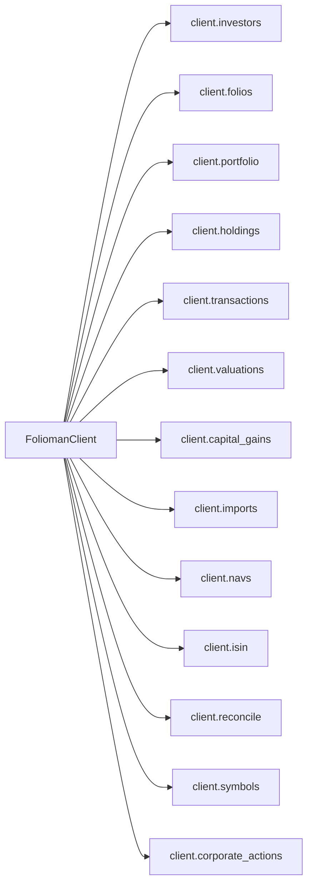

# `FoliomanClient` & Resources

`FoliomanClient` is the primary entry point to `folioman-client`. It exposes a unified facade that dynamically routes calls to either local embedded services or remote HTTP REST endpoints based on configuration.

---

## Architecture & Sub-Resources

An instance of `FoliomanClient` exposes 13 typed sub-resources:

### Resource Summary

| Sub-Resource | Property | Class | Primary Operations |
| :--- | :--- | :--- | :--- |
| **Investors** | `client.investors` | `InvestorsResource` | `list()`, `get()`, `create()`, `delete()` |
| **Folios** | `client.folios` | `FoliosResource` | `list()`, `get()`, `create()`, `merge()` |
| **Portfolio** | `client.portfolio` | `PortfolioResource` | `get()`, `history()` |
| **Holdings** | `client.holdings` | `HoldingsResource` | `list()`, `get()` |
| **Transactions** | `client.transactions` | `TransactionsResource` | `list()`, `create()`, `delete()` |
| **Valuations** | `client.valuations` | `ValuationsResource` | `compute()`, `status()`, `queue_recompute()` |
| **Capital Gains** | `client.capital_gains` | `CapitalGainsResource` | `summary()`, `schedule_112a()`, `audit()` |
| **Statement Import** | `client.imports` | `ImportsResource` | `cas_pdf()`, `job_status()`, `retry()` |
| **NAV & Price Sync** | `client.navs` | `NavsResource` | `refresh()`, `backfill()`, `freshness()` |
| **ISIN Catalog** | `client.isin` | `ISINResource` | `sync()`, `lookup()`, `status()` |
| **Reconciliation** | `client.reconcile` | `ReconcileResource` | `investor()`, `all()`, `acknowledge()` |
| **Symbol Resolution** | `client.symbols` | `SymbolsResource` | `resolve()`, `status()` |
| **Corporate Actions** | `client.corporate_actions` | `CorporateActionsResource` | `sync()`, `apply()`, `revert()` |

!!! tip "Data Models"
    All methods on these resources return typed Pydantic models from `folioman_client.models`. For full field definitions, types, and schema tables, see **[Domain Models & Schema Reference](../models.md)**.

---

## 1. Primary Client Facade

### `FoliomanClient`
The central facade managing connection lifecycle, configuration, and dispatching operations to embedded database services or remote REST endpoints.

::: folioman_client.client.FoliomanClient
    options:
        show_root_heading: false
        show_source: false
        heading_level: 4
        members_order: source

---

## 2. Portfolio & Valuation Resources

### `PortfolioResource` (`client.portfolio`)
Inspect overall portfolio net worth, allocation breakdown, and historical value series.

::: folioman_client.client.PortfolioResource
    options:
        show_root_heading: false
        show_source: false
        heading_level: 4
        members_order: source

---

### `HoldingsResource` (`client.holdings`)
Query current security holdings, unit quantities, cost basis, and unrealized gains.

::: folioman_client.client.HoldingsResource
    options:
        show_root_heading: false
        show_source: false
        heading_level: 4
        members_order: source

---

### `ValuationsResource` (`client.valuations`)
Trigger asynchronous portfolio valuation recomputations and query compute status.

::: folioman_client.client.ValuationsResource
    options:
        show_root_heading: false
        show_source: false
        heading_level: 4
        members_order: source

---

## 3. Market Data & Reference Resources

### `NavsResource` (`client.navs`)
Fetch real-time mutual fund NAVs, stock prices, and backfill historical data points.

::: folioman_client.client.NavsResource
    options:
        show_root_heading: false
        show_source: false
        heading_level: 4
        members_order: source

---

### `ISINResource` (`client.isin`)
Seed, update, and search the 100k+ master security and ISIN reference database.

::: folioman_client.client.ISINResource
    options:
        show_root_heading: false
        show_source: false
        heading_level: 4
        members_order: source

---

### `SymbolsResource` (`client.symbols`)
Resolve national exchange tickers (NSE, BSE) from ISINs.

::: folioman_client.client.SymbolsResource
    options:
        show_root_heading: false
        show_source: false
        heading_level: 4
        members_order: source

---

## 4. Ledger & Statement Ingestion Resources

### `ImportsResource` (`client.imports`)
Ingest CAMS/KFintech CAS and NSDL/CDSL eCAS PDF statements with password decryption.

::: folioman_client.client.ImportsResource
    options:
        show_root_heading: false
        show_source: false
        heading_level: 4
        members_order: source

---

### `InvestorsResource` (`client.investors`)
Manage investor identities, encrypted PAN storage, and family groupings.

::: folioman_client.client.InvestorsResource
    options:
        show_root_heading: false
        show_source: false
        heading_level: 4
        members_order: source

---

### `FoliosResource` (`client.folios`)
Query mutual fund folios, AMC schemes, and folio merge operations.

::: folioman_client.client.FoliosResource
    options:
        show_root_heading: false
        show_source: false
        heading_level: 4
        members_order: source

---

### `TransactionsResource` (`client.transactions`)
Query immutable ledger transactions and manually record financial trades.

::: folioman_client.client.TransactionsResource
    options:
        show_root_heading: false
        show_source: false
        heading_level: 4
        members_order: source

---

## 5. Tax & Corporate Actions Resources

### `CapitalGainsResource` (`client.capital_gains`)
Compute LTCG/STCG tax liabilities, Section 112A grandfathering, and export ITR Schedule 112A reports.

::: folioman_client.client.CapitalGainsResource
    options:
        show_root_heading: false
        show_source: false
        heading_level: 4
        members_order: source

---

### `CorporateActionsResource` (`client.corporate_actions`)
Fetch, review, apply, and audit stock splits, bonus issues, and demergers.

::: folioman_client.client.CorporateActionsResource
    options:
        show_root_heading: false
        show_source: false
        heading_level: 4
        members_order: source

---

### `ReconcileResource` (`client.reconcile`)
Reconcile statement snapshot units against calculated transaction ledger units.

::: folioman_client.client.ReconcileResource
    options:
        show_root_heading: false
        show_source: false
        heading_level: 4
        members_order: source
