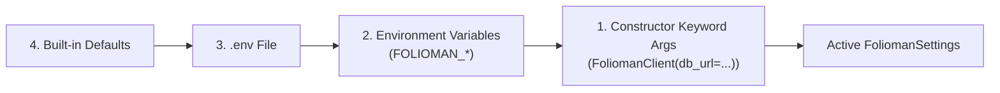

# Configuration & Settings

`folioman_client.config` manages runtime configuration using `pydantic-settings`. It supports environment variables, `.env` files, and constructor overrides with automatic type validation.

---

## Configuration Hierarchy

Settings are resolved in the following order of precedence (highest to lowest):

1. **Explicit Constructor Arguments**: Passed directly to `FoliomanClient(...)` or `FoliomanSettings(...)`.
2. **Environment Variables**: System-level environment variables (prefixed with `FOLIOMAN_`).
3. **Environment File (`.env`)**: Variables defined in a local `.env` file in the working directory.
4. **Default Values**: Hardcoded fallbacks declared in `FoliomanSettings`.

---

## Environment Variables Reference

| Setting Key | Environment Variable | Default Value | Description |
| :--- | :--- | :--- | :--- |
| `database_url` | `FOLIOMAN_DATABASE_URL` | `sqlite+aiosqlite:///~/.folioman/folioman.db` | Async SQLAlchemy database connection string. |
| `pan_secret` | `FOLIOMAN_PAN_SECRET` | System Keyring / Auto-generated | 32-byte url-safe base64 key used for Fernet PAN encryption and HMAC-SHA256 indexing. |
| `encryption_key` | `FOLIOMAN_ENCRYPTION_KEY` | None | Alternative alias for `pan_secret`. |
| `mode` | `FOLIOMAN_MODE` | `embedded` | Operating mode: `"embedded"` or `"remote"`. |
| `base_url` | `FOLIOMAN_BASE_URL` | None | Base URL for remote Folioman server (e.g. `https://api.example.com`). |
| `username` | `FOLIOMAN_USERNAME` | None | Username for remote JWT authentication. |
| `password` | `FOLIOMAN_PASSWORD` | None | Password for remote JWT authentication. |
| `token_refresh_skew` | `FOLIOMAN_TOKEN_REFRESH_SKEW` | `30` | Seconds before expiration to trigger background token refresh. |
| `auto_migrate` | `FOLIOMAN_AUTO_MIGRATE` | `True` | Automatically initialize database tables on first launch. |
| `default_user_id` | `FOLIOMAN_DEFAULT_USER_ID` | `"default"` | Default user identifier for local single-tenant usage. |

---

## API Reference: `folioman_client.config`

::: folioman_client.config
    options:
        show_root_heading: true
        show_source: false
        heading_level: 3
        members_order: source
