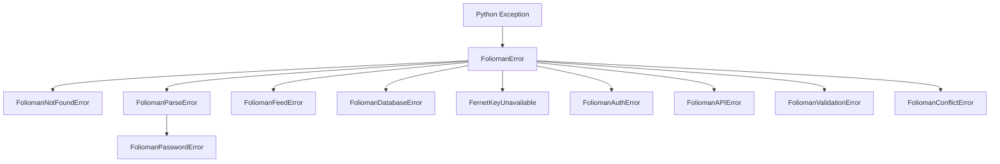

# Exceptions & Error Handling

All domain errors and API exceptions in `folioman-client` inherit from the base exception `FoliomanError`. This provides a consistent exception hierarchy across both the asynchronous Python SDK and CLI commands.

---

## Exception Hierarchy Diagram

---

## HTTP Status Codes & Error Mapping

| Exception Class | HTTP Status | Typical Root Cause |
| :--- | :---: | :--- |
| `FoliomanNotFoundError` | **404** | Investor ID, Folio ID, or Security ID does not exist in the database. |
| `FoliomanValidationError` | **422** | Invalid transaction parameters, malformed PAN format, or negative unit quantity. |
| `FoliomanPasswordError` | **400** | Incorrect password provided when decrypting CAS / eCAS PDF statement. |
| `FoliomanParseError` | **400** | Corrupted or unsupported statement layout provided during ingestion. |
| `FoliomanAuthError` | **401** | Missing, expired, or invalid JWT bearer token in remote client mode. |
| `FoliomanConflictError` | **409** | Duplicate record conflict, e.g. re-importing already existing deduplicated transactions. |
| `FoliomanDatabaseError` | **500** | Operational SQLite lock, broken connection pool, or low-level database failure. |
| `FernetKeyUnavailable` | **500** | Missing PAN master encryption key in keyring and environment variables. |
| `FoliomanFeedError` | **502** | Upstream market data feed failure (AMFI, Yahoo Finance, or mfapi.in unreachable). |

!!! tip "Error Handling Patterns"
    For best practices on catching exceptions, diagnosing database locks, and logging, see **[Error Handling & Debugging Guide](../error-handling-and-debugging.md)**.

---

## API Reference: `folioman_client.errors`

::: folioman_client.errors
    options:
        show_root_heading: true
        show_source: false
        heading_level: 3
        members_order: source

---

## Serialization Types: `folioman_client.types`

::: folioman_client.types
    options:
        show_root_heading: true
        show_source: false
        heading_level: 3
        members_order: source
