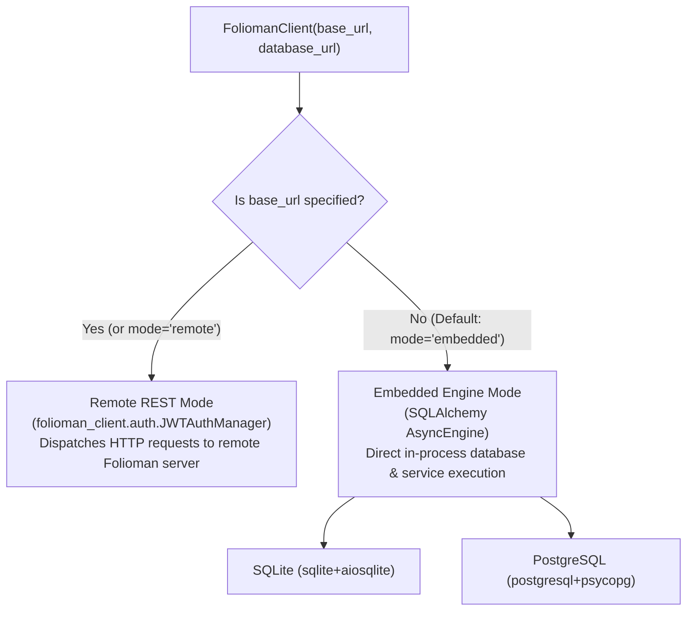

# API Reference Overview

The `folioman-client` library provides a typed, embedded portfolio accounting engine and async REST SDK for Indian personal finance, mutual funds, and equities.

This section provides the comprehensive API reference generated from the codebase, organized into dedicated, modular guides:

<div class="grid cards" markdown>

-   :material-laptop:{ .lg .middle } __[Client & Resources](client.md)__

    ---

    The primary `FoliomanClient` facade managing both embedded database engines and remote REST HTTP routing across 13 sub-resources.

-   :material-cog:{ .lg .middle } __[Configuration & Settings](config.md)__

    ---

    Environment variables, `.env` file resolution, and runtime settings via `FoliomanSettings`.

-   :material-database:{ .lg .middle } __[Domain Models & Schemas](../models.md)__

    ---

    The three-tier architecture: Public API response DTOs (`folioman_client.models`), Core mathematical domain models, and SQLAlchemy 2.0 ORM tables.

-   :material-cogs:{ .lg .middle } __[Application Services](services.md)__

    ---

    The 10 application business services handling statement ingestion, NAV feeds, FIFO valuation, corporate actions replay, and reconciliation.

-   :material-alert-circle:{ .lg .middle } __[Exceptions & Errors](errors.md)__

    ---

    Structured exception hierarchy inheriting from `FoliomanError`, with deterministic HTTP status codes and error details.

</div>

---

## Operating Modes: Embedded vs Remote

`FoliomanClient` automatically configures its execution mode based on the provided initialization arguments:



### 1. Embedded Engine Mode (Recommended)

Default zero-configuration local database mode. All portfolio valuation, CAS statement parsing, corporate actions, and capital gains computations run directly in-process:

```python
import asyncio
from folioman_client import FoliomanClient

async def main():
    # Connects to default embedded SQLite database (~/.folioman/folioman.db)
    client = FoliomanClient()
    
    # Query investor portfolio summary
    summary = await client.portfolio.get(investor_id=1)
    print(f"Total Portfolio Value: INR {summary.total_value:,.2f}")

asyncio.run(main())
```

### 2. Remote REST Client Mode (Legacy)

Connects asynchronously to a remote Folioman server via HTTP REST APIs with automatic JWT token management:

```python
import asyncio
from folioman_client import FoliomanClient

async def main():
    client = FoliomanClient(
        base_url="https://api.folioman.example.com",
        username="advisor@example.com",
        password="secure_password",
    )
    
    investors = await client.investors.list()
    for inv in investors:
        print(f"Investor: {inv.name} (ID: {inv.id})")

asyncio.run(main())
```

---

## Quick Reference Links

| Component | Module | Primary Class / Entry Point | Guide |
| :--- | :--- | :--- | :--- |
| **Client Facade** | `folioman_client.client` | [`FoliomanClient`](client.md) | [Python SDK Guide](../client.md) |
| **Settings** | `folioman_client.config` | [`FoliomanSettings`](config.md) | [Configuration](../setup-and-configuration.md) |
| **Public DTOs** | `folioman_client.models` | `PortfolioSummary`, `Holding`, `Transaction` | [Data Models](../models.md) |
| **Domain Services** | `folioman_client.services` | `ImportService`, `ValuationService`, etc. | [Services Reference](services.md) |
| **Exceptions** | `folioman_client.errors` | `FoliomanError`, `FoliomanNotFoundError` | [Error Guide](../error-handling-and-debugging.md) |
