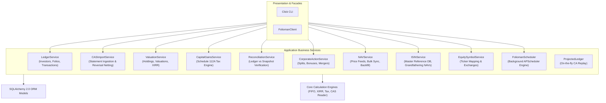

# Application Services API Reference

The `folioman_client.services` package contains 10 application business services that implement portfolio operations, market data synchronization, financial math orchestration, and database persistence.

---

## Service Summary & Architecture

!!! note "Architectural Walkthrough"
    For detailed architectural diagrams, parameter lists, and internal design patterns of each service, see the **[Application Services Architectural Guide](../modules/services.md)**.

---

## 1. `CASImportService`

Manages CAS (CAMS/KFintech) and eCAS (NSDL/CDSL) statement parsing, PDF decryption, reversal netting, and savepoint-isolated database insertion.

::: folioman_client.services.import_service
    options:
        show_root_heading: true
        show_source: false
        heading_level: 3
        members_order: source

---

## 2. `NAVService`

Coordinates bulk price updates from AMFI, historical backfills via `mfapi.in`, closing equity prices from NSE Bhavcopy, and foreign stock prices from Yahoo Finance.

::: folioman_client.services.nav_service
    options:
        show_root_heading: true
        show_source: false
        heading_level: 3
        members_order: source

---

## 3. `ValuationService`

Computes point-in-time and trailing portfolio valuations, asset allocation breakdowns, FIFO open lots, and portfolio-level annualized XIRR.

::: folioman_client.services.valuation_service
    options:
        show_root_heading: true
        show_source: false
        heading_level: 3
        members_order: source

---

## 4. `CapitalGainsService`

Executes Indian capital gains tax computations under Sections 111A, 112, 112A, and 50AA. Formats exportable ITR Schedule 112A line-by-line datasets.

::: folioman_client.services.capital_gains_service
    options:
        show_root_heading: true
        show_source: false
        heading_level: 3
        members_order: source

---

## 5. `ReconciliationService`

Verifies structural integrity between cumulative transaction ledgers and periodic holding snapshots. Explains discrepancies via corporate action detection.

::: folioman_client.services.reconciliation_service
    options:
        show_root_heading: true
        show_source: false
        heading_level: 3
        members_order: source

---

## 6. `CorporateActionService`

Manages corporate action references (splits, bonus issues, mergers, demergers) and applies on-the-fly multiplier adjustments without mutating historical transactions.

::: folioman_client.services.corporate_action_service
    options:
        show_root_heading: true
        show_source: false
        heading_level: 3
        members_order: source

---

## 7. `LedgerService`

Provides atomic CRUD operations for investors, folios, and manual ledger transactions with strict PAN encryption and validation.

::: folioman_client.services.ledger_service
    options:
        show_root_heading: true
        show_source: false
        heading_level: 3
        members_order: source

---

## 8. `ISINService`

Manages the local reference catalog of 100,000+ Indian securities, AMFI mutual fund codes, and grandfathering NAV prices as of January 31, 2018.

::: folioman_client.services.isin_service
    options:
        show_root_heading: true
        show_source: false
        heading_level: 3
        members_order: source

---

## 9. `EquitySymbolService`

Resolves exchange-specific trading tickers (NSE/BSE symbols) from ISINs and manages exchange calendar schedules.

::: folioman_client.services.equity_symbol_service
    options:
        show_root_heading: true
        show_source: false
        heading_level: 3
        members_order: source

---

## 10. `FoliomanScheduler`

Wraps APScheduler for non-blocking background daily synchronization of NAV feeds and portfolio net worth valuations.

::: folioman_client.services.scheduler
    options:
        show_root_heading: true
        show_source: false
        heading_level: 3
        members_order: source
