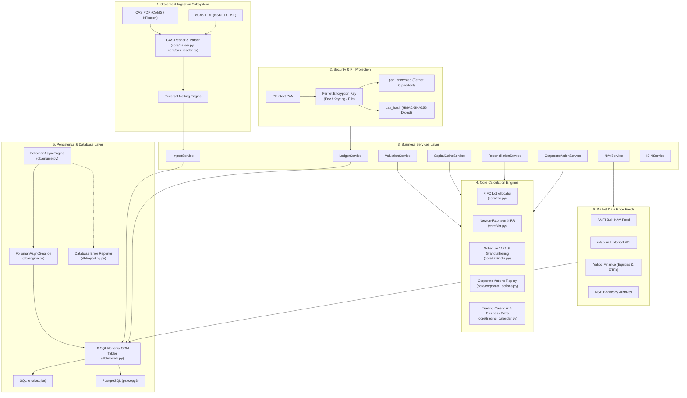
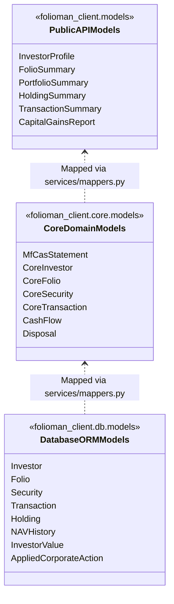
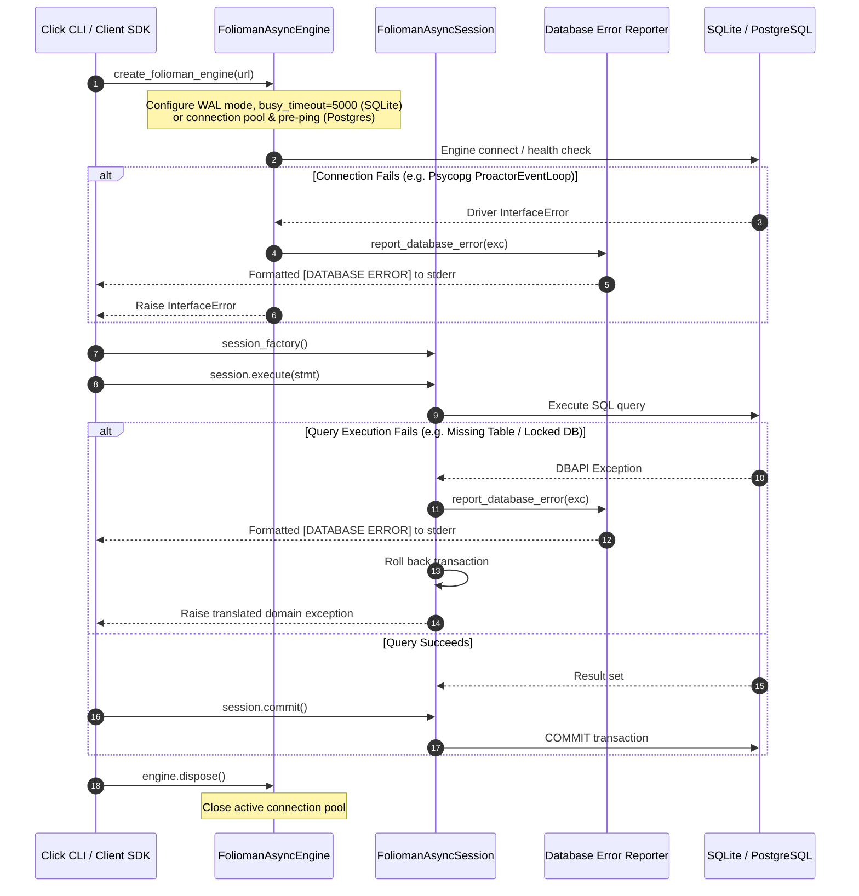

# System Architecture & Technical Design

This document details the architectural design, subsystem relationships, data flow models, and application lifecycle of `folioman-client`.

---

## 1. System Overview

`folioman-client` is a zero-configuration, local-first portfolio accounting engine and CLI for Indian personal finance, mutual funds, and equities. Starting in `v0.2.0`, the library operates primarily as an **embedded database application** backed by SQLite (via `aiosqlite`) or PostgreSQL (via `psycopg3`). It retains backward compatibility as an asynchronous HTTP REST SDK for remote Folioman server deployments.

### 1.1 Core Capabilities

1. **CAS & eCAS Statement Ingestion**: Parses Consolidated Account Statements (CAS) from CAMS and KFintech, as well as NSDL/CDSL equity Demat eCAS PDFs via `casparser` and `pypdfium2`. It executes transaction reversal netting and SHA-256 deduplication hashing to ensure idempotent statement re-imports.
2. **Strict Financial Lot Accounting (FIFO)**: Implements First-In-First-Out (FIFO) lot allocation with Section 48 cost basis additions (brokerage, stamp duty transfer allocations) using arbitrary-precision `Decimal` arithmetic.
3. **Indian Capital Gains Engine (Schedule 112A)**: Computes Long-Term (LTCG) and Short-Term (STCG) capital gains under Indian Income Tax Act rules, including Section 112A grandfathering (Jan 31, 2018 FMV lookup) and Union Budget 2024 cutoff rules (July 23, 2024). Emits official 14-column ITR Schedule 112A CSV reports.
4. **Non-Destructive Corporate Actions**: Models stock splits, bonus issues, mergers, and demergers on-the-fly over immutable transaction ledgers without rewriting historical database records.
5. **Multi-Source Market Data Feeds**: Automated NAV and price synchronization via AMFI bulk feeds, `mfapi.in`, Yahoo Finance, and NSE Bhavcopy archives.
6. **Centralized Actionable Database Diagnostics**: Formats database failures into standardized console diagnostic blocks identifying the failing operation, query, application source line, root cause, and corrective action.

---

## 2. High-Level System Architecture

The following diagram illustrates the major subsystems of `folioman-client` and how data flows from external statements and market feeds into the core domain engine and persistent storage:

---

## 3. The Three Model Layers

To maintain clear separation between persistence schemas, pure mathematical domain calculations, and public REST/SDK models, `folioman-client` employs three distinct model hierarchies:

### 3.1 Model Layer Responsibilities

| Layer | Module Path | Base Class | Primary Purpose |
| :--- | :--- | :--- | :--- |
| **Public API Models** | `folioman_client.models` | `pydantic.BaseModel` | Consumer-facing Data Transfer Objects (DTOs) returned by `FoliomanClient` resource methods. Formatted for API responses and JSON serialization. |
| **Core Domain Models** | `folioman_client.core.models` | `pydantic.BaseModel` | Intermediate, framework-free structures used during CAS PDF parsing, statement reconciliation, corporate actions replay, and financial math. Contains no database dependencies. |
| **Database ORM Models** | `folioman_client.db.models` | SQLAlchemy 2.0 `Base` | Declarative database tables persisted to SQLite or PostgreSQL. Captures foreign key relationships, indexes, unique constraints, and audit columns. |

### 3.2 Data Translation Layer (`services/mappers.py`)

The mapper module provides bidirectional, lossless translations between database entities and core domain representations:
- `db_to_core_security(sec: db.Security) -> core.Security`
- `db_to_core_transaction(txn: db.Transaction) -> core.Transaction`
- `core_to_db_transaction(txn: core.Transaction, investor_id: int, folio_id: int, security_id: int) -> db.Transaction`

---

## 4. Subsystem Interactions

### 4.1 Ingestion & Normalization Subsystem
- **Parser Dispatch (`core/cas_reader.py`)**: Inspects PDF headers to route documents to either `parse_cas_pdf` (for CAMS/KFintech mutual fund statements) or `parse_ecas_pdf` (for NSDL/CDSL demat statements).
- **Reversal Netting (`core/parser.py`)**: Detects paired reversal transactions (`PURCHASE` followed by `REVERSAL`), netting them out before creating ledger rows. Unpaired reversals fall back to snapshot units to avoid corrupted lot histories.
- **Deduplication Hashing (`services/import_service.py`)**: Generates an SHA-256 digest over normalized transaction tuples: `(folio_number, isin, transaction_date, type, units, amount)`. Prevents duplicate ledger entries during repeated imports of overlapping statement date ranges.

### 4.2 Portfolio Accounting & Math Subsystem
- **FIFO Allocation Engine (`core/fifo.py`)**: Maintains a FIFO queue of open lots (`FIFOUnits`). When a sale occurs, it consumes the oldest available lots, computes realized gain/loss, and allocates buy-side stamp duty across sold slices with 2-decimal banker's rounding (`ROUND_HALF_EVEN`).
- **Cost Basis Preservation**: Cost basis is carried as a **total amount** (`cost_total`) on open lots rather than per-unit price. This prevents rounding drift from recurring decimals when non-divisible stock split or merger ratios are applied.
- **XIRR Solver (`core/xirr.py`)**: Solves the internal rate of return for irregular cash flows using Newton-Raphson root finding:

  $$r_{n+1} = r_n - \frac{\text{NPV}(r_n)}{\text{NPV}'(r_n)}$$

  If Newton-Raphson diverges, encounters zero derivatives, or crosses the $-100\%$ boundary ($r \le -0.999999$), it automatically falls back to a bracketed bisection algorithm in the range $[-0.999999, 100.0]$.

### 4.3 Corporate Actions & Projected Ledger Subsystem
- **Immutability Invariant**: Historical `Transaction` rows in the database are **never updated** when stock splits, bonuses, or mergers occur.
- **Dynamic Replay (`services/projected_ledger.py`)**: Replays corporate actions on-the-fly over immutable transactions. Evaluates corporate action events (`CorporateActionApplyEvent`) in strict chronological order and adjusts unit counts and effective cost bases on read operations.

### 4.4 Indian Tax Subsystem (Schedule 112A)
- **Eligibility & Holding Periods (`core/tax/india.py`)**:
  - Equity & Equity-Oriented MFs qualify for Section 112A.
  - Long-term threshold: held $> 12$ calendar months.
- **Section 112A Grandfathering (Jan 31, 2018)**:
  For shares acquired on or before January 31, 2018, Section 55(2)(ac) defines the deemed cost of acquisition:

  $$\text{Deemed Cost} = \max(\text{Actual Cost}, \min(\text{FMV as of 31-Jan-2018}, \text{Sale Price}))$$

- **Budget 2024 Transition Rules**:
  Splits transactions around July 23, 2024:
  - Transfers before July 23, 2024: LTCG taxed at 10% (beyond ₹1 lakh exemption).
  - Transfers on or after July 23, 2024: LTCG taxed at 12.5% (beyond ₹1.25 lakh exemption).
- **ITR CSV Generation (`core/tax/schedule_112a.py`)**: Exports the complete 14-column schedule conforming to the Income Tax Department e-filing schema.

---

## 5. Application Lifecycle & Database Concurrency

### 5.1 Concurrency Rules & Boundaries
1. **Thread-Safe Event Loop Isolation**: Worker threads spawned by background schedulers (e.g. APScheduler) must not share an `AsyncEngine` bound to a different thread's event loop.
2. **Strict Rollback on Error**: All session errors trigger automatic transaction rollback before raising translated exceptions.
3. **De-duplicated Error Reporting**: Exceptions carry `_folioman_db_error_reported = True` upon being formatted. Subsequent abstraction layers catching the same exception bubble it up without generating redundant console output.
