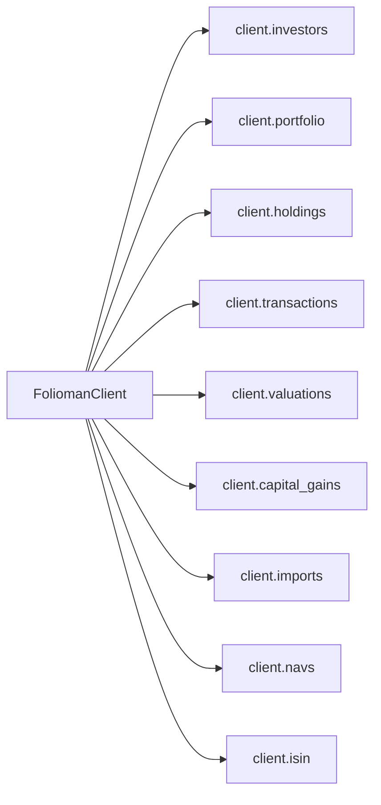

# Python Client SDK

`FoliomanClient` is the primary entry point for embedding Folioman portfolio management into Python applications.

---

## The `FoliomanClient` Class

```python
from folioman_client import FoliomanClient

async with FoliomanClient(
    database_url="sqlite+aiosqlite:///folioman.db",
    user_id="default",
    start_scheduler=False,
) as client:
    ...
```

### Constructor Parameters

| Parameter         | Type          | Default     | Description                                                                                |
| :---------------- | :------------ | :---------- | :----------------------------------------------------------------------------------------- |
| `database_url`    | `str \| None` | `None`      | SQLAlchemy connection URL. If omitted, uses `settings.database_url` or defaults to SQLite. |
| `user_id`         | `str`         | `"default"` | Multi-tenancy tenant or advisor scope identifier.                                          |
| `timeout`         | `float`       | `30.0`      | Network timeout (seconds) for external price feeds.                                        |
| `start_scheduler` | `bool`        | `False`     | If `True`, launches an in-process daemon thread scheduler for 6-hourly NAV refreshes.      |

---

## Resource Sub-Clients

`FoliomanClient` exposes its capabilities through structured resource sub-clients:



---

### 1. `client.investors`

Manages investor profiles.

#### `list()`

```python
async def list(
    *,
    family_id: int | None = None,
    unaffiliated: bool = False,
) -> list[Investor]
```

Lists all investors belonging to the current `user_id`.

#### `get()`

```python
async def get(investor_id: int) -> InvestorDetail
```

Retrieves detailed profile information for an investor, including masked PAN.

#### `create()`

```python
async def create(
    name: str,
    *,
    pan: str | None = None,
    email: str = "",
    family_id: int | None = None,
) -> InvestorDetail
```

Creates a new investor with an encrypted PAN.

---

### 2. `client.portfolio`

Retrieves consolidated portfolio valuation, asset allocation, and XIRR.

#### `get()`

```python
async def get(
    investor_id: int,
    *,
    as_of: date | str | None = None,
) -> PortfolioSummary
```

Calculates point-in-time portfolio metrics:

- `total_inr`: Current market value.
- `invested_inr`: Total invested amount (FIFO cost basis).
- `unrealized_pnl_inr`: Absolute profit/loss.
- `return_pct`: Total percentage gain.
- `xirr`: Money-weighted annualized return.
- `asset_mix`: Allocation across Equity, Debt, Hybrid, Other.
- `holdings`: Full list of priced holdings.

---

### 3. `client.holdings`

Queries individual positions and scheme details.

#### `list()`

```python
async def list(
    investor_id: int,
    *,
    as_of: date | str | None = None,
) -> list[Holding]
```

Returns a list of all currently held securities with quantities, market value, invested cost, and scheme-level XIRR.

#### `get()`

```python
async def get(
    investor_id: int,
    security_id: int,
    *,
    as_of: date | str | None = None,
) -> SchemeDetail
```

Returns detailed historical metrics for a single scheme, including transaction ledger, folio breakdowns, and NAV price points.

---

### 4. `client.transactions`

Accesses the raw immutable ledger.

#### `list()`

```python
async def list(investor_id: int) -> list[Transaction]
```

Returns all ledger entries (buys, sells, transfers, dividends) sorted chronologically.

---

### 5. `client.valuations`

Accesses net-worth time-series data.

#### `list()`

```python
async def list(
    investor_id: int,
    *,
    from_date: date | str | None = None,
    to_date: date | str | None = None,
    granularity: Literal["daily", "weekly", "monthly"] = "monthly",
) -> ValueSeries
```

Reconstructs net-worth progression over time from ledger transactions and historical NAVs.

#### `status()`

```python
async def status(investor_id: int) -> ValuationStatus
```

Returns readiness status of the portfolio valuation series.

---

### 6. `client.capital_gains`

Indian tax reporting and Schedule 112A calculations.

#### `list()`

```python
async def list(
    investor_id: int,
    *,
    include_unreconciled: bool = False,
) -> list[CapitalGainsFyPoint]
```

Summarizes realized Short-Term Capital Gains (STCG) and Long-Term Capital Gains (LTCG) across all financial years with disposals.

#### `get()`

```python
async def get(
    investor_id: int,
    *,
    fy: str,
    include_unreconciled: bool = False,
) -> CapitalGainsReport
```

Generates a lot-level capital gains report for a specific financial year (e.g. `"2024-25"`), factoring in Section 112A 2018 grandfathering FMVs and the 23-Jul-2024 Budget regime cutoff.

---

### 7. `client.imports`

Ingests statement files.

#### `cas_pdf()`

```python
async def cas_pdf(
    file_path: str | Path | BinaryIO,
    password: str,
    *,
    investor_id: int | None = None,
) -> ImportJob
```

Parses CAMS/KFintech or NSDL/CDSL eCAS PDF statements, normalizes folios, deduplicates transactions via SHA-256 content hashes, and queues NAV backfills.

---

### 8. `client.navs`

Manages price feeds.

#### `refresh()`

```python
async def refresh(*, types: list[str] | None = None) -> dict[str, Any]
```

Fetches the latest available NAVs and market closing prices for all held securities.

#### `backfill()`

```python
async def backfill(*, force: bool = False) -> dict[str, Any]
```

Backfills missing historical NAV gaps between the earliest trade date and today.

---

### 9. `client.isin`

Manages the reference directory.

#### `update()`

```python
async def update() -> bool
```

Downloads and applies updates to `ref_schemes` and `ref_isins` from the remote repository.

#### `status()`

```python
async def status() -> dict[str, Any]
```

Returns current reference dictionary version and statistics.
