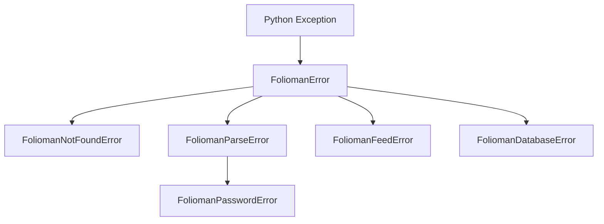

# Error Handling & Exceptions

`folioman-client` provides a focused, predictable exception hierarchy derived from `FoliomanError`. This allows your application to handle missing entities, PDF password errors, parsing failures, and external price feed issues cleanly.

---

## Exception Hierarchy



---

## Exception Classes

### `FoliomanError`

```python
class FoliomanError(Exception):
    """Base exception for all Folioman client errors."""
```

The common ancestor of all SDK exceptions. Catching `FoliomanError` intercepts any library-specific error.

---

### `FoliomanNotFoundError`

```python
class FoliomanNotFoundError(FoliomanError):
    """Raised when a requested resource (investor, security, transaction) does not exist."""
```

- **When Raised**:
    - Requesting an `investor_id` that is not present in the database.
    - Querying a `security_id` not found in the catalog.
- **Recommended Action**:
    - Catch and return a 404 or prompt the user to create the entity.

---

### `FoliomanParseError`

```python
class FoliomanParseError(FoliomanError):
    """Raised when statement parsing fails or document shape is unsupported."""
```

- **When Raised**:
    - The supplied file is not a valid CAMS/KFintech or NSDL/CDSL PDF statement.
    - The PDF structure is corrupted.

---

### `FoliomanPasswordError`

```python
class FoliomanPasswordError(FoliomanParseError):
    """Raised when the PDF password is wrong or missing."""
```

- **When Raised**:
    - Encrypted CAS PDF cannot be unlocked with the provided password.
- **Recommended Action**:
    - Prompt the user to re-enter their statement password (usually the investor's PAN).

---

### `FoliomanFeedError`

```python
class FoliomanFeedError(FoliomanError):
    """Raised when external price feed APIs fail or return malformed data."""
```

- **When Raised**:
    - Network timeout or HTTP 5xx errors from `mfapi.in`, AMFI, Yahoo Finance, or CoinGecko.
- **Recommended Action**:
    - Retain existing stale prices and retry the sync later.

---

### `FoliomanDatabaseError`

```python
class FoliomanDatabaseError(FoliomanError):
    """Raised on database connection failures or integrity constraint violations."""
```

- **When Raised**:
    - Database URL is unreachable or connection pool is exhausted.
