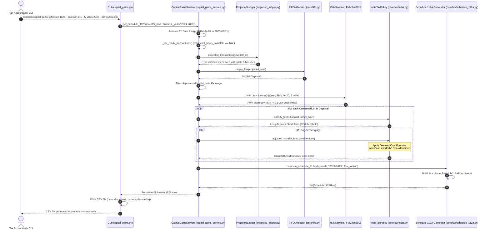

# Execution Flow: Capital Gains Tax & Schedule 112A (`get_schedule_112a`)

This specification traces the execution path for calculating realized capital gains, applying Section 112A grandfathering, enforcing Budget 2024 rate cutoffs, and generating the official 14-column Schedule 112A report.

---

## 1. Flow Overview & Sequence Diagram

---

## 2. Step-by-Step Technical Walkthrough

### Step 1: Tax Readiness & Cost Basis Audit
- **Source**: `CapitalGainsService._tax_ready_transactions()` in `services/capital_gains_service.py`.
- **Action**:
  - Queries all transactions for `investor_id`.
  - Filters out incomplete scheme blocks (`cost_basis_complete == False`).
  - **Invariant**: Capital gains cannot legally be calculated if the opening acquisition cost is unknown. If incomplete transactions exist, a warning is logged detailing which folios have missing opening lots.

### Step 2: Virtual Ledger Interleaving & FIFO Disposal Extraction
- **Source**: `ProjectedLedger.projected_transactions()` and `core/fifo.py:apply_fifo()`.
- **Action**:
  - Replays corporate action events (stock splits and bonus issues) to ensure that the units and costs of historical acquisition lots reflect current capitalization.
  - Runs the FIFO allocation engine across the entire chronological transaction history from inception.
  - Extracts all `SellDisposal` objects whose sale date falls within the selected Financial Year (e.g. `2024-04-01` to `2025-03-31`).

### Step 3: Grandfathering Benchmark Price Lookup
- **Source**: `CapitalGainsService._build_fmv_lookup()` in `services/capital_gains_service.py`.
- **Action**:
  - Identifies all unique ISINs present in the financial year's disposals.
  - Queries the `FMVJan2018` database table for official closing prices on January 31, 2018.
  - Constructs an in-memory lookup function: `fmv_lookup(isin, date) -> Decimal | None`.

### Step 4: Statutory Classification & Deemed Cost Adjustment
- **Source**: `core/tax/india.py:IndiaTaxPolicy`.
- **Action**: For each consumed lot:
  1. **Term Classification**:
     - Calculates holding period: $\Delta d = \text{sold\_on} - \text{acquired\_on}$.
     - For Listed Equities and Equity Mutual Funds: Long-Term if $\Delta d > 365$ days; otherwise Short-Term.
     - For Debt Mutual Funds acquired on or after April 1, 2023: Automatically classified as Short-Term under Section 50AA regardless of holding duration.
  2. **Budget 2024 Rate Tagging**:
     - If $\text{sold\_on} < \text{2024-07-23}$: STCG @ 15%, LTCG @ 10%.
     - If $\text{sold\_on} \ge \text{2024-07-23}$: STCG @ 20%, LTCG @ 12.5%.
  3. **Section 112A Grandfathering**:
     - If lot was acquired on or before January 31, 2018:
       $$\text{Deemed Cost} = \max(\text{Actual Cost}, \min(\text{FMV as of 31-Jan-2018}, \text{Sale Value}))$$
     - If acquired after January 31, 2018:
       $$\text{Deemed Cost} = \text{Actual Purchase Cost}$$
  4. **Section 48 Deductions**:
     - Deducts brokerage, exchange turnover charges, and transfer fees from the sale proceeds.

### Step 5: Schedule 112A 14-Column Export
- **Source**: `core/tax/schedule_112a.py:compute_schedule_112a()`.
- **Action**:
  - Maps each grandfathered disposal component into a `Schedule112ARow`.
  - Strips trailing decimals for share quantities (`_fmt_natural`).
  - Rounds currency amounts to 2 decimal places (`_fmt_money`).
  - Serializes to CSV dictionary compatible with Income Tax Department e-filing utilities.
