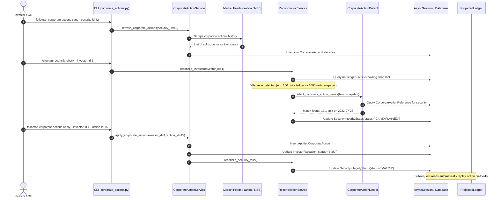

# Execution Flow: Corporate Actions Discovery & Replay

This specification traces how stock splits, bonus shares, and mergers are scraped from market feeds, reconciled against holding balances, and applied without mutating historical transaction ledgers.

---

## 1. Flow Overview & Sequence Diagram

---

## 2. Step-by-Step Technical Walkthrough

### Step 1: Corporate Actions Scraping & Ingestion
- **Source**: `CorporateActionService.refresh_corporate_actions()` in `services/corporate_action_service.py`.
- **Action**:
  - Connects to Yahoo Finance or downloads NSE Bhavcopy archives.
  - Scrapes corporate action notices for tracked equities.
  - Extracts action type (`SPLIT`, `BONUS`, `MERGER`), ex-date, and execution ratios (e.g., $10:1$, $1:1$).
  - Upserts rows into `CorporateActionReference` avoiding duplicates via the unique constraint `(security_id, action_type, ex_date)`.

### Step 2: Mismatch Discovery & Heuristic Detection
- **Source**: `ReconciliationService.reconcile_security_folio()` and `core/corporate_action_detect.py`.
- **Action**:
  - Compares the sum of transactions in `Transaction` against the latest balance reported in `Holding`.
  - When a mismatch is found (e.g. snapshot has 1,000 shares but ledger only records 100 shares):
    - Computes unit ratio: $R = 1000 / 100 = 10.0$.
    - Searches `CorporateActionReference` for an action on this security with a matching ratio ($10:1$) whose ex-date falls between the last transaction date and the snapshot date.
    - Sets `SecurityIntegrityStatus.status = "CA_EXPLAINED"` and embeds the suggested action reference ID in `extra_json`.

### Step 3: Application to Investor Ledger
- **Source**: `CorporateActionService.apply_corporate_action()` in `services/corporate_action_service.py`.
- **Action**:
  - Creates a row in `AppliedCorporateAction` linking `(investor_id, action_reference_id)`.
  - **Does NOT mutate historical rows in the `Transaction` table**.
  - Marks the investor's cached valuations as stale: `Investor.valuation_status = "stale"`.
  - Re-runs reconciliation. The ledger balance now reflects the virtual multiplier, transitioning `SecurityIntegrityStatus.status` from `CA_EXPLAINED` to `MATCH`.

### Step 4: Virtual Replay on Read
- **Source**: `ProjectedLedger.projected_transactions()` in `services/projected_ledger.py`.
- **Action**:
  - Whenever `ValuationService`, `FIFOUnits`, or `CapitalGainsService` requests transactions for an investor, `ProjectedLedger` dynamically merges raw database transactions with applied actions.
  - For splits: multiplies prior purchase lot units and adjusts virtual unit prices while preserving total cost basis.
  - For bonuses: injects virtual zero-cost `BONUS` acquisition transactions on the ex-date.
