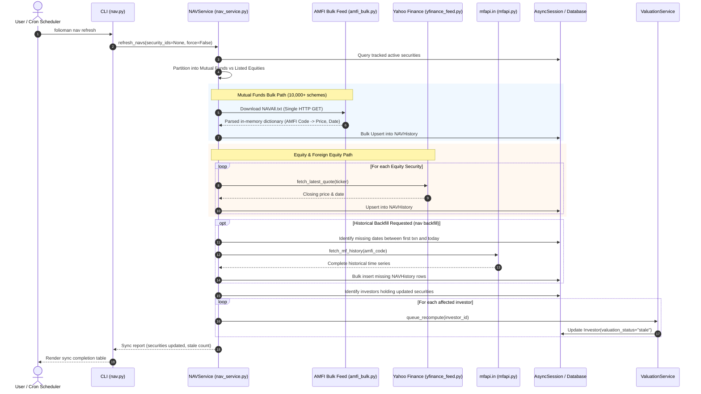

# Execution Flow: NAV & Price Synchronization (`nav refresh`)

This specification traces how market prices and Net Asset Values (NAVs) are synchronized from external providers into the persistent price database.

---

## 1. Flow Overview & Sequence Diagram

---

## 2. Step-by-Step Technical Walkthrough

### Step 1: Target Security Partitioning
- **Source**: `NAVService.refresh_navs()` in `services/nav_service.py`.
- **Action**:
  - Queries `Security` records associated with active investor folios.
  - Partitions securities into two processing streams:
    - **Mutual Funds**: Schemes with `amfi_code` populated or `security_type == "MF"`.
    - **Listed Equities & ETFs**: Instruments with exchange tickers (`symbol`) or ISINs.

### Step 2: High-Performance Bulk Mutual Fund Sync
- **Source**: `core/price_feeds/amfi_bulk.py`.
- **Action**:
  - Downloads the official AMFI text feed (`NAVAll.txt`) in a single compressed HTTP request.
  - Parses the semicolon-delimited lines into an in-memory dictionary keyed by 6-digit AMFI code.
  - Matches active mutual funds in the local portfolio against the AMFI dictionary.
  - Prepares bulk database upsert statements for `NAVHistory`, avoiding thousands of individual network queries.

### Step 3: Equity & ETF Price Fetching
- **Source**: `core/price_feeds/yfinance_feed.py` and `core/price_feeds/nse_bhavcopy.py`.
- **Action**:
  - Resolves exchange tickers with proper suffixes (`.NS` for NSE, `.BO` for BSE).
  - Fetches the latest session closing price.
  - Validates that the returned date matches the expected market trading session via `trading_calendar.py`.

### Step 4: Database Persistence & Lag Evaluation
- **Action**:
  - Upserts quotes into `NAVHistory` with `(security_id, date, nav, feed_source)`.
  - Calculates quote freshness lag:

    $$\text{Lag} = \text{trading\_days\_between}(\text{latest\_quote\_date}, \text{today})$$

  - If $\text{Lag} \le 1$, marks status as `Current`.
  - If $\text{Lag} == 2$, marks status as `Lagging`.
  - If $\text{Lag} \ge 3$, marks status as `Stale`.

### Step 5: Valuation Cache Invalidation
- **Action**:
  - Finds all investors holding securities whose NAVs were updated.
  - Calls `ValuationService.queue_recompute(investor_id)`.
  - Sets `Investor.valuation_status = "stale"`, scheduling background time-series recalculation.
