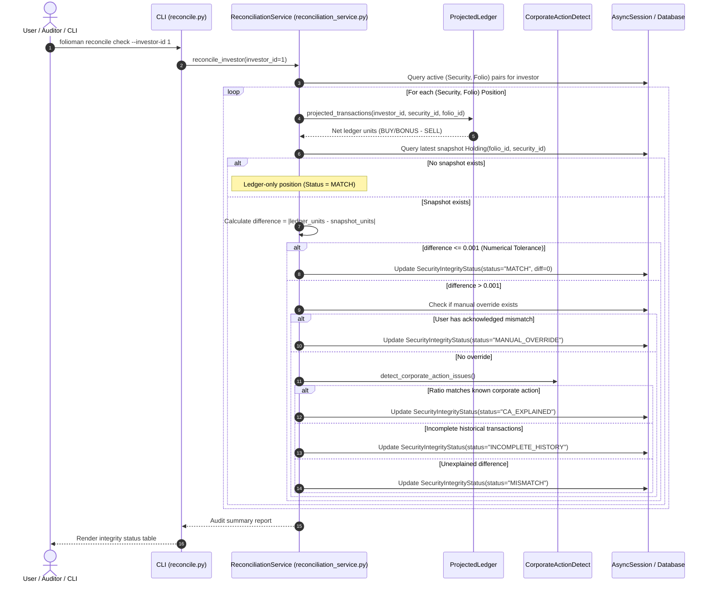

# Execution Flow: Portfolio Reconciliation (`reconcile check`)

This specification traces the reconciliation pipeline used to audit the mathematical integrity of portfolio positions by comparing running ledger totals against periodic account statements.

---

## 1. Flow Overview & Sequence Diagram



---

## 2. Step-by-Step Technical Walkthrough

### Step 1: Position Discovery
- **Source**: `ReconciliationService.reconcile_investor()` in `services/reconciliation_service.py`.
- **Action**:
  - Queries all distinct `(security_id, folio_id)` combinations across both the `Transaction` table and the `Holding` table for the specified investor.

### Step 2: Net Ledger Units Calculation
- **Source**: `ProjectedLedger.compute_ledger()`.
- **Action**:
  - Replays all approved corporate actions (`AppliedCorporateAction`) over historical transaction records.
  - Aggregates share counts:
    $$\text{Ledger Units} = \sum (\text{BUY} + \text{BONUS} + \text{TRANSFER\_IN}) - \sum (\text{SELL} + \text{TRANSFER\_OUT})$$

### Step 3: Snapshot Balance Comparison & Tolerance Check
- **Source**: `ReconciliationService.reconcile_security_folio()`.
- **Action**:
  - Fetches the most recent snapshot row from `Holding` for this `(investor_id, security_id, folio_id)`.
  - Computes unit delta:
    $$\Delta U = |\text{Ledger Units} - \text{Snapshot Units}|$$
  - Compares $\Delta U$ against `TOLERANCE = Decimal("0.001")`.
  - If $\Delta U \le \text{TOLERANCE}$, the position is considered mathematically sound: status is set to `MATCH`.

### Step 4: Discrepancy Diagnostics & Corporate Action Heuristics
- **Action**: When $\Delta U > \text{TOLERANCE}$, the reconciler attempts to determine the root cause:
  1. **Manual Override Check**: If the user previously acknowledged this specific difference via `acknowledge_mismatch()`, status remains `MANUAL_OVERRIDE`.
  2. **Corporate Action Match**: Invokes `core/corporate_action_detect.py`. If the ratio between snapshot units and ledger units matches a known split or bonus issue recorded in `CorporateActionReference`, status is marked `CA_EXPLAINED`.
  3. **Incomplete Statement History**: If the statement block has a non-zero opening balance without preceding transactions, status is marked `INCOMPLETE_HISTORY`.
  4. **True Discrepancy**: If no explanation accounts for the difference, status is marked `MISMATCH`.

### Step 5: User Suppression & Acknowledgment
- **Source**: `ReconciliationService.acknowledge_mismatch()`.
- **Action**:
  - If an investor is aware of an unresolvable legacy discrepancy (e.g., lost physical certificates or missing transactions from 20 years ago), they can acknowledge the mismatch:
    ```bash
    folioman reconcile ack --investor-id 1 --security-id 42 --folio-id 10 --reason "Pre-2005 physical shares not in CAS"
    ```
  - This transitions the position to `MANUAL_OVERRIDE`, suppressing warnings in portfolio summaries.
