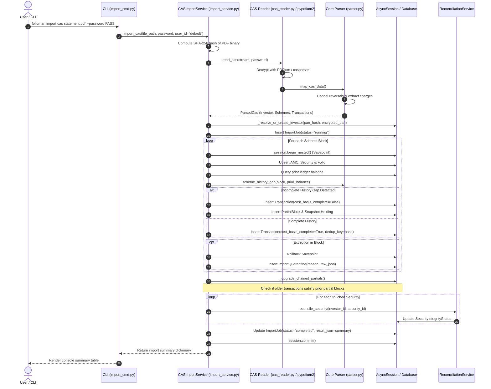

# Execution Flow: Statement Ingestion (`import cas`)

This specification traces the end-to-end execution path when a user imports a CAMS, KFintech, or NSDL/CDSL eCAS statement into `folioman-client`.

---

## 1. Flow Overview & Sequence Diagram

---

## 2. Step-by-Step Technical Walkthrough

### Step 1: Binary Intake & Deduplication Hashing
- **Source**: `CASImportService.import_cas` in `services/import_service.py`.
- **Action**: Reads the PDF byte stream from disk or memory. Computes `sha256(content).hexdigest()`. This hash serves as the default `source_ref` for every transaction imported in this batch, establishing an immutable provenance link.

### Step 2: PDF Decryption & Extraction
- **Source**: `read_cas()` in `core/cas_reader.py`.
- **Action**: Attempts decryption with user password. If incorrect, raises `CASPasswordError` (mapped to `FoliomanPasswordError`).
- Uses `casparser` table parser with `pypdfium2` text stream fallback to produce structured intermediate data.

### Step 3: Domain Transformation & Reversal Cancellation
- **Source**: `map_cas_data()` in `core/parser.py`.
- **Action**:
  - `_cancel_reversals()`: Two-pass algorithm scans for transaction cancellations, bounced cheques, and failed SIPs within a 30-day window, dropping offsetting line pairs.
  - `_collect_per_index_charges()`: Parses stamp duty, STT, and transaction fees from transaction narrations and associates them with the parent transaction.

### Step 4: Investor Resolution
- **Source**: `_resolve_or_create_investor()` in `services/import_service.py`.
- **Action**:
  - Extracts PAN from statement metadata.
  - Normalizes PAN to uppercase and computes `pan_hash(pan)` (HMAC-SHA256).
  - Queries `SELECT * FROM investors WHERE user_id = :u AND pan_hash = :h`.
  - If existing, binds to this investor.
  - If not found, provisions a new `Investor` row with `pan_encrypted` (Fernet) and `pan_hash`.

### Step 5: Scheme Processing & Nested Savepoints
- **Action**: For each mutual fund scheme block or eCAS account:
  - Opens a transaction savepoint: `async with session.begin_nested():`.
  - Upserts `AMC`, `Security` (matching on AMFI code, ISIN, or ticker), and `Folio` (normalized number).
  - Queries the sum of prior transactions already recorded for this security/folio before the statement start date: `_prior_ledger_balance()`.
  - Evaluates `scheme_history_gap()`:
    - If `opening_units == 0` or `prior_balance == opening_units`: Transaction history is **complete** (`cost_basis_complete = True`).
    - If `opening_units > 0` and `prior_balance != opening_units`: Statement represents an **incomplete history gap**. Transactions are flagged `cost_basis_complete = False`, a `PartialBlock` record is stored, and an anchor `Holding` snapshot is created.
  - Computes `_dedup_key` for every line. Checks for duplicate key in `Transaction`. Skips existing lines; inserts new trades.
  - **Quarantine Handling**: If parsing a scheme block throws an exception, the savepoint rolls back only that block. The scheme is isolated into `ImportQuarantine`, and processing continues for subsequent schemes.

### Step 6: Chained Partial Upgrades (`_upgrade_chained_partials`)
- **Action**: When users import statements out of order (e.g., importing 2024 first, then later importing 2020–2023):
  - `_upgrade_chained_partials` queries all pending `PartialBlock` rows for the investor.
  - Checks if newly inserted transactions bridge the opening unit deficit.
  - If satisfied, executes bulk SQL `UPDATE transactions SET cost_basis_complete = True`, deletes the temporary `Holding` snapshot, and deletes the `PartialBlock`.

### Step 7: Auto-Reconciliation & Job Finalization
- **Action**:
  - Triggers `reconcile_security()` on all touched securities to update `SecurityIntegrityStatus`.
  - Updates `ImportJob`: `status = "completed"` (or `"partially_reconciled"` if items were quarantined).
  - Commits database transaction.
