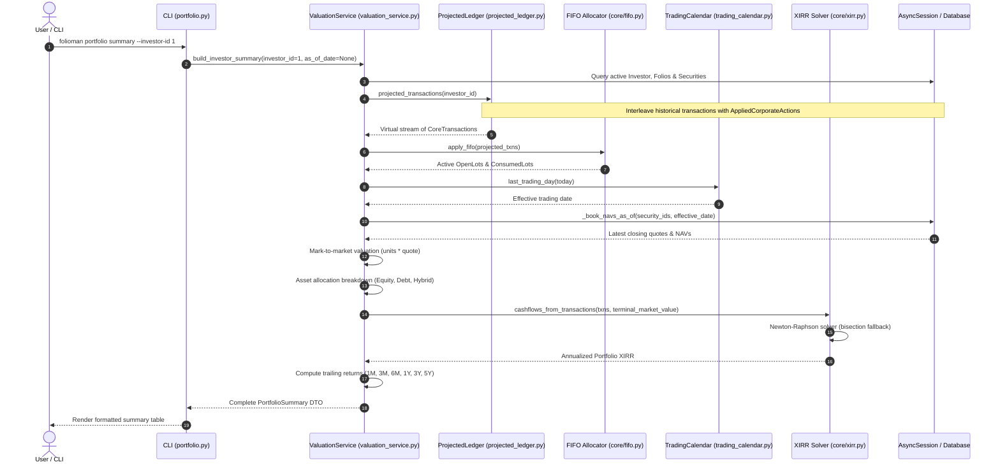

# Execution Flow: Portfolio Valuation & XIRR (`build_investor_summary`)

This specification traces the execution path for calculating current portfolio valuations, asset allocations, XIRR returns, and historical daily time series.

---

## 1. Flow Overview & Sequence Diagram

---

## 2. Step-by-Step Technical Walkthrough

### Step 1: Active Position Resolution
- **Source**: `ValuationService._current_positions()` in `services/valuation_service.py`.
- **Action**:
  - Queries all `Transaction` rows for the investor.
  - Queries all snapshot `Holding` records.
  - Replays corporate actions on-the-fly via `ProjectedLedger.projected_transactions()`. This multiplies units for prior splits and adds synthetic bonus shares without touching the database.
  - Passes projected transactions to `apply_fifo()` to identify all securities with active `OpenLot` quantities ($units > 0$).

### Step 2: Quote Resolution with Trading Calendar Fallback
- **Source**: `ValuationService._book_navs_as_of()` in `services/valuation_service.py`.
- **Action**:
  - Identifies the target date (defaults to `date.today()`).
  - Calls `core/trading_calendar.py:last_trading_day()` to ensure non-trading days (weekends, public exchange holidays) step back to the latest active market session.
  - Queries `NAVHistory` for the latest quote on or before the effective date for each active security.
  - If a quote is older than `_NAV_STALE_GRACE_TRADING_DAYS` (1 day), increments the `stale_quotes_count` indicator.

### Step 3: Mark-to-Market Valuation & Gain Calculation
- **Action**: For each active position:
  - $\text{Invested Capital} = \sum \text{lot.cost\_total}$
  - $\text{Current Value} = \text{held\_units} \times \text{latest\_quote}$
  - $\text{Unrealized Gain} = \text{Current Value} - \text{Invested Capital}$
  - $\text{Absolute Return \%} = (\text{Unrealized Gain} / \text{Invested Capital}) \times 100$
  - Classifies asset category: maps mutual funds via `metadata_json.equity_oriented` and equities via `security_type` to `Equity`, `Debt`, `Hybrid`, or `Commodity`.

### Step 4: Cashflow Extraction & XIRR Calculation
- **Source**: `core/xirr.py:cashflows_from_transactions()` and `compute_xirr()`.
- **Action**:
  - Transforms all chronological `BUY`, `SELL`, and dividend events into net cashflow tuples $(d_i, C_i)$:
    - Purchase amounts and transfer-in values: Negative cash outflows.
    - Redemption proceeds and dividends: Positive cash inflows.
  - Appends the total portfolio market value as a final positive cash inflow as of the valuation date: $+ \text{Total Market Value}$.
  - Invokes `compute_xirr()`:
    - Runs Newton-Raphson iteration using analytical first derivatives.
    - Falls back to bounded bisection search $[-0.9999, 10.0]$ if iterations exceed 100 or derivative approaches zero.
    - Emits annualized money-weighted return (e.g., `0.1452` = 14.52%).

### Step 5: Trailing Performance Returns
- **Action**: Evaluates rolling performance across historical horizons: `1M`, `3M`, `6M`, `1Y`, `3Y`, `5Y`.
  - Queries historical portfolio value from `InvestorValue` as of $T - \Delta t$.
  - For horizons $< 1\text{Y}$: computes simple percentage gain.
  - For horizons $\ge 1\text{Y}$: computes Compound Annual Growth Rate (CAGR):

    $$\text{CAGR} = \left(\frac{V_{\text{now}}}{V_{\text{past}}}\right)^{\frac{1}{\text{years}}} - 1$$

### Step 6: Daily Time-Series Roll-Forward (`recompute_investor_valuation`)
- When requested via `folioman valuations recompute` or background scheduler:
  - Iterates day-by-day from the earliest recorded transaction date up to today.
  - Reconstructs end-of-day holdings and applies closing NAVs for every date.
  - Bulk upserts records into `InvestorValue` in batches of 100 days.
