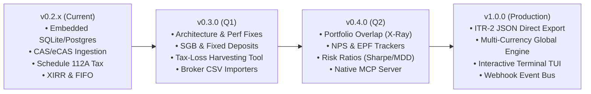

# Future Enhancements & Feature Roadmap for folioman-client

This document outlines proposed future enhancements, architectural upgrades, and new feature specifications for `folioman-client`. These proposals expand the library from a mutual fund & equity portfolio engine into a comprehensive, privacy-first Indian wealth management and financial intelligence platform.

---

## Roadmap Overview



---

## 1. New Asset Classes & Statement Ingestion

### 1.1 Sovereign Gold Bonds (SGB) & Physical Gold Engine
- **Motivation:** Sovereign Gold Bonds are a cornerstone of Indian investment portfolios. They carry unique mechanics: semi-annual 2.5% interest payouts, 8-year RBI redemption with **100% tax-free capital gains** under Section 47(vii), and secondary market trading on NSE/BSE with LTCG rules.
- **Specification:**
  - Track tranche issuance price, issue date, and scheduled maturity date.
  - Automatically calculate semi-annual interest cashflows and flag them as taxable "Income from Other Sources".
  - Tax engine distinction: 0% tax if held until RBI maturity vs. Section 112 indexation/flat tax if sold on secondary exchange.
- **Target Interface:**
  ```python
  sgb = await client.fixed_income.add_sgb(
      tranche="2016-17 Series I",
      units=50,
      issue_price=Decimal("3119.00"),
      issue_date=date(2016, 9, 30),
      investor_id=1,
  )
  interest_schedule = await client.fixed_income.get_cashflows(investor_id=1)
  ```

### 1.2 Direct Broker Tradebook & Contract Note Ingestion
- **Motivation:** Users often trade weekly or monthly on Zerodha, Groww, Angel One, or Upstox, but CAS statements are only published monthly. Direct ingestion enables real-time trade updates.
- **Specification:**
  - Zero-dependency CSV parsers for:
    - **Zerodha**: Console Tradebook CSV & Holdings CSV.
    - **Groww**: Order history & stock reports.
    - **Upstox / Angel One**: Trade ledger exports.
  - PDF Contract Note parser with password decryption and automated STT/Brokerage/GST expense breakdown under Section 48.

### 1.3 National Pension System (NPS) Tier-I & Tier-II Ingestion
- **Motivation:** NPS statements from Protean (NSDL CRA) and KFintech contain daily NAVs across Pension Fund Managers (HDFC, SBI, ICICI) and asset classes (Equity 'E', Corporate Bonds 'C', Government Securities 'G', Alternative 'A').
- **Specification:**
  - Parse CRA statement PDFs and extract PRAN, scheme units, and tier classifications.
  - Fetch official daily NPS NAVs published by the NPS Trust.
  - Calculate Section 80CCD(1) and 80CCD(1B) tax deduction summaries.

### 1.4 EPF & PPF (Employee & Public Provident Fund) Passbook Ingestion
- **Motivation:** EPF represents a huge portion of Indian salaried net worth. Budget 2021 introduced taxable interest on annual employee contributions exceeding ₹2,50,000.
- **Specification:**
  - Parse EPFO UAN passbook PDFs.
  - Segregate taxable vs. non-taxable provident fund contribution buckets.
  - Track annual compounding interest accruals.

---

## 2. Advanced Financial Analytics & Portfolio Intelligence

### 2.1 Portfolio Overlap & Underlying Stock X-Ray
- **Problem:** An investor holding 4 diversified mutual funds often unknowingly holds massive duplicate exposure to large-cap stocks (e.g., 25% of their total wealth in HDFC Bank and Reliance Industries).
- **Proposed Solution:**
  - Download and cache monthly AMC portfolio disclosure sheets (mandated by SEBI).
  - Compute stock-level exposure across all funds:
    $$\text{Effective Weight of Stock } S = \sum_{F \in \text{Funds}} (\text{Weight of } S \text{ in Fund } F) \times (\text{Value of Fund } F) / \text{Total Portfolio Value}$$
  - Calculate pairwise fund overlap percentage:
    $$\text{Overlap}(A, B) = \sum_{i} \min(w_{A,i}, w_{B,i})$$
- **Target Interface:**
  ```python
  overlap = await client.analytics.fund_overlap(
      isin_a="INF174K01LS2", isin_b="INF209K01165"
  )
  print(
      f"Overlap: {overlap.common_percentage:.1f}% across {len(overlap.common_stocks)} stocks"
  )

  xray = await client.analytics.portfolio_xray(investor_id=1)
  for stock in xray.top_underlying_stocks[:10]:
      print(
          f"{stock.name}: {stock.weight_pct:.2f}% of total portfolio (₹{stock.value_inr:,.2f})"
      )
  ```

### 2.2 Risk-Adjusted Performance Metrics (Sharpe, Sortino, Drawdown)
- **Proposed Feature:** Calculate standard institutional risk statistics:
  - **Sharpe Ratio:** Risk-free rate adjusted excess return against RBI 91-day T-Bill rate.
  - **Sortino Ratio:** Penalizes only downside volatility.
  - **Maximum Drawdown (MDD):** Peak-to-trough historical portfolio decline.
  - **Rolling CAGR:** 1-year, 3-year, and 5-year rolling returns to eliminate point-to-point endpoint bias.

### 2.3 Automated Goal Tagging & Retirement Monte Carlo Simulation
- **Proposed Feature:**
  - Assign folios or specific holdings to financial goals (e.g., "Retirement 2045", "Emergency Fund", "Kids College 2036").
  - Run Monte Carlo simulations (10,000 iterations) with historical Indian equity & debt return distributions and inflation models (e.g., 6% CPI) to calculate success probability for each goal.

---

## 3. Tax Optimization & Compliance Automation

### 3.1 Year-End Tax-Loss & LTCG Exemption Harvesting Simulator
- **Proposed Feature:**
  - Automated recommendations before March 31:
    - **LTCG Exemption Utilization:** Pinpoint equity holdings to redeem and immediately re-buy to capture the full ₹1.25 Lakh annual 0% tax threshold under Section 112A without altering asset allocation.
    - **Tax-Loss Harvesting:** Identify underwater short-term or long-term lots that can be sold to offset realized capital gains before financial year close.
- **Target Interface:**
  ```python
  plan = await client.tax.harvesting_plan(investor_id=1, fy="2024-25")
  print(f"Remaining 112A Exemption: ₹{plan.unutilized_exemption:,.2f}")
  for action in plan.recommended_actions:
      print(
          f"[{action.type}] Sell {action.units} of {action.security_name} (Saves ₹{action.tax_saved_inr:,.2f} tax)"
      )
  ```

### 3.2 Quarterly Advance Tax Schedule Estimator (Section 208 / 211)
- **Problem:** Investors realizing large capital gains often incur interest penalties under Section 234B and 234C because they fail to pay quarterly advance tax installments.
- **Proposed Feature:**
  - Track realized capital gains by calendar quarter:
    - Q1: Up to June 15 (15% cumulative)
    - Q2: Up to September 15 (45% cumulative)
    - Q3: Up to December 15 (75% cumulative)
    - Q4: Up to March 15 (100% cumulative)
  - Estimate exact rupee advance tax payment requirements per quarter to avoid Section 234C interest penalties.

### 3.3 Direct ITR-2 / ITR-3 Income Tax Portal JSON Export
- **Problem:** CAs and taxpayers spend hours manually keying capital gains numbers and ISINs into the Indian Income Tax e-filing portal.
- **Proposed Feature:** Generate the official `.json` schema file matching the CBDT e-filing portal specifications for Schedule 112A, Schedule CG, and Schedule OS, allowing 1-click import into the tax portal.

---

## 4. Architectural & Performance Enhancements (From Audit Findings)

As identified in [`docs/CODEBASE_AUDIT.md`](file:///d:/GitHub_Clones/folioman-client/docs/CODEBASE_AUDIT.md), the following architectural refactorings should be implemented:

| Issue ID | Enhancement | Priority | Description |
| :--- | :--- | :---: | :--- |
| **`ARCH-001`** | **Client Decoupling Protocol** | High | Split `FoliomanClient` into `EmbeddedFoliomanClient` and `RemoteFoliomanClient` implementing a shared `PortfolioClientProtocol`. Eliminate dormant database services in remote mode. |
| **`PERF-004`** | **One-Time DDL Engine Lifecycle** | High | Remove `init_schema()` calls from 18 CRUD methods in `LedgerService` and `ValuationService`. Ensure schema initialization occurs once at startup. |
| **`PERF-001`** | **Batch Deduplication in Ingestion** | High | Replace row-by-row `SELECT` dedup queries in `ImportService` with batch `WHERE dedup_key IN (...)` queries to speed up CAS statement import from $O(N)$ to $O(1)$ round-trips. |
| **`REL-004`** | **Event-Driven Valuation Invalidation** | High | Connect `ImportService`, manual transactions, and corporate action replays to `ValuationService.queue_recompute()` so cached net worth history is never stale. |
| **`ARCH-003`** | **Exception Standardisation** | Medium | Replace remaining standard library `ValueError` raises in service classes with `FoliomanNotFoundError` and `FoliomanValidationError`. |
| **`COMP-001`** | **Modular Corporate Action Detectors** | Medium | Refactor `_detect_split_bonus_merger` into decoupled detection strategies for Splits, Bonuses, Mergers, and Demergers. |

---

## 5. Integration Ecosystem & Developer Tooling

### 5.1 Native Model Context Protocol (MCP) Server
- **Concept:** Provide a bundled MCP server (`folioman-mcp` or `folioman mcp serve`) allowing Claude Desktop, Cursor, Antigravity, and other AI agent environments to directly interact with your personal portfolio.
- **Supported Tools:**
  - `get_net_worth(investor_id)`
  - `list_holdings(investor_id)`
  - `calculate_capital_gains(investor_id, fy)`
  - `refresh_market_prices()`
  - `rebalance_portfolio(investor_id, targets)`
- **Example Usage in Chat:**
  > *"Hey Claude, analyze my portfolio and tell me if I have any rebalancing opportunities or upcoming tax-loss harvesting candidates."*

### 5.2 Interactive Terminal User Interface (TUI via `textual`)
- **Concept:** Launch `folioman tui` to open a full terminal dashboard with mouse support, searchable holdings tables, live stock ticker sparklines, and theme customization, running entirely in your terminal.

```
┌─ Folioman Portfolio Monitor ────────────────────────────────────────────────────────┐
│ Net Worth: ₹18,42,500.00  │  1D Change: +₹12,400.00 (+0.68%)  │  XIRR: 16.42%      │
├─────────────────────────────────────────────────────────────────────────────────────┤
│ Security Name                         Units        NAV/Price       Value      1D    │
│ Parag Parikh Flexi Cap Fund - Direct   1,240.50     ₹82.45      ₹1,02,280   +0.82%  │
│ UTI Nifty 50 Index Fund - Direct       3,120.10     ₹174.12     ₹5,43,272   +0.41%  │
│ Reliance Industries Ltd                   50.00   ₹2,840.00     ₹1,42,000   -0.34%  │
│ ...                                                                                 │
└─────────────────────────────────────────────────────────────────────────────────────┘
```

### 5.3 Webhook Notification Bus
- **Concept:** Lightweight publish-subscribe event bus that emits signed JSON webhooks on key lifecycle events:
  - `event: statement.imported`
  - `event: price_feed.updated`
  - `event: corporate_action.detected`
  - `event: valuation.threshold_reached`
- Enables effortless integration with Home Assistant, Telegram bots, n8n, Zapier, and custom web apps.

---

## 6. Implementation Phasing & Complexity Matrix

| Milestone | Feature | Estimated Effort | Impact | Target Release |
| :--- | :--- | :---: | :---: | :---: |
| **Phase 1** | One-time DDL & Batch Deduplication (`PERF-001`, `PERF-004`) | Small (1-2 days) | High | `v0.2.1` |
| **Phase 1** | Automated Valuation Invalidation (`REL-004`) | Small (1 day) | High | `v0.2.1` |
| **Phase 2** | SGB & Physical Gold Tracker | Medium (3-5 days) | High | `v0.3.0` |
| **Phase 2** | Tax-Loss Harvesting Simulator | Medium (3-4 days) | High | `v0.3.0` |
| **Phase 2** | Zerodha & Broker Tradebook CSV Importers | Medium (3-5 days) | High | `v0.3.0` |
| **Phase 3** | Portfolio Overlap & Underlying Stock X-Ray | Large (1-2 weeks) | Very High | `v0.4.0` |
| **Phase 3** | NPS & EPF Statement Parsers | Medium (1 week) | Medium | `v0.4.0` |
| **Phase 3** | Native MCP Server (`folioman mcp serve`) | Small (2-3 days) | High | `v0.4.0` |
| **Phase 4** | Direct ITR-2 JSON Exporter | Large (1-2 weeks) | Very High | `v1.0.0` |
| **Phase 4** | Interactive Terminal TUI (`folioman tui`) | Medium (1 week) | Medium | `v1.0.0` |

---

## Contributing to Future Enhancements

If you are an engineer or AI agent looking to implement one of these enhancements:
1. Review [`AGENTS.md`](file:///d:/GitHub_Clones/folioman-client/AGENTS.md) for architectural invariants (strict `Decimal`, PAN encryption, in-memory testing).
2. Check existing tests in `tests/` to follow established async test fixtures.
3. Open an issue or discussion on GitHub referencing the feature section in this document.
