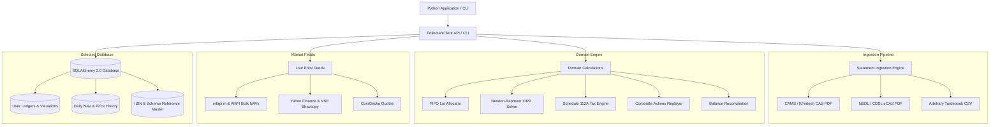

# Folioman Client

[](https://pypi.org/project/folioman-client/)
[](https://pypi.org/project/folioman-client/)
[](https://opensource.org/licenses/MIT)

An embedded, typed Python portfolio engine and CLI for Indian mutual funds and equities.

The `folioman-client` library provides a high-performance, asynchronous financial engine that can be embedded directly into wealth management backends, financial analysis scripts, notebooks, or desktop applications. It also ships with a command-line interface (`folioman`) for statement ingestion and portfolio maintenance.

!!! note "Self-Contained & Embedded"
Starting with **v0.2.0**, `folioman-client` is completely serverless. It does not require a running external Folioman web server, Docker daemon, or Django setup. It uses an embedded SQLite database by default, with pluggable support for PostgreSQL and MySQL.

---

## Architectural Overview



---

## Key Features

- **Embedded Pluggable Storage**: Zero-configuration SQLite out of the box with automatic WAL mode and concurrency locks. Seamlessly connect to PostgreSQL or MySQL using standard connection URLs (`postgresql+psycopg://...`).
- **Unified Single-Database Architecture**: User portfolios, transaction ledgers, historical NAV points, and the 100,000-row national ISIN reference dictionary are stored entirely within the configured database.
- **Statement Ingestion**: Ingest CAMS/KFintech mutual fund statements and NSDL/CDSL eCAS demat statements directly, with idempotent SHA-256 deduplication and automatic partial-block convergence.
- **Real-Time & Historical Feeds**: Multi-source quote fetching across `mfapi.in`, AMFI bulk text dumps, Yahoo Finance, and NSE Bhavcopy archives with automated historical gap filling.
- **Accurate Financial Math**: First-In-First-Out (FIFO) lot accounting, Section 48 brokerage inclusions, and high-precision Newton-Raphson / bisection XIRR root-finding.
- **Indian Capital Gains Tax (Schedule 112A)**: Full LTCG/STCG reporting, Section 112A grandfathering (31-Jan-2018 FMV lookup), and Budget 2024 regime cutoffs (23-Jul-2024).
- **Non-Destructive Corporate Actions**: Dynamic event replay of stock splits, bonuses, mergers, and demergers on read without corrupting original tradebook contract notes.
- **Full CLI Suite**: Terminal command suite (`folioman`) for statement imports, reference database updates, NAV refreshes, and valuations.

---

## Installation

Install using standard Python package managers:

=== "pip"

    ```bash
    pip install folioman-client
    ```

=== "uv"

    ```bash
    uv add folioman-client
    ```

=== "poetry"

    ```bash
    poetry add folioman-client
    ```

### Optional PostgreSQL Support

To connect to a PostgreSQL database:

```bash
pip install "folioman-client[postgres]"
```

---

## Minimal Example

```python
import asyncio
from folioman_client import FoliomanClient


async def main() -> None:
    # Zero-setup: defaults to local SQLite; or pass PostgreSQL URL
    async with FoliomanClient() as client:
        # Ingest statement
        job = await client.imports.cas_pdf(
            "cas_statement.pdf", password="MY_PAN_NUMBER"
        )
        print(f"Imported {job.get('transactions_created', 0)} transactions.")

        # Sync latest NAVs & prices
        await client.navs.refresh()

        # Query portfolio summary
        summary = await client.portfolio.get(investor_id=1)
        print(f"Total Value: INR {summary.total_inr:,.2f}")
        print(f"XIRR: {summary.xirr * 100:.2f}%" if summary.xirr else "XIRR: N/A")

        # Inspect priced holdings
        holdings = await client.holdings.list(investor_id=1)
        for h in holdings:
            val_str = (
                f"INR {h.value_inr:,.2f}" if h.value_inr is not None else "Unpriced"
            )
            print(f"- {h.name}: {h.units} units | Value: {val_str}")


if __name__ == "__main__":
    asyncio.run(main())
```

---

## Attribution & Acknowledgements

`folioman-client` is an independent Python library implementation under the **MIT License**. It is inspired by the architectural concepts, data schemas, and calculation rules of the open-source project **[Folioman](https://github.com/codereverser/folioman)** by `codereverser`. We gratefully acknowledge the Folioman project and its contributors.
