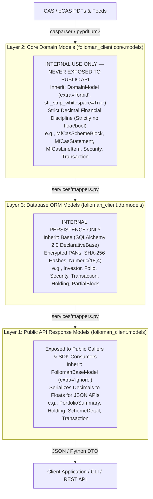
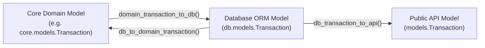

# Data Models Architecture & Schema Reference

In `folioman-client`, models are strictly partitioned into **three distinct architectural layers**. This separation of concerns guarantees clean serialization boundaries, framework independence, database schema encapsulation, and bulletproof financial precision.

---

## 1. The Three Model Layers Architecture



### Summary Comparison Table

| Feature / Attribute | Layer 1: Public API Models | Layer 2: Core Domain Models | Layer 3: Database ORM Models |
| :--- | :--- | :--- | :--- |
| **Python Module** | `folioman_client.models` | `folioman_client.core.models` | `folioman_client.db.models` |
| **Base Class** | `FoliomanBaseModel` (`pydantic.BaseModel`) | `DomainModel` (`pydantic.BaseModel`) | `Base` (`DeclarativeBase`) |
| **Public Visibility** | **Public** (Returned by `FoliomanClient` & CLI) | **Internal Only** (Forbidden from public API) | **Internal Only** (Persistence engine only) |
| **Validation Policy** | `extra="ignore"`, `from_attributes=True` | `extra="forbid"`, `str_strip_whitespace=True` | Database Schema & SQL Constraints |
| **Numeric Representation** | `ConfiguredDecimal` (Python `Decimal` $\to$ JSON `float`) | `DecimalField` (Rejects `float` and `bool`) | `Numeric(18, 4)` |
| **PAN & Secret Handling** | Masked only (e.g. `"XXXXXX1234F"`) | Raw during resolution; masked on statement | Encrypted (`LargeBinary`) + Hash (`pan_hash`) |
| **Primary Responsibility** | Client serialization, backwards compatibility | Parsing, math, FIFO lots, XIRR, gap analysis | SQL persistence, indexing, foreign keys, transactions |

---

## 2. Custom Serialization Types (`folioman_client.types`)

In portfolio accounting and tax computations, standard floating-point numbers (`0.1 + 0.2 = 0.30000000000000004`) introduce precision errors that can invalidate unit reconciliation or tax calculations. 

To bridge internal exact arithmetic with external JSON consumers, `folioman-client` provides annotated types in `folioman_client.types`:

```python
from folioman_client.types import (
    ConfiguredDecimal,
    ConfiguredDate,
    ConfiguredDatetime,
)
```

| Type Alias | Python Runtime Type | JSON Output | Description |
| :--- | :--- | :--- | :--- |
| `ConfiguredDecimal` | `decimal.Decimal` | `float` (or `None`) | Preserves exact fixed-point arithmetic in Python calculations while serializing cleanly to standard JSON floats for UI charts or APIs. |
| `ConfiguredDate` | `datetime.date` | `str` (`YYYY-MM-DD`) | Strictly validates calendar dates and serializes to ISO-8601 date strings. |
| `ConfiguredDatetime` | `datetime.datetime` | `str` (ISO-8601) | Represents exact UTC timestamps and serializes to standard ISO-8601 strings. |

---

## 3. Layer 1: Public API Response Models (`folioman_client.models`)

These models represent the public data transfer objects (DTOs) returned by `FoliomanClient` resources, services, and CLI commands. All models inherit from `FoliomanBaseModel`, configured with `extra="ignore"`, `populate_by_name=True`, and dictionary-like subscription (`model["key"]`).

### 3.1 Authentication Models

#### `TokenPair`
Returned when authenticating against a remote Folioman server.

| Field | Type | Required | Description |
| :--- | :--- | :--- | :--- |
| `access` | `str` | Yes | Short-lived JWT bearer token used for authorized requests. |
| `refresh` | `str` | Yes | Long-lived refresh token used to obtain renewed access tokens. |

#### `AccessToken`
Returned when refreshing an access token.

| Field | Type | Required | Description |
| :--- | :--- | :--- | :--- |
| `access` | `str` | Yes | Newly minted short-lived JWT bearer token. |

---

### 3.2 Investor & Folio Models

#### `Investor`
Summary representation of an individual investor or HUF entity.

| Field | Type | Required | Default | Description |
| :--- | :--- | :--- | :--- | :--- |
| `id` | `int` | Yes | — | Unique numeric investor ID. |
| `name` | `str` | Yes | — | Full legal or display name of the investor. |
| `email` | `str` | No | `""` | Contact email address. |
| `is_huf` | `bool` | No | `False` | True if the account is a Hindu Undivided Family. |
| `relation` | `str` | No | `""` | Relationship label if grouped into a family account (e.g. `Primary`, `Spouse`). |
| `family_id` | `int \| None` | No | `None` | Associated family group ID, if affiliated. |
| `has_pan` | `bool` | No | `False` | True if an encrypted PAN is stored for this investor. |
| `pan_locked` | `bool` | No | `False` | True if PAN modifications are locked for compliance. |
| `created_at` | `ConfiguredDatetime \| None` | No | `None` | Timestamp when investor record was created. |
| `updated_at` | `ConfiguredDatetime \| None` | No | `None` | Timestamp when investor record was last updated. |

#### `InvestorDetail`
Inherits all attributes from `Investor`, adding:

| Field | Type | Required | Default | Description |
| :--- | :--- | :--- | :--- | :--- |
| `pan_masked` | `str` | No | `""` | Masked PAN string (e.g., `ABCDE****F`) protecting personal information. |

#### `Folio`
Public representation of an account holding mutual fund units or demat shares.

| Field | Type | Required | Default | Description |
| :--- | :--- | :--- | :--- | :--- |
| `id` | `int` | Yes | — | Unique numeric folio ID. |
| `investor_id` | `int` | Yes | — | Owning investor ID. |
| `folio_number` | `str` | Yes | — | Account/folio number. |
| `folio_type` | `str` | Yes | — | Folio type: `'mf'` (Mutual Fund) or `'demat'` (Demat account). |
| `amc_code` | `str` | No | `""` | AMC short identifier code. |
| `broker` | `str` | No | `""` | Broker or DP name (mandatory for demat folios). |
| `pan_kyc` | `bool` | No | `False` | True if KYC verified via PAN. |
| `created_at` | `ConfiguredDatetime \| None` | No | `None` | Record creation timestamp. |

#### `FolioMergeResult`
Output when merging duplicate folio numbers under an investor.

| Field | Type | Required | Description |
| :--- | :--- | :--- | :--- |
| `target_folio_id` | `int` | Yes | Primary surviving folio ID. |
| `source_folio_ids` | `list[int]` | Yes | List of merged and deleted folio IDs. |
| `transactions_reassigned` | `int` | Yes | Number of transaction records repointed to the target folio. |
| `holdings_reassigned` | `int` | Yes | Number of holding records repointed to the target folio. |

---

### 3.3 Portfolio & Allocation Models

#### `PortfolioSummary`
Comprehensive portfolio valuation summary and health report for an investor.

| Field | Type | Required | Default | Description |
| :--- | :--- | :--- | :--- | :--- |
| `investor_id` | `int` | Yes | — | Investor ID. |
| `as_of` | `ConfiguredDate` | Yes | — | Valuation date. |
| `total_inr` | `ConfiguredDecimal` | Yes | — | Aggregate market value across all active holdings in INR. |
| `is_provisional` | `bool` | No | `False` | True if NAVs or prices are still updating for the day. |
| `navs_as_of` | `ConfiguredDate \| None` | No | `None` | Effective date of the latest NAV quotes used. |
| `navs_stale` | `bool` | No | `False` | True if quotes are older than the previous trading session. |
| `holdings_count` | `int` | No | `0` | Total count of active holdings. |
| `integrity_unit_count` | `int` | No | `0` | Count of holdings with verified balance checks. |
| `tax_ready_count` | `int` | No | `0` | Count of holdings where all trade lots are reconciled and tax-safe. |
| `needs_attention_count` | `int` | No | `0` | Holdings requiring user attention (e.g. unit mismatches). |
| `snapshot_count` | `int` | No | `0` | Number of historical statement snapshots on file. |
| `stale_count` | `int` | No | `0` | Number of unpriced or stale holdings. |
| `unpriced_fund_count` | `int` | No | `0` | Number of mutual funds lacking a current NAV quote. |
| `last_import_at` | `ConfiguredDatetime \| None` | No | `None` | Timestamp of the most recent statement import. |
| `day_change_inr` | `ConfiguredDecimal \| None` | No | `None` | Monetary change in portfolio value compared to previous business day. |
| `day_change_pct` | `float \| None` | No | `None` | Percentage change in portfolio value compared to previous business day. |
| `invested_inr` | `ConfiguredDecimal \| None` | No | `None` | Cumulative cost basis (invested capital) in INR. |
| `returns_inr` | `ConfiguredDecimal \| None` | No | `None` | Net unrealized profit/loss in INR (`total_inr - invested_inr`). |
| `return_pct` | `float \| None` | No | `None` | Absolute return percentage. |
| `xirr` | `float \| None` | No | `None` | Overall money-weighted annualized return (e.g. `0.142` for 14.2%). |
| `period_returns` | `list[PeriodReturn]` | No | `[]` | Trailing window performance metrics (1M, 3M, 1Y, 3Y, ALL). |
| `asset_mix` | `list[AssetMixRow]` | No | `[]` | Asset class breakdown (Equity, Debt, Cash, etc.). |
| `amc_mix` | `list[AllocationBucket]` | No | `[]` | Distribution breakdown by Asset Management Company. |
| `category_mix` | `list[AllocationBucket]` | No | `[]` | Distribution breakdown by SEBI mutual fund category. |
| `top_holdings` | `list[Holding]` | No | `[]` | Top holdings sorted by market valuation. |
| `holdings` | `list[Holding]` | No | `[]` | Complete list of priced holdings. |

#### `AssetMixRow`
| Field | Type | Required | Description |
| :--- | :--- | :--- | :--- |
| `security_type` | `str` | Yes | Asset class label (e.g., `'MF'`, `'EQUITY'`, `'GOLD'`, `'CASH'`). |
| `value_inr` | `ConfiguredDecimal` | Yes | Monetary valuation in INR allocated to this class. |

#### `AllocationBucket`
| Field | Type | Required | Description |
| :--- | :--- | :--- | :--- |
| `label` | `str` | Yes | Name of the bucket (e.g. `"HDFC AMC"` or `"Flexi Cap Fund"`). |
| `value_inr` | `ConfiguredDecimal` | Yes | Monetary valuation in INR allocated to this bucket. |

#### `PeriodReturn`
| Field | Type | Required | Description |
| :--- | :--- | :--- | :--- |
| `period` | `str` | Yes | Trailing evaluation window (e.g. `'1M'`, `'3M'`, `'6M'`, `'1Y'`, `'3Y'`, `'ALL'`). |
| `annualized` | `float` | Yes | Annualized money-weighted rate of return (XIRR). |
| `absolute` | `float \| None` | No | Absolute percentage change over the evaluation window. |
| `days` | `int` | Yes | Calendar days included in the evaluation window. |

---

### 3.4 Holding & Security Models

#### `Holding`
Priced position row under an investor.

| Field | Type | Required | Default | Description |
| :--- | :--- | :--- | :--- | :--- |
| `security_id` | `int` | Yes | — | Identifier of the security/scheme. |
| `name` | `str` | Yes | — | Full scheme or company name. |
| `security_type` | `str` | Yes | — | Asset type (e.g. `'MF'`, `'EQUITY'`, `'ETF'`). |
| `symbol` | `str` | No | `""` | NSE/BSE trading ticker symbol. |
| `amc` | `str` | No | `""` | Asset Management Company name. |
| `category` | `str` | No | `""` | SEBI investment category. |
| `units` | `ConfiguredDecimal` | Yes | — | Quantity of units held. |
| `value_inr` | `ConfiguredDecimal \| None` | No | `None` | Current market value in INR. |
| `invested_inr` | `ConfiguredDecimal \| None` | No | `None` | Cumulative cost basis (invested capital) in INR. |
| `latest_nav` | `ConfiguredDecimal \| None` | No | `None` | Latest recorded Net Asset Value or share price. |
| `return_pct` | `float \| None` | No | `None` | Absolute return percentage (`(value - cost) / cost`). |
| `xirr` | `float \| None` | No | `None` | Annualized money-weighted rate of return for this holding. |
| `day_change_inr` | `ConfiguredDecimal \| None` | No | `None` | Monetary change in valuation since previous trading day. |
| `day_change_pct` | `float \| None` | No | `None` | Percentage change since previous trading day. |

#### `SchemeRef`
Metadata identifying a mutual fund scheme or traded equity.

| Field | Type | Required | Default | Description |
| :--- | :--- | :--- | :--- | :--- |
| `id` | `int` | Yes | — | Security ID. |
| `name` | `str` | Yes | — | Full scheme or company name. |
| `isin` | `str` | No | `""` | 12-character ISIN code. |
| `symbol` | `str` | No | `""` | Exchange ticker symbol. |
| `security_type` | `str` | No | `""` | Asset type classification. |
| `amfi_code` | `str` | No | `""` | 6-digit AMFI code. |
| `amc` | `str \| None` | No | `None` | Asset Management Company name. |
| `category` | `str \| None` | No | `None` | SEBI category classification. |

#### `NavPoint`
Single historical pricing point.

| Field | Type | Required | Description |
| :--- | :--- | :--- | :--- |
| `date` | `ConfiguredDate` | Yes | Valuation date. |
| `nav` | `ConfiguredDecimal` | Yes | Net Asset Value or closing price per unit. |

#### `FolioBalance`
Unit breakdown in an individual folio account holding a security.

| Field | Type | Required | Default | Description |
| :--- | :--- | :--- | :--- | :--- |
| `number` | `str` | Yes | — | Folio or demat account number. |
| `broker` | `str` | No | `""` | Broker name or distributor ARN code. |
| `folio_type` | `str` | No | `""` | Folio type (e.g. `'regular'`, `'direct'`, `'demat'`). |
| `units` | `ConfiguredDecimal` | Yes | — | Unit balance held in this folio. |
| `value_inr` | `ConfiguredDecimal \| None` | No | `None` | Monetary valuation in INR for this folio. |

#### `SchemeDetail`
Deep inspection report for a specific holding, including historical NAV curve, folio breakdown, and transaction ledger.

| Field | Type | Required | Default | Description |
| :--- | :--- | :--- | :--- | :--- |
| `security` | `SchemeRef` | Yes | — | Security identity metadata. |
| `as_of` | `ConfiguredDate` | Yes | — | Valuation calculation date. |
| `units` | `ConfiguredDecimal` | Yes | — | Total units held across all folios. |
| `value_inr` | `ConfiguredDecimal \| None` | No | `None` | Total market valuation in INR. |
| `invested_inr` | `ConfiguredDecimal \| None` | No | `None` | Cumulative cost basis in INR. |
| `return_pct` | `float \| None` | No | `None` | Absolute return percentage. |
| `xirr` | `float \| None` | No | `None` | Annualized money-weighted rate of return. |
| `xirr_status` | `str` | No | `""` | Status indicator for XIRR calculation convergence. |
| `day_change_inr` | `ConfiguredDecimal \| None` | No | `None` | Valuation change compared to previous trading day. |
| `day_change_pct` | `float \| None` | No | `None` | Percentage change compared to previous trading day. |
| `latest_nav` | `ConfiguredDecimal \| None` | No | `None` | Most recent recorded Net Asset Value. |
| `latest_nav_date` | `ConfiguredDate \| None` | No | `None` | Date of the latest recorded NAV. |
| `has_transactions` | `bool` | No | `False` | True if transaction records exist for this scheme. |
| `partial_history` | `bool` | No | `False` | True if statement history starts with non-zero opening balance. |
| `partial_history_from`| `ConfiguredDate \| None` | No | `None` | Starting date of available history if partial. |
| `folios` | `list[FolioBalance]` | No | `[]` | Unit breakdown across individual folios. |
| `nav_history` | `list[NavPoint]` | No | `[]` | Historical NAV series for performance charting. |
| `transactions` | `list[Transaction]` | No | `[]` | Chronological transaction ledger for this scheme. |

---

### 3.5 Transactions & Ledger Models

#### `Transaction`
Immutable ledger record of an executed financial event.

| Field | Type | Required | Default | Description |
| :--- | :--- | :--- | :--- | :--- |
| `id` | `int` | Yes | — | Unique numeric ledger transaction ID. |
| `investor_id` | `int` | Yes | — | ID of the investor who owns the transaction. |
| `security_id` | `int` | Yes | — | ID of the traded security. |
| `folio_id` | `int \| None` | No | `None` | ID of the folio account if linked. |
| `date` | `ConfiguredDate` | Yes | — | Effective trade execution date. |
| `transaction_type` | `str` | Yes | — | Action type (`PURCHASE`, `REDEMPTION`, `SIP`, `SWITCH_IN`, `SWITCH_OUT`, `BONUS`, `SPLIT`, `DIVIDEND_PAYOUT`). |
| `units` | `ConfiguredDecimal` | Yes | — | Quantity of units transacted. |
| `nav_or_price` | `ConfiguredDecimal` | Yes | — | Executed NAV or share price. |
| `amount` | `ConfiguredDecimal \| None` | No | `None` | Gross monetary amount in INR. |
| `fees` | `ConfiguredDecimal` | No | `0` | Transaction fees charged. |
| `stamp_duty` | `ConfiguredDecimal` | No | `0` | Government stamp duty paid. |
| `brokerage` | `ConfiguredDecimal` | No | `0` | Brokerage commission paid. |
| `currency` | `str` | No | `"INR"` | Currency ISO code. |
| `source` | `str` | No | `""` | Statement ingestion source (e.g. `'CAMS'`, `'KFintech'`, `'CDSL'`). |
| `narration` | `str` | No | `""` | Original transaction narration text from statement. |
| `cost_basis_complete` | `bool` | No | `True` | Flag indicating whether historical purchase price is known. |
| `via_security` | `str \| None` | No | `None` | Paired security identifier for switches or transfers. |
| `balance` | `ConfiguredDecimal \| None` | No | `None` | Cumulative running unit balance after this transaction. |

---

### 3.6 Valuations & Series Models

#### `ValueSeriesPoint`
Single date point in a historical net worth time series.

| Field | Type | Required | Default | Description |
| :--- | :--- | :--- | :--- | :--- |
| `date` | `ConfiguredDate` | Yes | — | Valuation date. |
| `value_inr` | `ConfiguredDecimal` | Yes | — | Total portfolio market value in INR on this date. |
| `invested_inr` | `ConfiguredDecimal` | Yes | — | Cumulative invested capital (cost basis) in INR on this date. |
| `stale` | `bool` | No | `False` | True if quotes for any held security were carried forward from prior days. |

#### `ValueSeries`
Historical net worth time series output.

| Field | Type | Required | Default | Description |
| :--- | :--- | :--- | :--- | :--- |
| `investor_id` | `int \| None` | No | `None` | Filtered investor ID. |
| `family_id` | `int \| None` | No | `None` | Filtered family ID. |
| `start` | `ConfiguredDate` | Yes | — | Series start date. |
| `end` | `ConfiguredDate` | Yes | — | Series end date. |
| `granularity` | `str` | Yes | — | Sampling frequency (`'daily'`, `'weekly'`, `'monthly'`). |
| `points` | `list[ValueSeriesPoint]` | No | `[]` | Chronological list of historical valuation points. |

#### `ValuationStatus`
Indicates current engine state and coverage of valuation calculations.

| Field | Type | Required | Default | Description |
| :--- | :--- | :--- | :--- | :--- |
| `investor_id` | `int \| None` | No | `None` | Associated investor ID. |
| `family_id` | `int \| None` | No | `None` | Associated family ID. |
| `status` | `str` | Yes | — | Valuation state (`'READY'`, `'PENDING'`, `'COMPUTING'`, `'STALE'`). |
| `computed_through` | `ConfiguredDate \| None` | No | `None` | Latest date up to which daily valuations have been computed. |
| `recompute_from` | `ConfiguredDate \| None` | No | `None` | Earliest date requiring recomputation due to backdated trades. |
| `is_provisional` | `bool` | No | `False` | True if today's pricing has not yet closed. |

---

### 3.7 Capital Gains & Tax Models

#### `CapitalGainRow`
Single realized disposal lot matched using First-In, First-Out (FIFO) accounting.

| Field | Type | Required | Default | Description |
| :--- | :--- | :--- | :--- | :--- |
| `security_id` | `int \| None` | No | `None` | ID of the disposed security. |
| `name` | `str` | Yes | — | Scheme or security name. |
| `isin` | `str` | No | `""` | 12-character ISIN code. |
| `units` | `ConfiguredDecimal` | Yes | — | Number of units redeemed or sold. |
| `sale_value` | `ConfiguredDecimal` | Yes | — | Realized gross sale proceeds in INR. |
| `cost` | `ConfiguredDecimal` | Yes | — | Deemed purchase cost in INR (reflecting Section 112A grandfathering if applicable). |
| `gain` | `ConfiguredDecimal` | Yes | — | Realized capital gain or loss in INR (`sale_value - cost`). |
| `term` | `str` | Yes | — | Tax classification: `'STCG'` (Short-Term) or `'LTCG'` (Long-Term). |
| `acquired_on` | `ConfiguredDate` | Yes | — | Date the original units were purchased. |
| `sold_on` | `ConfiguredDate` | Yes | — | Date the units were redeemed or sold. |
| `grandfathering_unavailable` | `bool` | No | `False` | True if the lot was acquired before 31-Jan-2018 but grandfathering NAV was missing. |

#### `CapitalGainsReport`
Comprehensive capital gains statement for an Indian Financial Year (1 April – 31 March).

| Field | Type | Required | Default | Description |
| :--- | :--- | :--- | :--- | :--- |
| `fy` | `str` | Yes | — | Financial year label (e.g. `'2024-25'`). |
| `stcg_total` | `ConfiguredDecimal` | Yes | — | Total realized Short-Term Capital Gains in INR. |
| `ltcg_total` | `ConfiguredDecimal` | Yes | — | Total realized Long-Term Capital Gains in INR. |
| `rows` | `list[CapitalGainRow]` | No | `[]` | Detailed lot-level breakdown of all redemptions in this FY. |
| `disclaimer` | `str` | No | `""` | Statutory disclaimer clarifying tax assumptions and advisory notices. |

#### `CapitalGainsFyPoint`
Summary point showing annual realized gains across historical financial years.

| Field | Type | Required | Description |
| :--- | :--- | :--- | :--- |
| `fy` | `str` | Yes | Financial year label (e.g. `'2023-24'`). |
| `stcg` | `ConfiguredDecimal` | Yes | Realized STCG in INR for the year. |
| `ltcg` | `ConfiguredDecimal` | Yes | Realized LTCG in INR for the year. |

#### `Schedule112AReport`
Statutory Income Tax Return (ITR-2 / ITR-3) Schedule 112A report model.

| Field | Type | Required | Default | Description |
| :--- | :--- | :--- | :--- | :--- |
| `financial_year` | `str` | Yes | — | Financial year string (e.g. `"2024-25"`). |
| `quarter` | `str \| None` | No | `None` | Advance tax quarter identifier (`"Q1"`, `"Q2"`, `"Q3"`, `"Q4"`). |
| `investor_id` | `int` | Yes | — | Investor identifier. |
| `rows` | `list[dict[str, Any]]` | No | `[]` | Complete Schedule 112A rows ready for CSV / JSON export. |
| `total_sale_value` | `ConfiguredDecimal` | Yes | `Decimal(0)` | Aggregate gross consideration received. |
| `total_cost` | `ConfiguredDecimal` | Yes | `Decimal(0)` | Aggregate cost of acquisition. |
| `total_gain` | `ConfiguredDecimal` | Yes | `Decimal(0)` | Net capital gain before exemptions. |

---

### 3.8 Statement Ingestion, NAV Feeds & Reconciliation Models

#### `CASImportResult`
Result metadata returned after importing a CAMS/KFintech or NSDL/CDSL statement.

| Field | Type | Required | Default | Description |
| :--- | :--- | :--- | :--- | :--- |
| `job_id` | `str` | Yes | — | Unique import job UUID string. |
| `status` | `str` | Yes | — | Import status (`"completed"`, `"failed"`, `"partial"`). |
| `investor_id` | `int \| None` | No | `None` | Investor ID to which statements were imported. |
| `transactions_created` | `int` | No | `0` | Number of new transactions written to the ledger. |
| `transactions_skipped` | `int` | No | `0` | Number of identical duplicate rows skipped. |
| `holdings_created` | `int` | No | `0` | Number of holding snapshots created. |
| `schemes_quarantined` | `int` | No | `0` | Count of corrupted scheme blocks isolated into quarantine. |
| `partial_blocks_created`| `int` | No | `0` | Number of schemes flagged with non-zero opening balance gaps. |
| `errors` | `list[str]` | No | `[]` | List of non-fatal warnings or error messages. |

#### `NavSyncResult` & `NavBackfillResult`
Outputs from market data synchronization runs.

| Model | Key Fields | Description |
| :--- | :--- | :--- |
| `NavSyncResult` | `as_of: ConfiguredDate`, `quotes_updated: int`, `failed_symbols: list[str]` | Summary of daily NAV refresh. |
| `NavBackfillResult` | `isin: str`, `points_inserted: int`, `from_date: ConfiguredDate`, `to_date: ConfiguredDate` | Historical price backfill metrics. |

#### `NavFreshnessReport` & `NavFreshnessItem`
Audit report checking whether quotes across the investor's portfolio are current.

| Model | Key Fields | Description |
| :--- | :--- | :--- |
| `NavFreshnessItem` | `isin: str`, `name: str`, `latest_date: ConfiguredDate \| None`, `is_stale: bool`, `calendar_gap_days: int` | Freshness check for an individual scheme. |
| `NavFreshnessReport` | `as_of: ConfiguredDate`, `total_securities: int`, `stale_count: int`, `items: list[NavFreshnessItem]` | Overall portfolio pricing currency report. |

#### `ISINReferenceStatus`, `ISINSeedResult` & `ISINUpdateResult`
Inspection and seeding metrics for the 100,000+ national master ISIN dictionary.

| Model | Key Fields | Description |
| :--- | :--- | :--- |
| `ISINReferenceStatus` | `total_records: int`, `last_updated_at: ConfiguredDatetime \| None`, `ready: bool` | Health status of the ISIN dictionary. |
| `ISINSeedResult` | `seeded: bool`, `total_rows: int`, `message: str` | Metrics after loading bundled AMFI/NSE master files. |
| `ISINUpdateResult` | `rows_added: int`, `rows_updated: int`, `timestamp: ConfiguredDatetime` | Delta update counts after syncing with upstream registries. |

#### `PositionIntegrity`, `ReconcileInvestorResult` & `ReconcileAllResult`
Audit results comparing transaction ledger balances against statement holding snapshots.

| Model | Key Fields | Description |
| :--- | :--- | :--- |
| `PositionIntegrity` | `security_id: int`, `status: str`, `ledger_units: ConfiguredDecimal`, `snapshot_units: ConfiguredDecimal`, `difference: ConfiguredDecimal` | Balance verification for a single position. Status: `MATCH`, `MISMATCH`, `INCOMPLETE_HISTORY`, `CA_EXPLAINED`, `MANUAL_OVERRIDE`. |
| `PositionAcknowledgment`| `security_id: int`, `acknowledged: bool`, `reason: str` | User acknowledgment suppressing mismatch warnings. |
| `ReconcileInvestorResult`| `investor_id: int`, `checked_count: int`, `match_count: int`, `mismatch_count: int`, `details: list[PositionIntegrity]` | Portfolio reconciliation summary for an investor. |
| `ReconcileAllResult` | `investors_checked: int`, `total_positions: int`, `total_mismatches: int` | System-wide reconciliation run across all investors. |

#### `SymbolResolveResult`
Stock ticker and exchange resolution for an equity ISIN.

| Field | Type | Required | Description |
| :--- | :--- | :--- | :--- |
| `isin` | `str` | Yes | 12-character ISIN. |
| `symbol` | `str` | Yes | Resolved exchange symbol (e.g. `"TCS"`). |
| `exchange` | `str` | Yes | Trading exchange (`"NSE"`, `"BSE"`). |
| `source` | `str` | Yes | Mapping provider (e.g. `"isin_master"`, `"bhavcopy"`). |

#### `CorporateActionReference`, `CorporateActionRefreshResult` & `CorporateActionApplyResult`
Corporate action discovery and replay tracking.

| Model | Key Fields | Description |
| :--- | :--- | :--- |
| `CorporateActionReference` | `id: int`, `symbol: str`, `action_type: str`, `ex_date: ConfiguredDate`, `ratio: str` | Scraped corporate action declaration. |
| `CorporateActionRefreshResult`| `actions_scraped: int`, `actions_saved: int`, `as_of: ConfiguredDate` | Exchange corporate action refresh counts. |
| `CorporateActionApplyResult` | `investor_id: int`, `actions_applied: int`, `transactions_projected: int` | Dynamic corporate action replay summary. |

---

## 4. Layer 2: Core Domain Models (`folioman_client.core.models`)

!!! warning "Internal Engine Use Only — Never Exposed via Public API"
    All models under `folioman_client.core.models` are framework-free domain structures designed strictly for **internal statement parsing, validation, First-In-First-Out (FIFO) lot matching, XIRR numerical solving, and Schedule 112A grandfathering computations**.

    They are **NOT** returned by public SDK methods or REST endpoints. They use strict configuration (`extra="forbid"`, `str_strip_whitespace=True`) and strictly enforce the `Decimal` financial invariant (rejecting IEEE 754 `float` and `bool` literals).

### 4.1 Base Model & Custom Field Validators

#### `DomainModel` (`core/models/base.py`)
Base Pydantic class for all internal core entities:
```python
class DomainModel(BaseModel):
    model_config = ConfigDict(str_strip_whitespace=True, extra="forbid")
```
- Automatically trims leading/trailing whitespace on all string fields.
- **Forbids unknown attributes**: Prevents typo bugs and corrupted parser mappings by raising immediate validation errors.

#### `DecimalField` & `OptionalDecimalField` (`core/models/decimal_fields.py`)
Guarantees strict financial accounting by running `coerce_decimal` before validation:
- **Explicitly rejects `bool`**: (`bool` is an `int` subclass in Python; without this check, `True` becomes `Decimal(1)`).
- **Explicitly rejects `float`**: Prevents precision decay (e.g. `float(0.1)` $\ne$ `Decimal("0.1")`).
- Accepts `Decimal`, `int`, and string representations (e.g. `"100.25"`).

#### `CurrencyField` (`core/models/currency_fields.py`)
Normalizes strings to uppercase and strictly validates that values conform to 3-letter ISO-4217 currency codes (e.g., `"INR"`, `"USD"`).

---

### 4.2 CAS & Statement Parsed Blocks (`core/models/cas.py`)

These domain models represent intermediate structured blocks emitted by statement readers (`cas_reader.py`, `ecas_parser.py`, `parser.py`) before ledger persistence.

<a id="mfcaschemeblock"></a>
#### `MfCasSchemeBlock` {: #mfcasschemeblock }
**The foundational building block of mutual fund statement parsing.** A single CAMS or KFintech CAS statement contains a series of these scheme blocks.

```python
class MfCasSchemeBlock(DomainModel):
    folio: Folio
    security: Security
    transactions: list[MfCasLineItem] = Field(default_factory=list)
    opening_units: OptionalDecimalField = None
    closing_units: OptionalDecimalField = None
    closing_nav: OptionalDecimalField = None
    closing_value: OptionalDecimalField = None
    closing_cost: OptionalDecimalField = None
    closing_value_date: date | None = None
```

- **`folio`**: The [`Folio`](#core-folio) entity identifying the account number and AMC.
- **`security`**: The [`Security`](#core-security) value object identifying the scheme (name, ISIN, AMFI code).
- **`transactions`**: Ordered list of [`MfCasLineItem`](#mfcaslineitem) rows.
- **`opening_units` & `closing_units`**: Unit balances carried in at `statement_from` and closing at `statement_to`.
- **Provisional Valuation Fields** (`closing_nav`, `closing_value`, `closing_cost`, `closing_value_date`): Extracted directly from the PDF's valuation section (`Scheme.valuation`). Allows the engine to report an immediate portfolio value to the user upon import without waiting for background price feeds to sync.
- **Cost-Basis Integrity & Gap Analysis**: Used by `parser.scheme_history_gap(block, prior_balance)` to determine if this scheme extends the existing ledger without gaps:
  - If `opening_units == 0` (and prior ledger is 0): Inception-to-date complete history $\to$ Safe for tax lots.
  - If `opening_units > 0` but matches existing ledger balance: Seamless chaining $\to$ Safe for tax lots.
  - If `opening_units != prior_balance`: History gap detected $\to$ Isolates transactions as unverified and records closing balance as a snapshot [`Holding`](#core-holding) instead.

#### `MfCasLineItem`
One transaction row inside an `MfCasSchemeBlock`.

| Field | Type | Description |
| :--- | :--- | :--- |
| `date` | `datetime.date` | Execution date of the trade. |
| `transaction_type` | `TransactionType` | Action type (`BUY`, `SELL`, `DIVIDEND`, `SWITCH_IN`, `SWITCH_OUT`, etc.). |
| `units` | `DecimalField` | Quantity of units transacted. |
| `nav` | `DecimalField` | Executed NAV per unit. |
| `amount` | `OptionalDecimalField` | Gross monetary consideration. |
| `fees` | `DecimalField` | Transfer expenses (STT) folded in from separate PDF rows. |
| `stamp_duty` | `DecimalField` | Stamp duty paid on acquisition. |
| `description` | `str` | Statement narration text. |
| `balance` | `OptionalDecimalField` | Running unit balance printed on the statement. Used for SHA-256 deduplication to disambiguate same-day, same-amount redemptions. |

#### `MfCasStatement`
The container representing the entire parsed CAMS/KFintech mutual fund CAS PDF.

| Field | Type | Description |
| :--- | :--- | :--- |
| `investor_name` | `str` | Investor legal name. |
| `investor_email` | `str` | Contact email address. |
| `pan_masked` | `str` | Masked PAN as displayed on the statement. |
| `statement_from` | `date \| None` | Beginning of the reporting period. |
| `statement_to` | `date \| None` | End of the reporting period. |
| `file_hash` | `str` | SHA-256 binary hash of the source PDF. |
| `schemes` | `list[MfCasSchemeBlock]` | List of individual scheme blocks parsed from the document. |
| `skipped_unidentified`| `int` | Count of schemes dropped due to lack of ISIN/AMFI identifiers (e.g. matured or segregated funds). |

#### `CasInvestorIdentity`
Carries owner identity extracted from the statement:
- `name: str`
- `email: str`
- `pan: str` (**Full unmasked PAN**): Strictly an internal carrier used during statement ingestion to encrypt the PAN via Fernet into `pan_encrypted` and generate the HMAC-SHA256 `pan_hash`. It is never logged, printed, or sent over APIs.

#### `Depository`
`StrEnum` classifying demat depositories: `NSDL` or `CDSL`.

#### `EcasHoldingLine`
Single holding row extracted from an NSDL/CDSL eCAS:
- `security: Security`: Traded equity, ETF, bond, or demat mutual fund.
- `units: DecimalField`: Total units held in demat custody.
- `value_observed: OptionalDecimalField`: Valuation reported on eCAS.
- `avg_cost_observed: OptionalDecimalField`: Average cost per unit (where reported by depository).
- `folio: Folio | None`: RTA folio override (for demat-held mutual funds).

#### `EcasAccountBlock`
Account block within an eCAS:
- `folio: Folio`: Demat account or synthetic MF folio.
- `kind: Literal["demat", "mf_folios"]`: Distinguishes actual broker demat accounts from the synthetic RTA folio section emitted by NSDL/CDSL statements.
- `holdings: list[EcasHoldingLine]`: List of holdings in this account.

#### `EcasStatement`
Full parsed NSDL/CDSL eCAS container:
- `depository: Depository`: `NSDL` or `CDSL`.
- `statement_date: date`: Effective statement date.
- `investor_name: str`, `pan_masked: str`, `file_hash: str`.
- `accounts: list[EcasAccountBlock]`: List of account blocks.

---

### 4.3 Core Security Models (`core/models/security.py`)

#### `SecurityType`
`StrEnum` classifying internal asset classes:
- `MF` (`"mf"`): Mutual Fund schemes.
- `EQUITY` (`"equity"`): Direct listed equities.
- `ETF` (`"etf"`): Exchange-Traded Funds.
- `BOND` (`"bond"`): Sovereign and corporate debt securities.
- `FD` (`"fd"`): Fixed deposits.
- `CRYPTO` (`"crypto"`): Cryptographic assets.
- `FOREIGN_EQUITY` (`"foreign_equity"`): Overseas equities (e.g., US stocks).

<a id="core-security-coremodelssecuritypy"></a>
#### `Security` {: #core-security }
**Frozen, immutable value object** representing a financial instrument.

```python
class Security(DomainModel):
    model_config = ConfigDict(frozen=True)

    type: SecurityType
    name: str = Field(min_length=1, max_length=255)
    isin: str = ""
    symbol: str = Field(default="", max_length=32)
    exchange: str = Field(default="", max_length=16)
    currency: CurrencyField = "INR"
    amfi_code: str = Field(default="", max_length=16)
    metadata: dict[str, Any] = Field(default_factory=dict)
```

- **Identity-Only Equality & Hashing (`_identity`)**:
  ```python
  def _identity(self) -> tuple:
      return (self.type, self.isin, self.symbol, self.exchange, self.amfi_code, self.currency)
  ```
  `name` and `metadata` are **excluded** from `__hash__` and `__eq__`. This prevents name drift across statements (e.g. `"Parag Parikh Flexi Cap Fund - Direct"` vs `"PPFAS Flexi Cap Direct Growth"`) from creating separate dict entries, splitting FIFO tax lot queues, or dropping Schedule 112A LTCG rows.
- **ISIN Regex Validation**: Enforces structural validity `^[A-Z]{2}[A-Z0-9]{9}[0-9]$` for all non-empty ISIN strings.
- **Asset-Specific Constraints**: Validates that mutual funds have an ISIN or AMFI code, and equities have an ISIN or symbol.

---

### 4.4 Core Transaction Models (`core/models/transaction.py`)

#### `TransactionType`
`StrEnum` defining ledger operations:
`BUY`, `SELL`, `DIVIDEND`, `BONUS`, `SPLIT`, `MERGER`, `TRANSFER_IN`, `TRANSFER_OUT`.

#### `TransactionSource`
`StrEnum` tagging origin of trades:
`CAS_PDF`, `MANUAL`, `CSV_IMPORT`, `CORPORATE_ACTION`.

#### `Transaction`
A single ledger event used as pure mathematical input for FIFO and XIRR solvers.

- **Strict Sign Convention**: `units`, `nav_or_price`, and `fees` are **always non-negative**. Direction is strictly determined by `type` (e.g. `BUY` adds units, `SELL` subtracts). Direction is never inferred from negative numbers.
- **Statutory Deduction Allocation**:
  - `fees`: Sell-side STT and transaction charges (reduces net proceeds).
  - `stamp_duty`: Buy-side stamp duty. Allocated to disposals as a transfer expense; does not inflate cost basis.
  - `brokerage`: Buy-side brokerage. Part of Section 48 cost of acquisition; folded directly into effective lot cost by FIFO.
- **`cost_total` Basis Preservation**:
  Preserves unrounded cost basis through corporate actions (splits, mergers) where per-unit prices produce repeating decimals. FIFO apportions `cost_total` by unit fractions rather than rounding `units * nav_or_price`.

---

### 4.5 Core Holding Snapshot Models (`core/models/holding.py`)

#### `HoldingSource`
`StrEnum`: `ECAS`, `MANUAL`, `CAS_PDF` (statement snapshot for incomplete history), `LEDGER` (dynamically derived FIFO position).

<a id="core-holding-coremodelsholdingpy"></a>
#### `Holding` {: #core-holding }
Observed point-in-time holding position.
- Attributes: `security: Security`, `as_of_date: date`, `units: DecimalField`, `value_observed`, `avg_cost_observed`, `source: HoldingSource`, `folio_number`, `broker`.
- Validators: Enforces that `units`, `value_observed`, and `avg_cost_observed` cannot be negative.

---

### 4.6 Core Investor & Folio Models (`core/models/investor.py`)

#### `FolioType`
`StrEnum`: `MF` (`"mf"`), `DEMAT` (`"demat"`).

#### `normalize_folio_number`

```python
def normalize_folio_number(number: str) -> str
```

Canonical folio identity matching function across statements:
- Strips whitespace.
- Drops default zero sub-account suffixes (`"/0"`, `"/00"`).
- Preserves legally distinct non-zero holding suffixes (e.g. `"/20"` for joint holdings).

**Arguments:**
- `number` (`str`): Raw folio string from statement or user input.

**Returns:**
- `str`: Canonical normalized folio number.

<a id="core-folio-coremodelsinvestorpy"></a>
#### `Folio` & `Investor` {: #core-folio }
Framework-free internal identity shells:
- `Folio`: Validates that demat folios specify a `broker`.
- `Investor`: Validates name, email, and normalizes relationship strings.

---

### 4.7 Core Pricing & Corporate Action Models (`core/models/nav.py`, `quote.py`, `corporate_action.py`)

#### `NAVPoint` & `NAVHistory`
- `NAVPoint`: `(date, nav)` pair.
- `NAVHistory`: Chronologically sorted NAV series. Implements `latest()` and `nav_on(when: date) -> Decimal | None` using `bisect_right` binary search, providing weekend/holiday fallback to the previous business day's quote.

#### `Quote`
Point-in-time price quote for equities, ETFs, crypto, or bonds. Carries `price: DecimalField`, `currency: CurrencyField`, and `source: str`.

#### `CorporateActionEvent`
Frozen dataclass representing exchange feed records (NSE/BSE) before database persistence:
`symbol`, `subject`, `ex_date`, `isin`, `series`, `record_date`, `exchange`, `company_name`, `face_value`.

---

## 5. Layer 3: Database ORM Models (`folioman_client.db.models`)

The database persistence layer defines 18 SQLAlchemy 2.0 ORM tables inheriting from `Base` (`DeclarativeBase`) and `TimeStampedMixin`.

| ORM Model | Table Name | Key Columns & Indexes | Description |
| :--- | :--- | :--- | :--- |
| `Investor` | `investors` | `id`, `user_id`, `name`, `pan_encrypted` (`LargeBinary`), `pan_hash` (`String(64)`, indexed), `valuation_status` | Master investor identity record. Enforces PII encryption at rest. |
| `Family` | `families` | `id`, `name`, `user_id` | Grouping container for family offices and multi-account portfolios. |
| `Folio` | `folios` | `id`, `investor_id`, `number` (`String(64)`), `folio_type`, `amc_code`, `broker` | Unique account holding mutual funds or demat shares. |
| `Security` | `securities` | `id`, `security_type`, `name`, `isin` (`String(12)`, indexed), `symbol`, `amfi_code` | Master security catalog entity. |
| `Transaction` | `transactions` | `id`, `investor_id`, `security_id`, `folio_id`, `date`, `transaction_type`, `units`, `nav_or_price`, `dedup_key` (Unique) | **Immutable** financial trade record with SHA-256 deduplication. |
| `Holding` | `holdings` | `id`, `investor_id`, `security_id`, `folio_id`, `as_of_date`, `units`, `source` | Periodic holding snapshot for verification or incomplete history fallback. |
| `NAVHistory` | `nav_history` | `id`, `security_id`, `date`, `nav` (`Numeric(18,4)`), Unique: `(security_id, date)` | Historical time-series of closing NAVs and stock prices. |
| `InvestorValue` | `investor_values` | `id`, `investor_id`, `date`, `value_inr`, `invested_inr`, Unique: `(investor_id, date)` | Cached daily portfolio net worth history for high-speed charting. |
| `SecurityIntegrityStatus`| `security_integrity_status`| `id`, `investor_id`, `security_id`, `status`, `ledger_units`, `snapshot_units` | Current balance reconciliation state between ledger and statements. |
| `CorporateActionReference`| `corporate_action_references`| `id`, `symbol`, `action_type`, `ex_date`, `ratio`, `isin` | Scraped corporate action events from stock exchanges. |
| `AppliedCorporateAction` | `applied_corporate_actions` | `id`, `investor_id`, `corporate_action_id`, `security_id`, `applied_at` | Junction tracking corporate actions dynamically applied to an investor's ledger. |
| `ImportJob` | `import_jobs` | `id` (UUID), `user_id`, `investor_id`, `file_hash`, `status`, `result_json` | Lifecycle status tracking for statement ingestion jobs. |
| `ImportQuarantine` | `import_quarantines` | `id`, `job_id`, `investor_id`, `error_type`, `error_details`, `raw_payload` | Isolates malformed statement blocks without failing the entire import. |
| `PartialBlock` | `partial_blocks` | `id`, `investor_id`, `security_id`, `folio_id`, `opening_units`, `status` | Tracks mutual fund schemes with unchained opening balances awaiting older statements. |
| `GrandfatheringNAV` | `grandfathering_nav` | `id`, `isin` (Unique), `nav_jan_2018`, `source` | Statutory Section 112A Jan 31, 2018 FMV pricing catalog. |
| `AMC` | `amcs` | `id`, `code` (Unique), `name` | Asset Management Company master list. |
| `ISINReference` | `isin_references` | `id`, `isin` (Unique), `name`, `amfi_code`, `symbol`, `security_type` | 100,000+ national ISIN reference dictionary. |
| `SchemeReference` | `scheme_references`| `id`, `amfi_code` (Unique), `name`, `isin_growth`, `isin_reinv` | AMFI scheme master catalog. |
| `ReferenceMeta` | `reference_meta` | `key` (PK), `value`, `updated_at` | Key-value store tracking dictionary sync timestamps and version states. |
| `FXRate` | `fx_rates` | `id`, `base_currency`, `target_currency`, `date`, `rate` | Foreign exchange currency conversion rates for overseas assets. |
| `SchemaVersion` | `schema_version` | `version` (PK), `applied_at` | Database schema migration tracking. |

---

## 6. Translation & Model Mapping (`folioman_client.services.mappers`)

The adapter module `folioman_client.services.mappers` translates data losslessly across the three layers:



### Key Mapping Rules:
1. **Decimal Precision**: Domain `Decimal` values map directly to SQLAlchemy `Numeric(18, 4)` and serialize to Public API `ConfiguredDecimal`.
2. **PAN Sanitization**: Raw `CasInvestorIdentity.pan` is encrypted via Fernet into `Investor.pan_encrypted` and hashed into `Investor.pan_hash`. It is only ever converted to a masked string (`"XXXXXX1234F"`) when mapping to public `InvestorDetail.pan_masked`.
3. **Idempotent Dedup Keys**: Generated from core line item attributes and persisted to `Transaction.dedup_key`.
