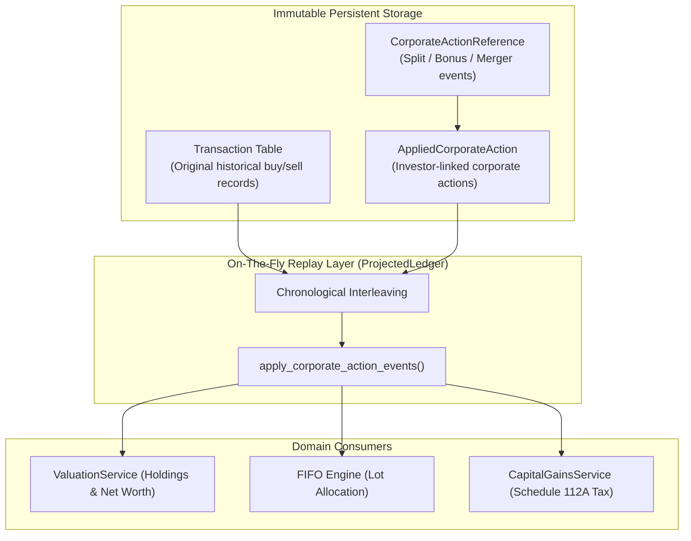
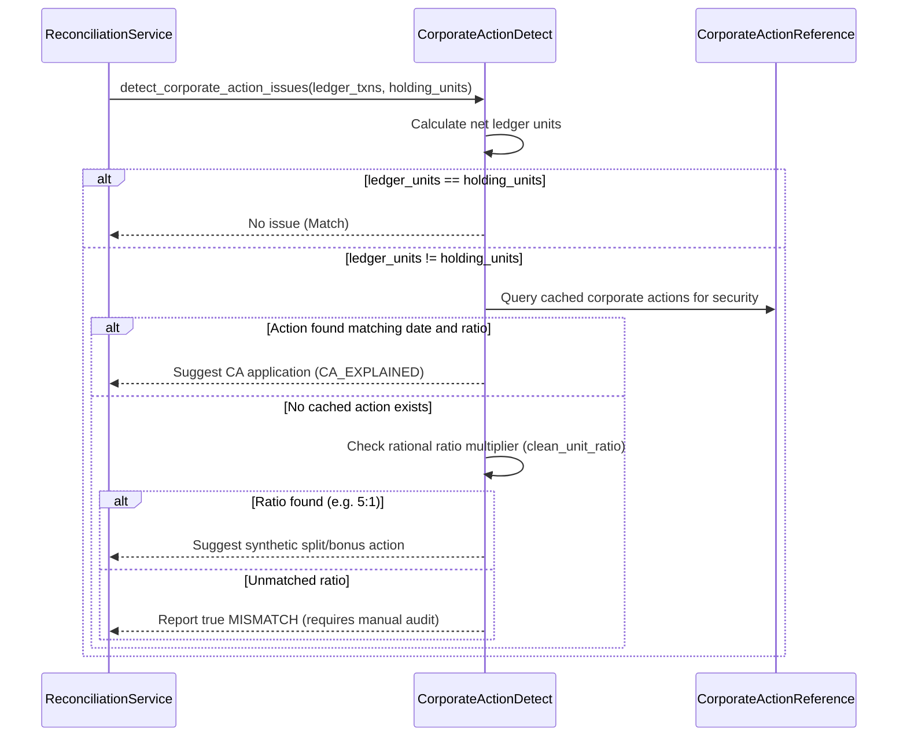

# Corporate Actions Engine (`folioman_client.core.corporate_actions*`)

This document details the corporate actions engine: the non-destructive event application mathematics in `core/corporate_actions.py` and the heuristic corporate action detector in `core/corporate_action_detect.py`.

---

## 1. Architectural Philosophy: Transaction Immutability

In financial portfolio software, corporate actions (stock splits, bonus issues, mergers, spin-offs) present a fundamental design choice:
1. **Destructive In-Place Mutation**: Update historical buy transaction records in the database (e.g., multiply units by 5 and divide purchase price by 5).
2. **Immutable Event Replay**: Preserve historical transactions as immutable historical facts and replay corporate action multipliers on-the-fly when reading the ledger.

`folioman-client` strictly adheres to **Immutable Event Replay**:



### Why Immutability is Essential:
1. **Audit Integrity**: The database always reflects what actually occurred on the transaction date (the contract note or bank debit amount).
2. **Tax Audits**: Income Tax Form 26AS and AIS report original transaction values. In-place modification invalidates reconciliations with external broker statements.
3. **Reversibility**: If a corporate action is applied in error (or with an incorrect record date), deleting the `AppliedCorporateAction` row instantly restores the ledger without needing database rollbacks.

---

## 2. Corporate Action Mathematics (`core/corporate_actions.py`)

### 2.1 Corporate Action Event Model

#### `CorporateActionApplyEvent`
Represents an action to be applied against an investor's ledger:
- `action_type: str`: `"SPLIT"`, `"REVERSE_SPLIT"`, `"BONUS"`, `"MERGER"`, `"RIGHTS"`, `"BUYBACK"`.
- `security: Security`: The impacted security.
- `ex_date: date`: Effective ex-action date.
- `ratio_from: int`: Numerator or source shares held.
- `ratio_to: int`: Denominator or resulting shares received.
- `acquirer_security: Security | None`: For mergers, the acquiring company receiving the new units.
- `cost_allocation_ratio: Decimal`: For demergers, fraction of cost basis allocated to the resulting entity.

### 2.2 Whole Shares Invariant
For Indian listed equities, share counts are strictly integer quantities. Fractional shares resulting from corporate actions are settled in cash via fractional share entitlements.
- `_issues_whole_shares(security: Security) -> bool`:
  Checks whether `security.type == SecurityType.EQUITY`. When true, fractional rounding is prevented, ensuring that simulated units align with actual depository balances.

### 2.3 Mathematical Specifications by Action Type

#### 1. Stock Split (`apply_split`)
- **Example**: 5-for-1 split (`ratio_from = 1`, `ratio_to = 5`).
- **Multiplier**: $M = \text{ratio\_to} / \text{ratio\_from} = 5.0$.
- **Prior Buy Lots**: Every open purchase lot acquired *prior* to `ex_date` has its units multiplied:
  $$\text{units}_{\text{new}} = \text{units}_{\text{old}} \times M$$
- **Cost Basis Invariant**: `cost_total` remains strictly unchanged. The virtual unit price becomes $\text{cost\_total} / \text{units}_{\text{new}}$.

#### 2. Reverse Split / Consolidation (`apply_reverse_split`)
- **Example**: 1-for-10 consolidation (`ratio_from = 10`, `ratio_to = 1`).
- **Multiplier**: $M = \text{ratio\_to} / \text{ratio\_from} = 0.1$.
- Prior open lots are consolidated: $\text{units}_{\text{new}} = \lfloor \text{units}_{\text{old}} \times M \rfloor$.

#### 3. Bonus Issue (`apply_bonus` / `apply_bonus_from_multiplier`)
- **Example**: 1:1 bonus (`ratio_from = 1`, `ratio_to = 1`).
- **Eligible Units**: Held units as of record date:
  $$\text{held\_units} = \sum_{\text{prior}} \text{BUY} - \sum_{\text{prior}} \text{SELL}$$
- **Bonus Units Issued**:
  $$\text{bonus\_units} = \text{held\_units} \times \left(\frac{\text{ratio\_to}}{\text{ratio\_from}}\right)$$
- **Synthetic Acquisition Lot**: Injects a virtual `Transaction` on `ex_date`:
  - `transaction_type = "BONUS"`
  - `units = bonus_units`
  - `nav_or_price = Decimal("0")`
  - `amount = Decimal("0")`
  - `cost_basis_complete = True`
- **Tax Consequence**: Under Section 55(2)(aa) of the Indian Income Tax Act, bonus shares have a deemed acquisition cost of **₹0.00**.

#### 4. Corporate Merger (`apply_merger`)
- **Example**: Target Company A merges into Acquirer Company B at swap ratio 2:5 (for every 2 shares of A, investor receives 5 shares of B).
- **Execution Flow**:
  1. Computes active open lots of Target Company A as of `ex_date`.
  2. Injects virtual liquidation transaction closing out Company A position:
     - `transaction_type = "SELL"`, `units = held_units_A`, `amount = 0`.
  3. Injects virtual acquisition lots in Acquirer Company B for each original lot in A:
     - $\text{units}_B = \text{units}_A \times (5 / 2)$.
     - $\text{cost\_total}_B = \text{cost\_total}_A$ (Cost basis carries over).
     - $\text{acquired\_on} = \text{original acquisition date in Company A}$ (Holding period is grandfathered under Section 47(vii)).

#### 5. Rights Issue (`apply_rights`)
- Models subscription to discounted shares, recording a `BUY` transaction at the rights exercise price on the subscription date.

#### 6. Buyback (`apply_buyback`)
- Models corporate share repurchase (tender offer), recording a `SELL` transaction with proceeds corresponding to the buyback price.

---

## 3. Heuristic Corporate Action Detection (`core/corporate_action_detect.py`)

When an investor imports an updated statement after a stock split, the balance observed in the CAS holding snapshot will suddenly be $2\times$, $5\times$, or $10\times$ higher than the ledger's net units.

`corporate_action_detect.py` contains the algorithm that analyzes unexplained mismatches and automatically reconstructs the underlying corporate action.

### 3.1 Rational Ratio Solver (`clean_unit_ratio`)
Given snapshot units $U_{\text{snap}}$ and ledger units $U_{\text{ledger}}$:
$$R = \frac{U_{\text{snap}}}{U_{\text{ledger}}}$$
The solver tests common corporate action ratios:
$$\{2/1, 3/1, 4/1, 5/1, 10/1, 3/2, 5/2, 4/1, 1/2, 1/5, 1/10\}$$
If $|R - \text{candidate}| < 0.0001$, the candidate is selected as the matched multiplier.

### 3.2 Detection Workflow (`detect_corporate_action_issues`)



### 3.3 Output Issue Descriptors
When a discrepancy is explained, the detector returns a structured dictionary:
```python
{
    "kind": "corporate_action_suggested",
    "security_id": 42,
    "security_name": "Tata Steel Limited",
    "ratio": "10:1",
    "action_type": "SPLIT",
    "holding_units": "1000",
    "ledger_units": "100",
    "suggested_action": "Apply 10:1 split on 2022-07-28",
}
```
This enables the CLI or GUI to offer a single-click resolution: `folioman corporate-actions apply --investor-id 1 --action-id 89`.
