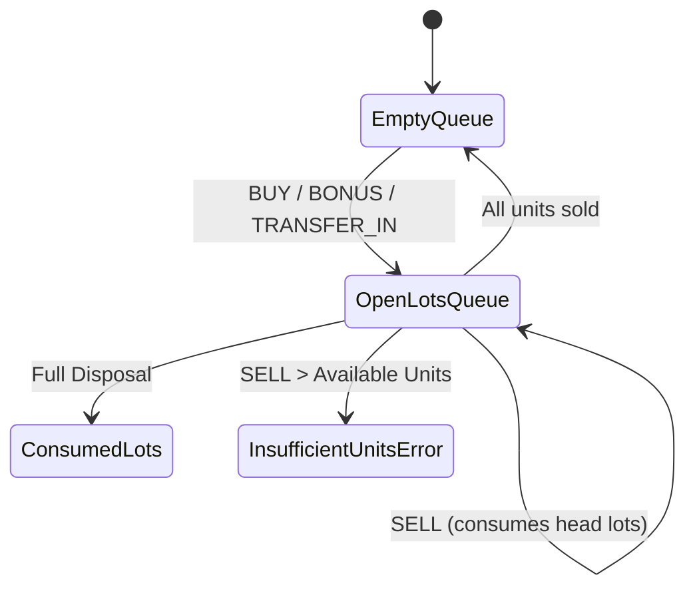
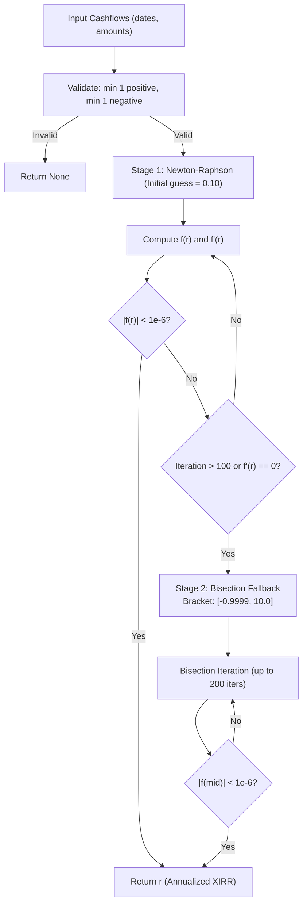

# Core Financial Mathematics & Parsers (`folioman_client.core`)

This document details the pure mathematical algorithms, lot-accounting state machines, and statement parsers contained in `src/folioman_client/core/`. These modules are independent of database frameworks and contain domain financial logic.

---

## 1. FIFO Lot Accounting Engine (`core/fifo.py`)

The FIFO (First-In, First-Out) module implements tax-compliant lot matching for Indian capital gains and portfolio cost basis calculations.

### 1.1 Why Standard Per-Unit Price Fails
Traditional portfolio systems store lot cost as a per-unit price:
$$\text{Cost} = \text{Units} \times \text{Price}$$
In real-world equity accounting, corporate actions (such as a 1:3 bonus issue or a 7:10 merger ratio) create non-terminating repeating decimals (e.g., $100 / 3 = 33.333333...$). If per-unit prices are stored and rounded, the total invested capital gradually drifts over successive splits or partial sales.

**Folioman Invariant: Cost Total Basis Preservation**
`OpenLot` preserves `cost_total` as an exact, unrounded `Decimal`. When partial lots are sold, the cost basis is proportionally allocated:
$$\text{Consumed Cost} = \text{cost\_total} \times \left(\frac{\text{Sold Units}}{\text{Lot Units}}\right)$$
$$\text{Remaining Cost} = \text{cost\_total} - \text{Consumed Cost}$$
This ensures that the sum of consumed costs across all partial disposals plus remaining open lots is always identical to the original cash paid, down to the exact paisa.

### 1.2 Core Data Structures

#### `OpenLot`
Represents an unconsumed or partially unconsumed purchase lot:
- `acquired_on: date`: Date the lot was originally acquired.
- `units: Decimal`: Remaining active units in the lot.
- `cost_total: Decimal`: Remaining unconsumed cost basis (total INR).
- `nav_or_price: Decimal`: Acquisition price per unit (for display/reference).
- `source_ref: str`: Audit trail reference tracking back to original transaction ID or corporate action event.
- `source: str`: `"cas_pdf"`, `"manual"`, `"split"`, `"bonus"`, etc.

#### `ConsumedLot`
Represents the matched portion of an `OpenLot` consumed by a `SELL` transaction:
- `acquired_on: date`: Original purchase date.
- `sold_on: date`: Disposal date.
- `units: Decimal`: Quantity of units consumed.
- `cost_total: Decimal`: Exact portion of cost basis assigned to this disposal.
- `proceeds: Decimal`: Net sale proceeds realized from this portion.
- `nav_buy: Decimal`: Effective purchase price per unit.
- `nav_sell: Decimal`: Effective sale price per unit.

#### `SellDisposal`
Aggregates all `ConsumedLot` components for a single disposal event:
- `disposal_txn: Transaction`: The original `SELL` transaction.
- `consumed_lots: list[ConsumedLot]`: Chronological breakdown of lots matched.
- Properties:
  - `units -> Decimal`: Total units disposed.
  - `proceeds -> Decimal`: Total net cash received.
  - `cost_total -> Decimal`: Sum of all consumed lot costs.
  - `realized_gain -> Decimal`: $\text{proceeds} - \text{cost\_total}$.

### 1.3 `FIFOUnits` State Machine

The `FIFOUnits` class maintains the mutable FIFO queue for a single security:

#### Key Methods:
- `buy(date, units, nav_or_price, amount, fees=0, stamp_duty=0, source="manual", source_ref="")`:
  Appends an `OpenLot` to the internal queue. Automatically factors in transfer expenses and stamp duty:
  $$\text{cost\_total} = \text{amount} + \text{stamp\_duty} + \text{fees}$$
- `sell(date, units, nav_or_price, amount, fees=0, source_ref="") -> list[ConsumedLot]`:
  Dequeues units from the earliest open lots. If the head lot has fewer units than required, it is completely consumed, and consumption cascades to the next lot.
  - **Exception**: Raises `InsufficientUnitsError` if total queued units $< \text{requested sale units}$.
- `reduce_lots(cost_by_acquired_on: dict[date, Decimal]) -> None`:
  Directly reduces the cost basis of specific acquisition lots without altering units. Used during corporate **demergers** where cost of acquisition is split between the parent entity and spun-off subsidiary.
- `_refresh_average()`:
  Maintains running weighted average cost: $\sum \text{cost\_total} / \sum \text{units}$.

### 1.4 Helper Functions
- `apply_fifo(transactions: Iterable[Transaction]) -> tuple[list[OpenLot], list[SellDisposal]]`:
  Accepts arbitrary sequences of transactions, sorts them chronologically, runs them through `FIFOUnits`, and returns both remaining open lots and all realized disposals.
- `net_intraday_offsets(transactions: Sequence[Transaction]) -> list[Transaction]`:
  Identifies and offsets same-day matching buy/sell transactions before running cross-day FIFO.
- `net_units_from_transactions(transactions: Iterable[Transaction]) -> Decimal`:
  Fast summation of held units: $\sum (\text{BUY} + \text{BONUS} + \text{TRANSFER\_IN}) - \sum (\text{SELL} + \text{TRANSFER\_OUT})$.

---

## 2. Extended Internal Rate of Return (`core/xirr.py`)

The XIRR module calculates annualized money-weighted returns over irregular cashflow schedules.

### 2.1 Mathematical Formulation
Given a sequence of $N$ cashflows $(d_i, C_i)$ where $d_i$ is the transaction date and $C_i$ is the cashflow amount (negative for cash invested, positive for cash withdrawn or terminal value):

$$f(r) = \sum_{i=1}^{N} \frac{C_i}{(1 + r)^{\frac{d_i - d_0}{365.0}}} = 0$$

Where $d_0$ is the date of the initial cashflow and $r$ is the annual rate of return.

### 2.2 Dual-Stage Root Finding Engine
Finding $r$ requires solving a non-linear polynomial. Folioman implements a robust, two-tier numerical solver:

#### Stage 1: Newton-Raphson Iteration
Uses the analytical first derivative with respect to $r$:
$$f'(r) = \sum_{i=1}^{N} -C_i \cdot \frac{d_i - d_0}{365.0} \cdot (1 + r)^{-\left(\frac{d_i - d_0}{365.0} + 1\right)}$$
Updating $r_{k+1} = r_k - \frac{f(r_k)}{f'(r_k)}$. Converges quadratically in 4–8 iterations for typical investment schedules.

#### Stage 2: Bisection Search Fallback
When non-convex cashflow patterns (e.g. large early withdrawals followed by re-investments) cause Newton-Raphson to diverge or hit local extrema ($f'(r) \approx 0$), the solver automatically falls back to binary search over the bounded interval $[-0.9999, 10.0]$ (from $-99.99\%$ to $+1,000\%$).

### 2.3 Cashflow Preparation
`cashflows_from_transactions(transactions, terminal_value, as_of_date) -> list[CashFlow]`:
Transforms immutable transaction rows into XIRR cashflows:
- `BUY`, `TRANSFER_IN`: Cash outflow (negative amount: $-(units \times nav + fees + stamp\_duty)$).
- `SELL`, `TRANSFER_OUT`: Cash inflow (positive amount: $+(units \times nav - fees)$).
- Terminal Portfolio Value: Final synthetic cash inflow (positive amount: $+terminal\_value$ as of `as_of_date`).

---

## 3. CAS Parsing & Reversal Cancellation (`core/parser.py`)

The CAS parser processes low-level extracted statement lines, cancels transaction reversals, and isolates history gaps.

### 3.1 Two-Pass Reversal Cancellation Engine
Real-world mutual fund statements frequently contain bounced transactions, cancelled SIP mandates, and reversed switch orders. If unhandled, these create fictitious trading volume and distort FIFO lots.

`_cancel_reversals(scheme_txns: Sequence) -> list`:
1. **Forward Scan**: Traverses transactions and matches any reversal indicator (e.g., narration containing `"REVERSAL"`, `"BOUNCE"`, `"REJECTED"`, or `"CANCELLATION"`).
2. **Backward Proximity Search**: Searches backwards within a 30-day temporal window for an identical prior transaction with the opposite sign:
   $$\text{units}_A = -\text{units}_B \quad \text{and} \quad \text{amount}_A = -\text{amount}_B$$
3. **Cancellation**: Drops both the original failed transaction and the offsetting reversal line from the ledger, preventing corrupted cost basis history.

### 3.2 Stamp Duty & Fee Allocation
`_collect_per_index_charges(scheme_txns)`:
Scans statement narrations for statutory deductions and charges:
- **Stamp Duty**: Introduced July 1, 2020 at 0.005% on mutual fund unit purchases.
- **STT (Securities Transaction Tax)**: Extracted from equity/arbitrage redemption lines.
Allocates these expenses directly to the parent transaction record to ensure Section 48 tax deductibility.

### 3.3 History Gap & Continuity Analysis
- `scheme_history_gap(block, prior_balance=0) -> str | None`:
  Determines whether a statement scheme block represents complete, unbroken history:
  - If `block.opening_units == 0`: History starts at scheme inception (Complete).
  - If `block.opening_units > 0` and `prior_balance == block.opening_units`: Prior statement already established the opening balance (Complete).
  - If `block.opening_units > 0` and `prior_balance != block.opening_units`: Transactions prior to statement start date are missing (Incomplete History Gap).

---

## 4. Dual-Engine CAS PDF Reader (`core/cas_reader.py`)

`cas_reader.py` extracts text and structured data from encrypted PDF files.

### 4.1 Hybrid Extraction Architecture
1. **Primary Parser (`casparser`)**: Attempts high-performance structured table extraction using PDF text stream parsing.
2. **Fallback Parser (`pypdfium2`)**: If the PDF is malformed, uses Google's PDFium engine to render and extract raw text streams directly.
3. **Password Management**: Validates user-supplied passwords (investor PAN or email password). Maps decrypt failures to `CASPasswordError`.

---

## 5. NSDL / CDSL eCAS Equity Parser (`core/ecas_parser.py`)

`ecas_parser.py` parses Demat Consolidated Account Statements from NSDL and CDSL depositories.

### 5.1 Extracted Fields
- **Demat Account**: Depository Participant (DP) Name, DP ID, Client ID, Account Type.
- **Holdings Table**: ISIN, Security Description, Total Units, Available Units, Frozen Units, Observed Market Price, Total Valuation.
- **Average Cost**: Where provided in eCAS (common in newer CDSL statements), captures `avg_cost_observed`.

---

## 6. Trading Calendar Engine (`core/trading_calendar.py`)

Accurate financial reporting requires synchronizing market quotes against valid stock exchange trading days.

### 6.1 Methods
- `last_trading_day(d: date) -> date`:
  If `d` falls on a weekend (Saturday/Sunday) or an official NSE/BSE holiday, steps backward day-by-day until a valid market trading session is found.
- `trading_days_between(start: date, end: date) -> int`:
  Calculates the exact number of active exchange trading days between two dates. Used by `NAVService` to determine whether a price quote is stale beyond the grace period.
- `completed_trading_day(today: date) -> date`:
  Returns the latest trading day whose market session has fully concluded and for which closing prices are final.
