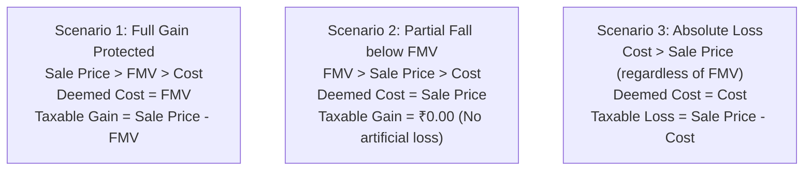

# Indian Tax Engine & Schedule 112A (`folioman_client.core.tax`)

This document provides a comprehensive technical guide to the Indian capital gains tax engine implemented in `src/folioman_client/core/tax/`. It covers statutory rules, Section 112A grandfathering, Budget 2024 amendments, and ITR Schedule 112A CSV generation.

---

## 1. Statutory Context & Legal Provisions

The Indian Income Tax Act, 1961 governs capital gains through several key sections:

```mermaid
flowchart TD
    Asset["Disposal of Security"] --> CheckType{"Asset Classification"}
    
    CheckType -->|Listed Equity / Equity MF| EquityPath["Section 112A / 111A"]
    CheckType -->|Debt Mutual Fund (Acquired >= 1 Apr 2023)| Sec50AA["Section 50AA\n(Deemed Short-Term regardless of holding period)"]
    CheckType -->|Debt MF (Acquired < 1 Apr 2023)| TraditionalDebt["Section 112\n(LTCG with indexation if held > 36M)"]
    
    EquityPath --> CheckHolding{"Holding Period > 12 Months?"}
    CheckHolding -->|No (<= 12M)| STCG["Short-Term Capital Gain (STCG)\nSection 111A\nTaxed at 15% (pre-Budget 2024) or 20% (post-Budget 2024)"]
    CheckHolding -->|Yes (> 12M)| LTCG["Long-Term Capital Gain (LTCG)\nSection 112A\nTaxed at 10% (pre-Budget 2024) or 12.5% (post-Budget 2024)"]
    
    LTCG --> CheckAcq{"Acquired on or before 31 Jan 2018?"}
    CheckAcq -->|Yes| Grandfathering["Section 112A Grandfathering\nFMV as of 31-Jan-2018 applied"]
    CheckAcq -->|No| StandardLTCG["Standard LTCG\nCost = Purchase Price + Sec 48 expenses"]
```

---

## 2. Union Budget 2024 Amendments (July 23, 2024)

The Finance (No. 2) Act, 2024 enacted comprehensive changes to capital gains tax rates effective **July 23, 2024**:

| Asset / Term | Transfers Prior to July 23, 2024 | Transfers On or After July 23, 2024 | Section |
| :--- | :--- | :--- | :--- |
| **Listed Equity / Equity MF (STCG)** | 15% | **20%** | Section 111A |
| **Listed Equity / Equity MF (LTCG)** | 10% on gains $> ₹1,00,000$ | **12.5%** on gains $> ₹1,25,000$ | Section 112A |
| **Annual LTCG Exemption Limit** | ₹1,00,000 per financial year | **₹1,25,000** per financial year | Section 112A |
| **Indexation Benefit** | Available on unlisted debt / property | **Withdrawn** for transfers after July 23, 2024 | Section 48 |

In `core/tax/india.py`:
- `transfer_bucket(sold_on: date) -> str`: Categorizes disposal dates into `"pre_jul_2024"` or `"post_jul_2024"`.
- `acquire_bucket(acquired_on: date) -> str`: Categorizes acquisition dates into `"pre_jan_2018"` or `"post_jan_2018"`.

---

## 3. Section 112A Grandfathering Mathematics

Under Section 112A(4), equity shares and equity-oriented mutual fund units acquired on or before **January 31, 2018** are entitled to cost basis step-up (grandfathering) to shield unrealized gains accrued up to that date from tax.

### 3.1 Statutory Formula
For an asset acquired on or before January 31, 2018, the deemed cost of acquisition is computed as:

$$\text{Deemed Cost} = \max(\text{Actual Purchase Cost}, \min(\text{FMV as on 31 Jan 2018}, \text{Full Value of Consideration}))$$

Where:
- **Actual Purchase Cost**: Original cash paid upon acquisition (including stamp duty and brokerage).
- **FMV as on 31 Jan 2018**:
  - For Listed Equity: Highest traded price on stock exchanges on January 31, 2018 (or preceding trading day if unquoted on that date).
  - For Mutual Funds: Published closing NAV as on January 31, 2018.
- **Full Value of Consideration**: Gross sale proceeds realized upon disposal.

### 3.2 Visualizing the Three Scenarios



1. **Scenario 1 (Price has appreciated past Jan 2018)**:
   - Cost: ₹100, FMV: ₹250, Sale: ₹400.
   - Deemed Cost = $\max(100, \min(250, 400)) = \max(100, 250) = ₹250$.
   - Taxable LTCG = ₹400 - ₹250 = ₹150 (The ₹150 gained before Jan 2018 is completely tax-free).
2. **Scenario 2 (Price fell after Jan 2018 but still above original cost)**:
   - Cost: ₹100, FMV: ₹250, Sale: ₹200.
   - Deemed Cost = $\max(100, \min(250, 200)) = \max(100, 200) = ₹200$.
   - Taxable LTCG = ₹200 - ₹200 = ₹0.00 (No tax payable, but cannot claim an artificial capital loss).
3. **Scenario 3 (Loss below purchase price)**:
   - Cost: ₹100, FMV: ₹250, Sale: ₹80.
   - Deemed Cost = $\max(100, \min(250, 80)) = \max(100, 80) = ₹100$.
   - Taxable LTCG = ₹80 - ₹100 = -₹20 (Actual capital loss is preserved for set-off).

---

## 4. Section 48 Deductions & Transfer Expenses

Under Section 48(i) of the Act, deductions are permitted for:
- Expenditure incurred wholly and exclusively in connection with the transfer (brokerage, exchange turnover fees, SEBI charges, clearing charges).
- Stamp duty paid upon acquisition (added to acquisition cost basis).

> [!IMPORTANT]
> Securities Transaction Tax (STT) is explicitly **disallowed** as a deduction under Section 48 proviso. `folioman-client` isolates STT into a separate field and does not deduct it from taxable gains.

---

## 5. Schedule 112A Dataset & CSV Export (`core/tax/schedule_112a.py`)

The Income Tax Department requires taxpayers with LTCG under Section 112A to file line-by-line disclosures in Schedule 112A of Form ITR-2 or ITR-3.

### 5.1 Official 14-Column Specification

The `Schedule112ARow` model maps to the 14 columns required by the official ITR e-filing schema:

| Column | Field Name in Folioman | Description | Format |
| :---: | :--- | :--- | :--- |
| **1** | `description` | Scheme Name or Stock Name | Text |
| **2** | `units` | Number of units / shares sold | Integer or Decimal |
| **3** | `sale_price` | Sale price per unit | Natural Decimal |
| **4** | `full_value_consideration` | Total Sale Value ($Col 2 \times Col 3$) | Currency |
| **5** | `cost_of_acquisition` | Original Cost of Acquisition (without indexation) | Currency |
| **6** | `fmv_per_unit` | FMV as on January 31, 2018 per unit | Currency / Natural |
| **7** | `total_fmv` | Total Fair Market Value ($Col 2 \times Col 6$) | Currency |
| **8** | `transfer_expenses` | Sec 48 expenses (brokerage, turnover fees) | Currency |
| **9** | `total_deductions` | Total Deductions ($\text{Deemed Cost} + Col 8$) | Currency |
| **10** | `balance` | Gain before Section 54 deductions ($Col 4 - Col 9$) | Currency |
| **11** | `sec_54_deductions` | Deductions under Section 54F (residential reinvestment) | Default ₹0.00 |
| **12** | `net_gain` | Net Taxable Long-Term Capital Gain | Currency |
| **13** | `isin` | 12-character ISIN code | String |
| **14** | `acquisition_date` | Date of original purchase | YYYY-MM-DD |

### 5.2 Implementation Example

```python
from folioman_client.core.tax.schedule_112a import compute_schedule_112a

# Compute Schedule 112A rows from disposals
rows = compute_schedule_112a(
    disposals=sell_disposals,
    financial_year="2024-2025",
    fmv_lookup=isin_service.get_grandfathering_nav
)

# Export directly to standard CSV dictionary
csv_rows = [row.to_csv_dict() for row in rows]
```

### 5.3 Number Formatting Standards
To prevent validation errors when uploading CSV files to the Indian tax portal:
- Unit counts use `_fmt_natural()`: trailing decimal zeroes are stripped (`"50.000"` -> `"50"`).
- Currency amounts use `_fmt_money()`: rounded to 2 decimal places or integer rupees as mandated by ITD utilities.
