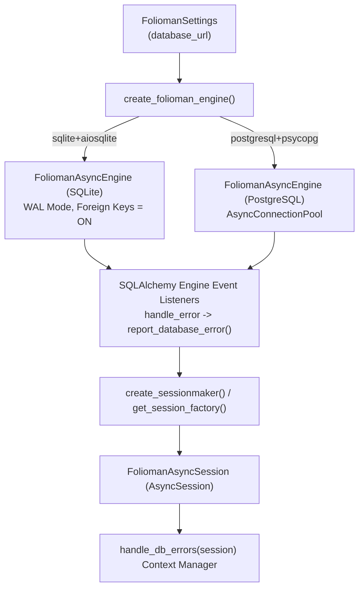
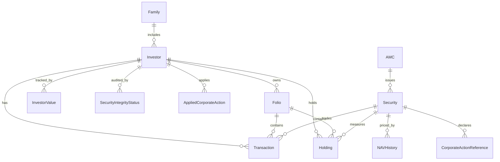

# Database Layer & Centralized Diagnostics (`folioman_client.db`)

This document details the database architecture, connection pooling, schema initialization, ORM data models, and the centralized, actionable database error reporting system implemented in `src/folioman_client/db/`.

---

## 1. Asynchronous Architecture & Engine Lifecycle

`folioman-client` is built on **SQLAlchemy 2.0 Async** and supports both **SQLite** (via `aiosqlite`) and **PostgreSQL** (via `psycopg3`).



### 1.1 Windows `ProactorEventLoop` vs `psycopg3` Caveat
On Windows with Python 3.11+, the default asyncio event loop is `ProactorEventLoop`. However, `psycopg3` async mode requires Windows socket file descriptors supported only by `SelectorEventLoop`. When using PostgreSQL on Windows, `folioman-client` or the host process must initialize asyncio with:
```python
import asyncio
import sys

if sys.platform == "win32":
    asyncio.set_event_loop_policy(asyncio.WindowsSelectorEventLoopPolicy())
```
If this is omitted, the centralized database error reporting mechanism detects the failure immediately, diagnosing:
```text
Cause : psycopg cannot use ProactorEventLoop in async mode.
Fix   : Use a compatible event loop or correct the async driver configuration:
        asyncio.set_event_loop_policy(asyncio.WindowsSelectorEventLoopPolicy())
```

---

## 2. Centralized Actionable Error Diagnostics (`db/reporting.py` & `db/errors.py`)

SQLAlchemy and driver exceptions can be verbose and difficult to decipher in complex async architectures. `folioman-client` implements a centralized error analysis and translation system that intercepts exceptions, inspects application call stacks, redacts sensitive PII, and returns clean, actionable domain exceptions.

### 2.1 Domain Exception Translation & Traceback Suppression
Low-level driver failures are intercepted by `handle_db_errors(session)` and translated into domain exceptions (`FoliomanDatabaseError`, `DuplicateInvestorError`, `FoliomanNotFoundError`):

- **Actionable Guidance**: Missing tables, syntax errors, or connection dropouts are parsed by `translate_operational_error()` to provide immediate remediation advice (e.g. `"Table or relation does not exist in the database schema. Verify the table name and run database schema migrations (init_schema) to create missing tables."`).
- **Suppressed Internal Tracebacks**: Domain exceptions are raised using `raise ... from None`, preventing internal SQLAlchemy greenlet and DBAPI driver tracebacks from cluttering terminal logs or application output.
- **Consistent CLI & SDK Experience**: The exact same clean error message is returned when calling Python SDK services or running CLI commands (which catch domain exceptions and render them via `click.ClickException`).

### 2.2 Standardized Diagnostic Block Format
For diagnostic purposes, `report_database_error()` generates a structured 8-field analysis:

```text
[DATABASE ERROR] sqlalchemy.exc.IntegrityError

Backend   : SQLite
Operation : INSERT
Query     : INSERT INTO investors (user_id, name, pan_hash) VALUES (?, ?, ?)
Location  : src/folioman_client/services/ledger_service.py:126
Cause     : Unique constraint failed: investors.pan_hash
Fix       : An investor with this PAN or unique identifier already exists.

Original error:
UNIQUE constraint failed: investors.pan_hash
```

### 2.3 Diagnostic Logging & Debug Mode (`FOLIOMAN_DEBUG_DB_ERRORS`)
To avoid dumping lengthy multi-line queries and column lists onto user consoles during normal operations:
- **Default**: The diagnostic metadata is attached to the exception object (`exc._folioman_db_error_info`) and logged at `logger.debug`.
- **Debug Mode**: Setting the environment variable `FOLIOMAN_DEBUG_DB_ERRORS=1` enables direct writing of the diagnostic banner to `sys.stderr` for interactive troubleshooting or test verification.

### 2.4 Accurate Application Call-Site Resolution
A major challenge in async SQLAlchemy applications is that exceptions are caught deep inside framework code (greenlets, task loops, or connection pool workers). Standard `traceback` parsing often points incorrectly to SQLAlchemy internals (`sqlalchemy/dialects/sqlite/aiosqlite.py`) rather than the application line that issued the query.

`extract_application_location()` solves this:
1. Inspects the active stack frames using `inspect.currentframe()`.
2. Inspects `__traceback__` attached to the exception.
3. If running inside a greenlet, accesses the parent coroutine's stack frame.
4. Filters out internal framework paths:
   - `site-packages/`
   - `sqlalchemy/`
   - `aiosqlite/`
   - `psycopg/`
   - `folioman_client/db/reporting.py`
   - `folioman_client/db/errors.py`
5. Returns the true application call site (e.g. `src/folioman_client/services/ledger_service.py:126`).

### 2.5 Security, Privacy & Secret Redaction
To protect financial confidentiality, the error reporting engine automatically sanitizes all output:
- **Connection URLs**: Passwords and usernames are stripped via `sanitize_url()`.
- **PANs**: Any 10-character Permanent Account Number string matching `[A-Z]{5}[0-9]{4}[A-Z]` is masked to `XXXXXX123D`.
- **Passwords**: Database and PDF passwords in messages or query strings are replaced with `***`.
- **Bound Parameters**: Bound SQL parameters are omitted by default to prevent leaking transaction amounts, folio numbers, or personal details in console logs.

### 2.6 Error De-Duplication
In layered architectures, an exception often bubbles up through several layers (e.g., Session listener $\to$ `handle_db_errors` $\to$ Service method $\to$ CLI command). Without de-duplication, the diagnostic banner would print multiple times for a single failure.

`report_database_error()` sets an internal flag on the exception instance:
```python
if getattr(exc, "_folioman_db_error_reported", False):
    return getattr(exc, "_folioman_db_error_info", None)
exc._folioman_db_error_reported = True
```
This guarantees that diagnostic blocks are processed **exactly once**.

---

## 3. Schema Migrations & Initialization (`db/migrations.py`)

Database setup is executed via `init_schema(engine)`:
- Invokes `Base.metadata.create_all()` inside an isolated connection block.
- **SQLite Pragmas**:
  - `PRAGMA journal_mode = WAL;` (Write-Ahead Logging for high concurrency).
  - `PRAGMA foreign_keys = ON;` (Enforces referential integrity).
  - `PRAGMA synchronous = NORMAL;` (Optimal balance of durability and write performance).
- **PostgreSQL Settings**:
  - Validates schema visibility and creates required B-Tree indexes.

---

## 4. ORM Model Declarations (`db/models.py`)

`folioman-client` defines 18 SQLAlchemy ORM tables inheriting from a common declarative `Base`:



### 4.1 Core Entity Tables

#### 1. `Investor` (`investors`)
- `id`: Integer primary key.
- `user_id`: String multi-tenant user or advisor identifier.
- `name`: Full legal name.
- `pan_encrypted`: `LargeBinary` Fernet ciphertext of plaintext PAN.
- `pan_hash`: `String(64)` HMAC-SHA256 deterministic digest used for fast indexed lookups without decrypting.
- `family_id`: Nullable foreign key to `Family`.
- `valuation_status`: `"fresh"`, `"stale"`, or `"recomputing"`.

#### 2. `Family` (`families`)
- Groups multiple investors (e.g. spouse, minor children, HUF accounts) for consolidated portfolio summaries.

#### 3. `Folio` (`folios`)
- `investor_id`: Foreign key to `Investor`.
- `number`: Normalized folio / account number.
- `amc_code`: AMFI fund house code.
- `folio_type`: `"mf"` (Mutual Fund) or `"demat"` (Equity Demat Account).

#### 4. `Security` (`securities`)
- `security_type`: `"MF"`, `"EQUITY"`, `"ETF"`, `"BOND"`, `"FD"`.
- `name`: Canonical security name.
- `isin`: 12-character International Securities Identification Number.
- `amfi_code`: AMFI 6-digit mutual fund scheme code.
- `symbol`: Exchange stock ticker (e.g. `RELIANCE`).
- `exchange`: `NSE`, `BSE`, or `NASDAQ`.

#### 5. `Transaction` (`transactions`)
- **Immutable historical ledger record**.
- `investor_id`, `security_id`, `folio_id`.
- `date`: Trade settlement date.
- `transaction_type`: `BUY`, `SELL`, `BONUS`, `TRANSFER_IN`, `TRANSFER_OUT`.
- `units`: `Numeric(18, 4)` share or unit quantity.
- `nav_or_price`: `Numeric(18, 4)` purchase/sale price per unit.
- `amount`: `Numeric(18, 4)` gross trade consideration.
- `fees`, `stamp_duty`: `Numeric(18, 4)` statutory deductions.
- `dedup_key`: `String(64)` SHA-256 idempotency hash.
- `cost_basis_complete`: Boolean flag indicating whether historical cost basis is verified.

#### 6. `Holding` (`holdings`)
- Periodic holding snapshot observed from CAS or eCAS statements. Used for position verification and incomplete history bridging.

#### 7. `NAVHistory` (`nav_history`)
- Historical time series of closing NAVs and prices.
- Composite unique key: `(security_id, date)`.

#### 8. `InvestorValue` (`investor_values`)
- Daily mark-to-market portfolio net worth and cost basis cache.
- Composite unique key: `(investor_id, date)`.

#### 9. `SecurityIntegrityStatus` (`security_integrity_status`)
- Current reconciliation state between ledger transactions and holding snapshots:
  - `status`: `MATCH`, `MISMATCH`, `INCOMPLETE_HISTORY`, `CA_EXPLAINED`, `MANUAL_OVERRIDE`.
  - `ledger_units`, `snapshot_units`, `difference`.

#### 10. `CorporateActionReference` (`corporate_action_references`)
- Repository of historical corporate action events (splits, bonuses, mergers) scraped from exchanges.

#### 11. `AppliedCorporateAction` (`applied_corporate_actions`)
- Junction linking a corporate action reference to an investor's ledger.

#### 12. `ImportJob` & `ImportQuarantine`
- Tracks background statement ingestion jobs and isolates malformed scheme blocks for user review.

#### 13. `PartialBlock`
- Tracks mutual fund schemes with unchained opening units awaiting older statements.

#### 14. `FMVJan2018`
- Reference table storing statutory Jan 31, 2018 grandfathering NAVs and stock prices.
