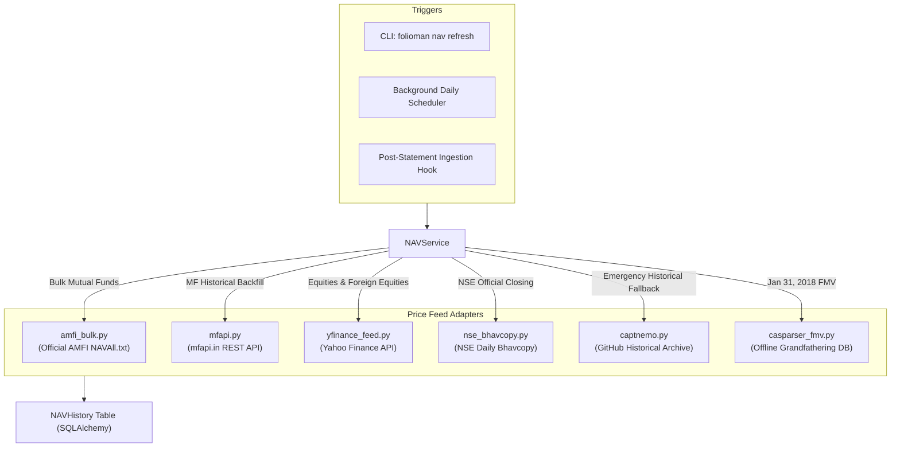
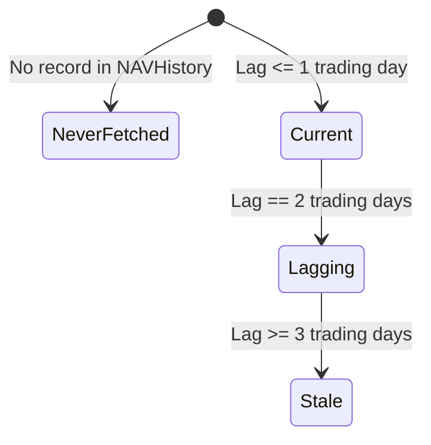

# Market Price Feeds (`folioman_client.core.price_feeds`)

This document details the multi-source market data ingestion adapters located in `src/folioman_client/core/price_feeds/`. These modules fetch daily Net Asset Values (NAVs), equity closing prices, historical time series, and corporate action notices across Indian asset classes.

---

## 1. Price Feed Architecture & Priority

To ensure resilience against external API outages, rate limits, and network volatility, `folioman-client` employs a multi-tiered feed hierarchy:

---

## 2. Feed Implementations

### 2.1 AMFI Daily Bulk Feed (`amfi_bulk.py`)
- **Primary Source**: Official Association of Mutual Funds in India (AMFI) website (`portal.amfiindia.com/DownloadNAVHistoryReport_PD.aspx` or `www.amfiindia.com/spages/NAVAll.txt`).
- **Characteristics**:
  - Contains closing NAVs for **all 10,000+ active mutual fund schemes** in a single text file.
  - Downloaded every evening after AMFI NAV cut-off (21:00 IST).
  - Executed in a single HTTP `GET` request, avoiding thousands of individual API round-trips.
- **Parsing Logic**:
  - Semicolon-delimited format:
    `Scheme Code;ISIN Div Payout/ ISIN Growth;ISIN Div Reinvestment;Scheme Name;Net Asset Value;Date`
  - Validates date against expected session date.
  - Strips spaces, parses dates into `datetime.date`, and coerces NAV to `Decimal`.

### 2.2 `mfapi.in` Adapter (`mfapi.py`)
- **Primary Source**: Community-maintained JSON REST API (`https://api.mfapi.in/mf/{amfi_code}`).
- **Capabilities**:
  - Point-in-time latest NAV.
  - Complete historical daily NAV time series from scheme inception (often spanning 15–25 years).
- **Execution Flow**:
  - `fetch_mf_history(amfi_code: str) -> list[tuple[date, Decimal]]`:
    Fetches JSON payload containing `data: [{"date": "DD-MM-YYYY", "nav": "123.4560"}, ...]`.
    Parses date format and populates gap ranges.
- **Error Handling**: Handles 404 (scheme discontinued or renamed) and 429 (rate limiting) with exponential backoff.

### 2.3 Yahoo Finance Adapter (`yfinance_feed.py`)
- **Primary Source**: Yahoo Finance API via `yfinance` library.
- **Scope**:
  - Indian Listed Equities (e.g. `TCS.NS`, `INFY.BO`).
  - Exchange-Traded Funds (ETFs) (e.g. `NIFTYBEES.NS`, `GOLDBEES.NS`).
  - Foreign Equities (e.g. `AAPL`, `MSFT`).
- **Capabilities**:
  - Daily adjusted closing prices.
  - Corporate actions: historical split ratios and dividend payouts.
- **Execution Details**:
  - Formats exchange suffixes (`.NS` for National Stock Exchange, `.BO` for Bombay Stock Exchange).
  - Normalizes prices into Indian Rupees (`INR`).

### 2.4 NSE Daily Bhavcopy (`nse_bhavcopy.py`)
- **Primary Source**: Official National Stock Exchange end-of-day equity archives.
- **Scope**: Canonical official closing prices for all equities and debt instruments traded on the NSE.
- **File Structure**:
  - Downloads zipped Bhavcopy CSV files: `sec_bhavdata_full_DDMMYYYY.csv`.
  - Extracts Series `EQ` (Equity shares) and `BE` (Book-entry trade-for-trade).
  - Filters out debt series, rights entitlements, and illiquid warrants unless explicitly requested.

### 2.5 Captnemo Historical Mutual Fund Archive (`captnemo.py`)
- **Primary Source**: Static GitHub repository archive maintaining continuous daily NAV historical JSON snapshots since 2006.
- **Use Case**: Cold-start initial syncs and offline gap filling when `mfapi.in` is unavailable or rate-limited.

### 2.6 Casparser FMV Database (`casparser_fmv.py`)
- **Primary Source**: Embedded SQLite database (`casparser-isin.db`).
- **Scope**: Contains the definitive, statutory closing NAVs and equity share prices for **January 31, 2018** published by CBDT.
- **Use Case**: Zero-network offline resolution for Section 112A capital gains grandfathering computations.

---

## 3. Feed Freshness & Lag Classification

The `NAVService.get_nav_freshness()` method evaluates market data age relative to active exchange trading sessions using `core/trading_calendar.py`:

- **`Current`**: The latest available quote is from the most recent trading session (or previous day if market has not closed).
- **`Lagging`**: Quote is missing for 1–2 trading sessions (often due to weekend processing or delay in AMC reporting).
- **`Stale`**: No quote recorded for 3 or more trading sessions. Triggers automated refresh retry.
- **`Never Fetched`**: Newly created security with zero entries in `NAVHistory`.
