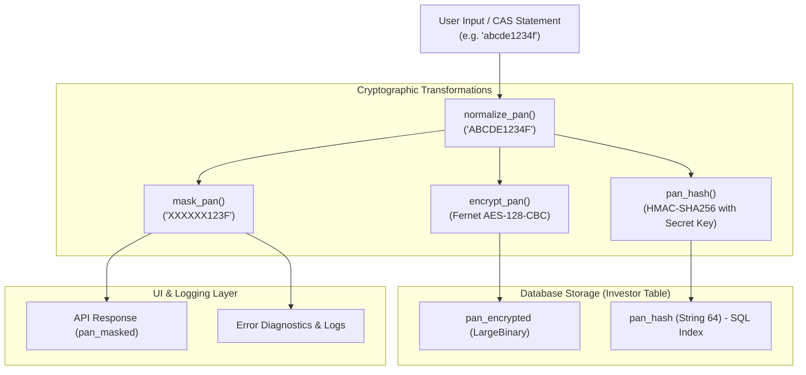
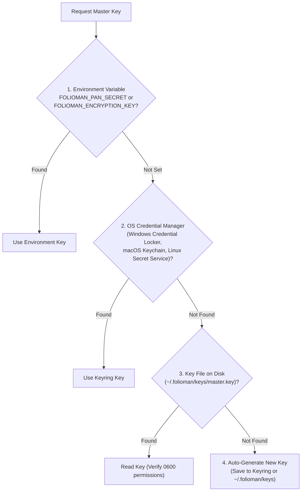

# Security, Cryptography & PII Protection (`folioman_client.security`)

This document details the cryptographic safeguards and privacy mechanisms used to protect sensitive personal financial identifiers in `folioman-client`, particularly the Permanent Account Number (PAN).

---

## 1. Threat Model & Design Requirements

The Permanent Account Number (PAN) is the primary taxpayer identifier in India. Because it is tied to bank accounts, demat folios, credit scores, and tax records, leaking plaintext PANs introduces serious identity theft and regulatory compliance risks.

### Security Invariants:
1. **Zero Plaintext Storage**: Plaintext PANs must **never** be stored in persistent database columns, log files, cache tables, or exception messages.
2. **Cryptographic At-Rest Encryption**: Stored PANs are encrypted using symmetric authenticated encryption (Fernet / AES-128-CBC + HMAC-SHA256).
3. **Zero Plaintext Indexing**: To allow fast SQL queries (e.g. `SELECT * FROM investors WHERE pan = ?`) without decrypting every row in the table, deterministic keyed HMAC-SHA256 hashing is used.
4. **Automatic Redaction**: All console diagnostic banners, log statements, and REST API models automatically mask PANs to the format `XXXXXX123D`.

---

## 2. Cryptographic Architecture



---

## 3. Cryptographic Implementation (`security/pan.py`)

### 3.1 Normalization (`normalize_pan`)
```python
def normalize_pan(raw: str) -> str:
    cleaned = raw.strip().upper()
    if not re.match(r"^[A-Z]{5}[0-9]{4}[A-Z]$", cleaned):
        raise FoliomanValidationError(f"Invalid PAN format: {mask_pan(cleaned)}")
    return cleaned
```
- Eliminates leading/trailing whitespace and converts to uppercase.
- Validates the standard Indian Income Tax regex: 5 alphabetic characters, 4 digits, 1 alphabetic check character.

### 3.2 Display Masking (`mask_pan`)
```python
def mask_pan(pan: str) -> str:
    if len(pan) != 10:
        return "XXXXXXXXXX"
    return f"XXXXXX{pan[6:]}"  # e.g., XXXXXX123F
```
- Replaces the first 6 characters with `X`, leaving only the last 4 characters visible for identification.

### 3.3 Symmetric Encryption (`encrypt_pan` & `decrypt_pan`)
- Uses `cryptography.fernet.Fernet`.
- **Fernet Specification**:
  - AES-128 in CBC mode with PKCS7 padding.
  - HMAC using SHA256 for message authentication.
  - 128-bit initialization vector (IV) generated via `os.urandom()`.
- Produces url-safe base64-encoded ciphertext. Every encryption of the same PAN produces a unique ciphertext due to randomized IVs.

### 3.4 Blind Index Hashing (`pan_hash`)
Because randomized Fernet ciphertexts cannot be searched using an SQL `WHERE` clause or indexed with a `UNIQUE` B-Tree constraint, `folioman-client` employs a keyed HMAC-SHA256 blind index:
```python
def pan_hash(pan: str, key: bytes | None = None) -> str:
    secret = key or get_encryption_key()
    return hmac.new(secret, pan.encode("utf-8"), hashlib.sha256).hexdigest()
```
- **Security Property**: An attacker who obtains a database dump cannot deduce the plaintext PAN from `pan_hash` without the secret key. Dictionary attacks against the finite space of valid PAN combinations are prevented by the secret key.

---

## 4. Key Management & Resolution Hierarchy (`security/keys.py`)

The symmetric master key is resolved at runtime through a strict priority cascade:



### Key Resolution Rules:
1. **Production / Cloud Deployments**: Set `FOLIOMAN_PAN_SECRET` in the environment or inject via Kubernetes / Docker secrets.
2. **Local Workstations**: The key is stored in the operating system's native secure credential storage (via Python `keyring`).
3. **Headless Linux Servers**: Stored in `~/.folioman/keys/master.key` with file permission `0600` (readable only by the owner).
