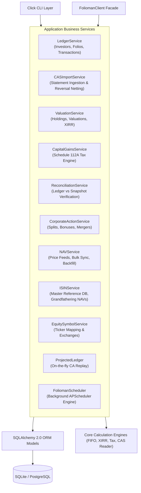

# Application Business Services (`folioman_client.services`)

This document provides a comprehensive technical reference for the 11 business service modules comprising the core service layer of `folioman-client`. These services coordinate database access, domain math, statement processing, tax rules, and background orchestration.

---

## 1. Services Architecture Overview

The service layer sits between presentation interfaces (CLI, REST API resources) and the low-level data layer (SQLAlchemy ORM models, core calculation algorithms). All services are asynchronous, operate over SQLAlchemy 2.0 `AsyncEngine`, and enforce transactional consistency using `AsyncSession`.



---

## 2. `LedgerService` (`ledger_service.py`)

### 2.1 Responsibilities
Manages investor entities, family associations, folio account records, manual trade entries, opening lot balances, and position queries.

### 2.2 Dependencies & Constructor
```python
class LedgerService:
    def __init__(self, engine: AsyncEngine | None = None) -> None:
        self.engine = engine or create_folioman_engine()
        self.session_factory = create_sessionmaker(self.engine)
        self._reconcile_service = ReconciliationService(engine=self.engine)
```
- Instantiates an internal `ReconciliationService` to trigger position audits when transactions are created or folios are merged.

### 2.3 Public Methods

#### `list_investors`

```python
async def list_investors(
    *,
    user_id: str = "default",
    family_id: int | None = None,
    unaffiliated: bool = False,
) -> list[dict[str, Any]]
```

List investors scoped by user/advisor account, with optional family group filtering.

**Arguments:**
- `user_id` (`str`, default: `"default"`): Multi-tenancy tenant or advisor identifier.
- `family_id` (`int | None`, default: `None`): If provided, filters results to members of the specified family.
- `unaffiliated` (`bool`, default: `False`): If `True`, restricts results to investors not assigned to any family group (`family_id IS NULL`).

**Returns:**
- `list[dict[str, Any]]`: List of investor dictionaries. Each dictionary contains:
  - `id` (`int`): Database primary key.
  - `name` (`str`): Investor legal name.
  - `email` (`str`): Contact email.
  - `is_huf` (`bool`): True if entity is a Hindu Undivided Family.
  - `relation` (`str`): Relationship label (e.g. `"self"`, `"spouse"`).
  - `family_id` (`int | None`): Associated family group ID.
  - `pan_masked` (`str`): Masked PAN string (e.g. `"XXXXXX123D"`).
  - `has_pan` (`bool`): True if an encrypted PAN is stored.
  - `created_at` (`datetime`): Record creation timestamp.
  - `updated_at` (`datetime`): Last update timestamp.

**Execution Details:**
1. Ensures database schema is initialized via `await init_schema(self.engine)`.
2. Queries the `Investor` table filtered by `user_id == user_id`, ordered by `Investor.name`.
3. If `family_id` is supplied, filters `Investor.family_id == family_id`.
4. If `unaffiliated=True`, filters `Investor.family_id.is_(None)`.
5. Projects rows into dictionaries exposing masked PAN (`pan_masked`) and `has_pan` flag without decrypting or exposing plaintext ciphertext.

---

#### `get_investor`

```python
async def get_investor(investor_id: int) -> dict[str, Any]
```

Retrieve detailed profile information for a single investor by primary key.

**Arguments:**
- `investor_id` (`int`, required): Unique database primary key identifier of the investor.

**Returns:**
- `dict[str, Any]`: Investor profile dictionary (`id`, `name`, `email`, `is_huf`, `relation`, `family_id`, `pan_masked`, `has_pan`, `created_at`, `updated_at`).

**Raises:**
- `ValueError`: If no investor exists with `investor_id`.

**Execution Details:**
1. Fetches investor row by primary key using `session.get(Investor, investor_id)`.
2. Raises `ValueError` if the record does not exist.
3. Formats and returns safe dictionary representation.

---

#### `create_investor`

```python
async def create_investor(
    *,
    user_id: str = "default",
    name: str,
    pan: str | None = None,
    email: str = "",
    family_id: int | None = None,
    is_huf: bool = False,
    relation: str = "",
) -> dict[str, Any]
```

Create a new investor profile with encrypted PAN protection and blind index search capability.

**Arguments:**
- `user_id` (`str`, default: `"default"`): Multi-tenancy tenant identifier.
- `name` (`str`, required): Full legal name of the investor.
- `pan` (`str | None`, default: `None`): 10-character Permanent Account Number. Encrypted at rest.
- `email` (`str`, default: `""`): Investor contact email.
- `family_id` (`int | None`, default: `None`): Optional family group ID association.
- `is_huf` (`bool`, default: `False`): Flag indicating if entity is a Hindu Undivided Family.
- `relation` (`str`, default: `""`): Relationship to primary user (e.g. `"self"`, `"spouse"`, `"child"`).

**Returns:**
- `dict[str, Any]`: The newly created investor record dictionary with `pan_masked` and `has_pan`.

**Execution Details:**
1. Normalizes the PAN: `norm_pan = pan.strip().upper()`.
2. Encrypts the PAN using Fernet symmetric encryption via `encrypt_pan(norm_pan)`.
3. Computes the deterministic HMAC-SHA256 lookup digest via `pan_hash(norm_pan)`.
4. Wraps database insertion in `handle_db_errors(session)` to capture and classify database constraint errors.
5. Commits and returns the created investor record with `pan_masked` (e.g. `XXXXXX123D`).

---

#### `list_folios`

```python
async def list_folios(investor_id: int) -> list[dict[str, Any]]
```

List all mutual fund folios and broker demat accounts belonging to an investor.

**Arguments:**
- `investor_id` (`int`, required): Target investor ID.

**Returns:**
- `list[dict[str, Any]]`: List of folio dictionaries (`id`, `investor_id`, `number`, `amc_code`, `broker`, `folio_type`, `created_at`, `updated_at`), ordered by folio number.

---

#### `create_folio`

```python
async def create_folio(
    investor_id: int,
    number: str,
    *,
    amc_code: str = "",
    broker: str = "",
    folio_type: str = "mf",
) -> dict[str, Any]
```

Create or return an existing folio under an investor (idempotent).

**Arguments:**
- `investor_id` (`int`, required): Target investor ID.
- `number` (`str`, required): Folio or demat account number (e.g. `"1234567/0"`).
- `amc_code` (`str`, default: `""`): AMC identifier for mutual funds (e.g. `"HDFC"`, `"NIPPON"`).
- `broker` (`str`, default: `""`): Broker/Depository participant name for demat folios (e.g. `"ZERODHA"`).
- `folio_type` (`str`, default: `"mf"`): Account type (`"mf"` or `"demat"`).

**Returns:**
- `dict[str, Any]`: Existing or newly created folio record dictionary.

**Execution Details:**
1. Cleans the folio string using `normalize_folio_number(number)` (strips leading zeroes, slashes, whitespace).
2. Executes an idempotency check: `where(Folio.investor_id == investor_id, Folio.number == norm_num, Folio.amc_code == amc_code)`.
3. If an existing record exists, returns it immediately without creating duplicates.
4. Otherwise, inserts and commits the new `Folio`.

---

#### `merge_folios`

```python
async def merge_folios(
    investor_id: int,
    source_folio_id: int,
    target_folio_id: int,
) -> dict[str, Any]
```

Consolidate two separate folio accounts belonging to the same investor into one.

**Arguments:**
- `investor_id` (`int`, required): Owner investor ID.
- `source_folio_id` (`int`, required): Source folio to be merged and removed.
- `target_folio_id` (`int`, required): Target destination folio retaining all records.

**Returns:**
- `dict[str, Any]`: Dictionary with row counts: `{"transactions_moved": int, "holdings_moved": int}`.

**Raises:**
- `ValueError`: If `source_folio_id == target_folio_id`, or either folio is not found or does not belong to `investor_id`.

**Execution Details:**
1. Validates `source_folio_id != target_folio_id`.
2. Checks that both folios exist and belong to `investor_id`.
3. Executes bulk SQL `update(Transaction)` moving all transaction rows to `target_folio_id`.
4. Executes bulk SQL `update(Holding)` moving all snapshot holdings to `target_folio_id`.
5. Deletes `SecurityIntegrityStatus` rows associated with `source_folio_id`.
6. Deletes the `source` folio row and commits.
7. Calls `await self._reconcile_service.reconcile_investor(investor_id)` to audit and recalculate target balances.

---

#### `list_transactions`

```python
async def list_transactions(
    investor_id: int,
    *,
    security_id: int | None = None,
    folio_id: int | None = None,
    from_date: date | None = None,
    to_date: date | None = None,
) -> list[dict[str, Any]]
```

Retrieve transaction records for an investor with optional filters for security, folio, and date range.

**Arguments:**
- `investor_id` (`int`, required): Target investor ID.
- `security_id` (`int | None`, default: `None`): Optional security filter.
- `folio_id` (`int | None`, default: `None`): Optional folio filter.
- `from_date` (`date | None`, default: `None`): Earliest transaction date filter.
- `to_date` (`date | None`, default: `None`): Latest transaction date filter.

**Returns:**
- `list[dict[str, Any]]`: Chronologically sorted list of transactions (`Transaction.date.asc()`, `Transaction.id.asc()`), eager-loading security and folio metadata.

---

#### `create_transaction`

```python
async def create_transaction(
    *,
    investor_id: int,
    security_id: int,
    date: date,
    transaction_type: str,
    units: Decimal | str,
    nav_or_price: Decimal | str,
    amount: Decimal | str | None = None,
    folio_id: int | None = None,
    fees: Decimal | str = "0",
    stamp_duty: Decimal | str = "0",
    narration: str = "",
    source: str = "manual",
    source_ref: str = "",
) -> dict[str, Any]
```

Record an immutable financial transaction in the ledger.

**Arguments:**
- `investor_id` (`int`, required): Target investor ID.
- `security_id` (`int`, required): Associated security ID.
- `date` (`date`, required): Trade / value date.
- `transaction_type` (`str`, required): Transaction classification (`"buy"`, `"sell"`, `"dividend_payout"`, `"bonus"`, etc.).
- `units` (`Decimal | str`, required): Number of units or shares traded (strictly coerced to `Decimal`).
- `nav_or_price` (`Decimal | str`, required): Price per unit or NAV at trade execution.
- `amount` (`Decimal | str | None`, default: `None`): Gross monetary value. If omitted, computed as `units * nav_or_price`.
- `folio_id` (`int | None`, default: `None`): Optional folio ID association.
- `fees` (`Decimal | str`, default: `"0"`): Brokerage, transaction charges, or AMC exit load.
- `stamp_duty` (`Decimal | str`, default: `"0"`): Statutory state stamp duty.
- `narration` (`str`, default: `""`): User or statement narration text.
- `source` (`str`, default: `"manual"`): Origin tag (`"manual"`, `"cas_pdf"`, `"ecas"`, `"api"`).
- `source_ref` (`str`, default: `""`): External unique identifier or idempotency reference.

**Returns:**
- `dict[str, Any]`: The committed transaction record dictionary.

**Execution Details:**
1. Coerces `units`, `nav_or_price`, `fees`, and `stamp_duty` to strict `Decimal`. If `amount` is omitted, calculates `units * nav_or_price`.
2. Inserts immutable row into `Transaction` with `cost_basis_complete = True`.
3. If `folio_id` is supplied, immediately triggers `reconcile_security_folio` on that position to recalculate net ledger units and update integrity status.

---

#### `create_opening_lot`

```python
async def create_opening_lot(
    *,
    investor_id: int,
    folio_id: int,
    security_id: int,
    units: Decimal | str,
    cost_basis: Decimal | str,
    as_of_date: date,
    classification: str = "ipo_allotment",
) -> dict[str, Any]
```

Synthesize an initial cost-basis acquisition lot for pre-existing holdings (e.g., IPO allotment, gift inheritance, or holdings prior to statement history).

**Arguments:**
- `investor_id` (`int`, required): Target investor ID.
- `folio_id` (`int`, required): Associated folio ID.
- `security_id` (`int`, required): Associated security ID.
- `units` (`Decimal | str`, required): Initial quantity held.
- `cost_basis` (`Decimal | str`, required): Total acquisition cost. Unit price is derived as `cost_basis / units`.
- `as_of_date` (`date`, required): Historical acquisition or allotment date.
- `classification` (`str`, default: `"ipo_allotment"`): Opening lot classification tag.

**Returns:**
- `dict[str, Any]`: The committed `BUY` transaction record dictionary. Sets `source="manual"` and structured `source_ref=f"opening-lot:{folio_id}:{security_id}:{classification}"`.

---

#### `list_holdings`

```python
async def list_holdings(
    investor_id: int,
    *,
    as_of: date | None = None,
) -> list[dict[str, Any]]
```

Compute active portfolio positions across all folios, combining transaction ledger units and statement snapshot holdings.

**Arguments:**
- `investor_id` (`int`, required): Target investor ID.
- `as_of` (`date | None`, default: `None`): Point-in-time date for valuation. Defaults to current date.

**Returns:**
- `list[dict[str, Any]]`: List of active position dictionaries with keys: `security_id`, `security_name`, `isin`, `folio_id`, `folio_number`, `units`, `latest_nav`, `market_value`, `cost_basis`, `unrealized_gain`. Positions with `effective_units <= 0` are filtered out.

---

## 3. `CASImportService` (`import_service.py`)

### 3.1 Responsibilities
Parses CAMS and KFintech Mutual Fund Consolidated Account Statements (CAS) and NSDL / CDSL Demat eCAS PDF statements. Deduplicates identical transactions, isolates incomplete histories into partial blocks, quarantines unparseable schemes, and automatically chains prior statements.

### 3.2 Key Data Structures & Hash Functions

#### `_canon_decimal`

```python
def _canon_decimal(value: Decimal | None) -> str
```

Converts a `Decimal` to normalized fixed-point text, stripping insignificant trailing zeroes (`"100.5000"` -> `"100.5"`).

**Arguments:**
- `value` (`Decimal | None`): Decimal number to canonicalize.

**Returns:**
- `str`: Normalized decimal string representation.

---

#### `_dedup_key`

```python
def _dedup_key(security_identity: str, folio_number: str, line: MfCasLineItem) -> str
```

Computes deterministic SHA-256 digest over transaction fields for idempotent deduplication:
`security_identity | folio_number | date | transaction_type | units | nav | amount | balance`.

**Arguments:**
- `security_identity` (`str`): Unique scheme identifier (ISIN or AMFI code).
- `folio_number` (`str`): Normalized folio account number.
- `line` (`MfCasLineItem`): Parsed statement line item.

**Returns:**
- `str`: SHA-256 hash string used to prevent duplicate trade ingestion.

---

### 3.3 Public Methods

#### `import_cas`

```python
async def import_cas(
    file_path_or_bytes: str | Path | bytes | io.IOBase,
    password: str,
    *,
    user_id: str = "default",
    investor_id: int | None = None,
    source_ref: str = "",
) -> dict[str, Any]
```

Import a CAMS/KFintech MF CAS or NSDL/CDSL eCAS PDF into the database.

**Arguments:**
- `file_path_or_bytes` (`str | Path | bytes | io.IOBase`, required): Path to PDF file or in-memory byte buffer.
- `password` (`str`, required): PDF opening password (case-sensitive).
- `user_id` (`str`, default: `"default"`): Multi-tenant user or portfolio identifier.
- `investor_id` (`int | None`, default: `None`): Optional existing investor ID to assign statements to.
- `source_ref` (`str`, default: `""`): Optional source tracking reference string (defaults to `sha256:<file_content_hash>`).

**Returns:**
- `dict[str, Any]`: Dictionary summary of imported entities, transactions, and quarantines (`job_id`, `investor_id`, `schemes_processed`, `transactions_imported`, `quarantined_count`, `partial_blocks_count`, `status`).

**Raises:**
- `FoliomanParseError`: If the file path is invalid or the PDF format cannot be parsed.
- `FoliomanPasswordError`: If the PDF password is incorrect or missing.

**Execution Flow:**
1. **Binary Extraction**: Reads raw file bytes or accepts memory stream. Validates file existence. Computes SHA-256 hash of file content if `source_ref` is blank.
2. **CAS Parsing**: Calls `read_cas(BytesIO(content), password)`. Maps `CASPasswordError` to `FoliomanPasswordError` and `CASParseError` to `FoliomanParseError`.
3. **Investor Resolution**: Finds investor matching `user_id` and hashed PAN (`pan_hash`). If absent, automatically provisions new `Investor` row with encrypted PAN.
4. **Job Tracking**: Inserts `ImportJob` record in `status="running"`.
5. **Mutual Fund Statement Processing**:
   - Loops over `parsed.mf.schemes`.
   - Uses nested transaction savepoints (`session.begin_nested()`) for each scheme block to ensure that an unparseable scheme does not abort the entire statement.
   - Upserts `AMC`, `Security` (matching by AMFI code, ISIN, or symbol), and `Folio`.
   - **History Gap Verification**: Evaluates whether the scheme has complete transaction history from opening using `scheme_history_gap()`. If `opening_units > 0` and prior ledger balance does not equal opening balance, the block is flagged as **incomplete history** (`cost_basis_complete = False`).
   - Inserts non-duplicate transactions (checking `Transaction.dedup_key`).
   - If history is incomplete, stores `PartialBlock` and creates snapshot `Holding` with `source="cas_pdf"`.
   - If parsing fails with an unexpected exception, creates `ImportQuarantine` row containing the raw error and scheme metadata.
6. **Chained Partial Upgrade (`_upgrade_chained_partials`)**:
   - Inspects all existing `PartialBlock` records for the investor.
   - If the newly imported statement supplied older transactions that satisfy the opening balance (`abs(prior - pb.opening_units) <= 0.001`), upgrades all incomplete transactions to `cost_basis_complete = True`, deletes the snapshot `Holding`, and removes the `PartialBlock`.
7. **eCAS Statement Processing (NSDL / CDSL)**:
   - For equity holdings reported in eCAS, snapshots observed holdings into `Holding` with `units`, `value_observed`, `avg_cost_observed`, and `source="ecas"`.
8. **Auto-Reconciliation**:
   - Calls `reconcile_security()` on all touched `security_id`s.
9. **Job Finalization**:
   - Marks `ImportJob.status` as `"completed"` (or `"partially_reconciled"` if items were quarantined or partial).
   - Commits session and returns detailed import summary.

---

## 4. `ValuationService` (`valuation_service.py`)

### 4.1 Responsibilities
The central analytical and mark-to-market performance engine. Calculates current portfolio net worth, asset class allocations, XIRR money-weighted returns, historical daily time series (`InvestorValue`), and rolling multi-period returns.

### 4.2 Key Algorithms & Formulas

1. **Mark-to-Market Valuation**:

   $$\text{Market Value} = \sum \text{Held Units} \times \text{Latest Available Quote}$$

2. **XIRR (Extended Internal Rate of Return)**:
   Finds root $r$ such that:

   $$\sum_{i=1}^{N} \frac{C_i}{(1 + r)^{\frac{d_i - d_0}{365}}} = 0$$

   where $C_i$ are net transaction cashflows (investments negative, redemptions positive) and the final cashflow $C_N$ is the terminal portfolio market value (positive).
3. **Trailing Period Returns**:
   Computes annualized CAGR for windows $\ge 1\text{Y}$ and absolute percentage change for windows $< 1\text{Y}$ across standard horizons: `1M`, `3M`, `6M`, `1Y`, `3Y`, `5Y`.

### 4.3 Public Methods

#### `build_investor_summary`

```python
async def build_investor_summary(
    investor_id: int,
    as_of: date | None = None,
) -> dict[str, Any]
```

Compile executive dashboard for an investor: valuation, allocations, XIRR, and period returns.

**Arguments:**
- `investor_id` (`int`, required): Target investor ID.
- `as_of` (`date | None`, default: `None`): Point-in-time valuation date. Defaults to current date.

**Returns:**
- `dict[str, Any]`: Comprehensive summary dictionary:
  - `investor_id`, `as_of`, `valuation` (total current value, total cost, unrealized gain, gain pct).
  - `xirr` (annualized money-weighted rate of return).
  - `period_returns` (`1M`, `3M`, `6M`, `1Y`, `3Y`, `5Y` performance).
  - `category_allocations` (allocation breakdown across `Equity`, `Debt`, `Hybrid`, `Commodity`).
  - `amc_allocations` (breakdown by asset management company / fund house).
  - `data_freshness` (unpriced funds count, stale feeds).
  - `integrity_status` (reconciliation status counts: tax-ready, mismatches, snapshots).

**Raises:**
- `FoliomanNotFoundError`: If `investor_id` does not exist.

---

#### `build_family_summary`

```python
async def build_family_summary(
    family_id: int,
    as_of: date | None = None,
) -> dict[str, Any]
```

Aggregate all member portfolios within a family group into a consolidated net worth and group XIRR.

**Arguments:**
- `family_id` (`int`, required): Target family group ID.
- `as_of` (`date | None`, default: `None`): Point-in-time valuation date.

**Returns:**
- `dict[str, Any]`: Consolidated group dashboard with aggregate valuation, member-by-member breakdown, combined category allocation, and group-level XIRR.

**Raises:**
- `FoliomanNotFoundError`: If `family_id` does not exist.

---

#### `build_scheme_detail`

```python
async def build_scheme_detail(
    investor_id: int,
    security_id: int,
    as_of: date | None = None,
) -> dict[str, Any]
```

Deep-dive position analysis for a single security held by an investor.

**Arguments:**
- `investor_id` (`int`, required): Target investor ID.
- `security_id` (`int`, required): Target security ID.
- `as_of` (`date | None`, default: `None`): Point-in-time valuation date.

**Returns:**
- `dict[str, Any]`: Detailed position dictionary including FIFO open acquisition lots, lot-by-lot unrealized gains, position-specific XIRR, full transaction history, and dividend distribution records.

---

#### `value_series`

```python
async def value_series(
    investor_id: int,
    from_date: date | None = None,
    to_date: date | None = None,
) -> list[dict[str, Any]]
```

Retrieve contiguous daily portfolio valuation time series for an investor.

**Arguments:**
- `investor_id` (`int`, required): Target investor ID.
- `from_date` (`date | None`, default: `None`): Start date of daily series.
- `to_date` (`date | None`, default: `None`): End date of daily series (defaults to current date).

**Returns:**
- `list[dict[str, Any]]`: List of daily valuation dictionaries from `InvestorValue` (`date`, `invested_amount`, `current_value`, `unrealized_gain`, `is_stale`). Automatically backfills missing dates on-the-fly if gaps are detected.

---

#### `family_value_series`

```python
async def family_value_series(
    family_id: int,
    from_date: date | None = None,
    to_date: date | None = None,
) -> list[dict[str, Any]]
```

Retrieve aggregated daily valuation time series across all members of a family.

**Arguments:**
- `family_id` (`int`, required): Target family group ID.
- `from_date` (`date | None`, default: `None`): Start date of time series.
- `to_date` (`date | None`, default: `None`): End date of time series.

**Returns:**
- `list[dict[str, Any]]`: Daily summed series (`date`, `invested_amount`, `current_value`, `unrealized_gain`).

---

#### `security_value_series`

```python
async def security_value_series(
    investor_id: int,
    security_id: int,
    from_date: date | None = None,
    to_date: date | None = None,
) -> list[dict[str, Any]]
```

Retrieve daily valuation and holding time series for a single security position.

**Arguments:**
- `investor_id` (`int`, required): Target investor ID.
- `security_id` (`int`, required): Target security ID.
- `from_date` (`date | None`, default: `None`): Start date of time series.
- `to_date` (`date | None`, default: `None`): End date of time series.

**Returns:**
- `list[dict[str, Any]]`: Daily position series (`date`, `held_units`, `nav`, `market_value`, `invested_amount`).

---

#### `get_valuation_status`

```python
async def get_valuation_status(investor_id: int) -> dict[str, Any]
```

Check valuation cache freshness and queued recalculation status for an investor.

**Arguments:**
- `investor_id` (`int`, required): Target investor ID.

**Returns:**
- `dict[str, Any]`: Cache status (`investor_id`, `status`, `earliest_stale_date`, `last_calculated_at`).

---

#### `queue_recompute`

```python
async def queue_recompute(
    investor_id: int,
    from_date: date | None = None,
) -> None
```

Mark the cached valuation time series for an investor as stale starting from `from_date`.

**Arguments:**
- `investor_id` (`int`, required): Target investor ID.
- `from_date` (`date | None`, default: `None`): Earliest invalidation date. If `None`, defaults to the earliest recorded transaction date.

**Returns:**
- `None`

**Execution Details:**
1. Updates `Investor.valuation_status = "stale"`.
2. Sets `Investor.earliest_stale_date = min(existing, from_date)`.
3. Commits to database to schedule background recomputation.

---

#### `recompute_investor_valuation`

```python
async def recompute_investor_valuation(
    investor_id: int,
    from_date: date | None = None,
    batch_size: int = 100,
) -> int
```

Execute deterministic daily roll-forward from `from_date` to `today`, persisting daily net worth.

**Arguments:**
- `investor_id` (`int`, required): Target investor ID.
- `from_date` (`date | None`, default: `None`): Start date for daily roll-forward.
- `batch_size` (`int`, default: `100`): SQL upsert batch size.

**Returns:**
- `int`: Count of daily valuation rows calculated and upserted into `InvestorValue`.

**Execution Details:**
1. Reconstructs daily held units by replaying transactions and corporate actions.
2. Resolves daily closing NAVs from `NAVHistory`.
3. Computes daily cost basis and market value.
4. Upserts rows into `InvestorValue` in batches.
5. Clears stale status flag on the `Investor` record.

---

#### `process_pending_valuations`

```python
async def process_pending_valuations() -> int
```

Process all investors whose valuation series are currently flagged as stale.

**Returns:**
- `int`: Count of investors whose historical valuations were successfully recomputed.

---

## 5. `CapitalGainsService` (`capital_gains_service.py`)

### 5.1 Responsibilities
Executes the Indian tax computation engine for realized capital gains on Mutual Funds and Listed Equities under Section 112A, Section 111A, and Section 50AA. Handles Section 112A grandfathering (Jan 31, 2018 FMV lookup), Section 48 expense additions, and Union Budget 2024 cutoff rules (July 23, 2024).

### 5.2 Key Policies & Statutory Rules

- **Union Budget 2024 Cutoff (July 23, 2024)**:
  - Transfers before July 23, 2024: Equity LTCG taxed at 10% (exemption ₹1,00,000); STCG at 15%.
  - Transfers on/after July 23, 2024: Equity LTCG taxed at 12.5% (exemption ₹1,25,000); STCG at 20%.
- **Holding Period Thresholds**:
  - Listed Equities & Equity Mutual Funds: Long-Term if held $> 12$ months (365 days).
  - Debt Mutual Funds (acquired on/after April 1, 2023): Deemed Short-Term under Section 50AA regardless of holding period.
- **Section 112A Grandfathering (Acquisitions on/before Jan 31, 2018)**:

  $$\text{Deemed Cost} = \max(\text{Actual Purchase Cost}, \min(\text{FMV as of Jan 31, 2018}, \text{Full Value of Consideration}))$$

### 5.3 Public Methods

#### `get_capital_gains_report`

```python
async def get_capital_gains_report(
    investor_id: int,
    fy: str,
    *,
    include_unreconciled: bool = False,
    fmv_lookup: Callable[[str, date], Decimal | None] | None = None,
) -> dict[str, Any]
```

Generate comprehensive realized capital gains tax report for an Indian financial year.

**Arguments:**
- `investor_id` (`int`, required): Target investor ID.
- `fy` (`str`, required): Financial year identifier string (e.g. `"2024-25"`, `"2024-2025"`).
- `include_unreconciled` (`bool`, default: `False`): If `True`, includes transactions from folios flagged as unverified or mismatched.
- `fmv_lookup` (`Callable | None`, default: `None`): Optional custom resolver for Jan 31, 2018 benchmark NAVs.

**Returns:**
- `dict[str, Any]`: Aggregated tax report dictionary:
  - `investor_id`, `financial_year`, `date_range`.
  - `ltcg_with_grandfathering`: Long-term gains eligible for Section 112A grandfathering relief.
  - `ltcg_without_grandfathering`: Long-term gains on assets acquired after Jan 31, 2018.
  - `stcg`: Short-term capital gains under Section 111A / Section 50AA.
  - `budget_2024_split`: Disposals split into pre-July-23-2024 and post-July-23-2024 tax buckets.
  - `disposals`: Full itemized list of realized sell trades with matched FIFO acquisition lots.

**Raises:**
- `FoliomanNotFoundError`: If `investor_id` does not exist.

**Execution Flow:**
1. Resolves date range for financial year via `india_fy_range(fy)` (e.g. `2024-04-01` to `2025-03-31`).
2. Queries tax-ready transactions for `investor_id` (`cost_basis_complete == True`).
3. Replays corporate actions on historical lots via `ProjectedLedger`.
4. Runs FIFO lot matching via `apply_fifo()` to match sell disposals with acquisition lots.
5. Filters disposals occurring within the target financial year.
6. Loads Jan 31, 2018 FMV reference prices from `FMVJan2018` table via `_build_fmv_lookup()`.
7. Applies `IndiaTaxPolicy.adjusted_cost()` to determine grandfathered cost basis and Section 48 deductions.
8. Aggregates results into tax buckets.

---

#### `list_capital_gains_by_fy`

```python
async def list_capital_gains_by_fy(
    investor_id: int,
    *,
    include_unreconciled: bool = False,
) -> list[dict[str, Any]]
```

List multi-year capital gains summary across all financial years having sell disposals.

**Arguments:**
- `investor_id` (`int`, required): Target investor ID.
- `include_unreconciled` (`bool`, default: `False`): Whether to include unreconciled positions.

**Returns:**
- `list[dict[str, Any]]`: List of yearly summaries (`financial_year`, `ltcg`, `stcg`, `total_realized_gain`, `trade_count`).

---

#### `get_schedule_112a`

```python
async def get_schedule_112a(
    investor_id: int,
    fy: str,
    *,
    include_unreconciled: bool = False,
    fmv_lookup: Callable[[str, date], Decimal | None] | None = None,
) -> dict[str, Any]
```

Generate the official 14-column ITR Schedule 112A dataset ready for direct export into Income Tax filing utilities.

**Arguments:**
- `investor_id` (`int`, required): Target investor ID.
- `fy` (`str`, required): Financial year identifier (e.g. `"2024-25"`).
- `include_unreconciled` (`bool`, default: `False`): Whether to include unreconciled transactions.
- `fmv_lookup` (`Callable | None`, default: `None`): Optional custom Jan 31, 2018 FMV resolver.

**Returns:**
- `dict[str, Any]`: Schedule 112A payload containing `investor_id`, `financial_year`, and `rows` (list of 14-column dictionaries):
  1. `share_or_unit_description`: Security name / scheme title.
  2. `units`: Number of units/shares sold.
  3. `sale_price_per_unit`: Gross consideration per unit.
  4. `full_value_of_consideration`: Total sale consideration.
  5. `cost_of_acquisition`: Historical acquisition cost (without indexation).
  6. `fmv_per_unit_jan_2018`: Fair Market Value as of 31st January 2018.
  7. `total_fmv`: Aggregate 31-Jan-2018 value.
  8. `expenditure_sec_48`: Transfer expenses wholly and exclusively incurred (brokerage, stamp duty).
  9. `total_deductions`: Total allowable deduction under Section 48.
  10. `balance`: Sale consideration minus allowable deductions.
  11. `deductions_sec_54f`: Capital gains exemptions claimed under Section 54F.
  12. `net_capital_gain`: Final taxable gain.
  13. `isin`: 12-character security ISIN code.
  14. `acquisition_date`: Historical lot purchase date.

---

## 6. `CorporateActionService` (`corporate_action_service.py`)

### 6.1 Responsibilities
Scrapes, records, and applies corporate actions (stock splits, reverse splits, bonus share issues, mergers, demergers, rights issues, and dividends).

### 6.2 Key Invariant: Transaction Immutability
`folioman-client` strictly adheres to **transaction immutability**. When a 1:5 stock split occurs, historical buy transactions in `Transaction` are **never multiplied or updated in place**. Instead:
1. The split event is recorded in `CorporateActionReference`.
2. The user or auto-reconciler links it to the investor's holdings via `AppliedCorporateAction`.
3. Read-time ledger projectors (`ProjectedLedger`) multiply units on-the-fly when calculating holdings, FIFO lots, or capital gains.

### 6.3 Public Methods

#### `refresh_corporate_actions`

```python
async def refresh_corporate_actions(
    *,
    security_ids: list[int] | None = None,
    since_year: int = 2016,
) -> dict[str, Any]
```

Fetch and cache corporate action history for equity securities from NSE/BSE feeds.

**Arguments:**
- `security_ids` (`list[int] | None`, default: `None`): Optional subset of security IDs to refresh. If `None`, queries all equity securities.
- `since_year` (`int`, default: `2016`): Earliest year to pull history back to.

**Returns:**
- `dict[str, Any]`: Summary dictionary with counts: `{"securities_checked": int, "actions_fetched": int, "errors": int}`.

**Execution Details:**
1. Scrapes corporate actions from Yahoo Finance and NSE Bhavcopy feeds for tracked securities.
2. Upserts parsed actions into `CorporateActionReference` avoiding duplicates by checking `(security_id, action_type, ex_date)`.

---

#### `apply_corporate_action`

```python
async def apply_corporate_action(
    investor_id: int,
    folio_id: int,
    reference_id: int,
) -> dict[str, Any]
```

Apply a cached corporate action (BONUS or SPLIT) to an investor folio.

**Arguments:**
- `investor_id` (`int`, required): Target investor ID.
- `folio_id` (`int`, required): Target folio ID holding the security.
- `reference_id` (`int`, required): Primary key of the `CorporateActionReference` to apply.

**Returns:**
- `dict[str, Any]`: Created `AppliedCorporateAction` event dictionary (`id`, `investor_id`, `security_id`, `folio_id`, `kind`, `unit_multiplier`, `ex_date`).

**Raises:**
- `ValueError`: If `reference_id` is not found, marked as `needs_review`, or is not an auto-applicable type (bonus/split).

**Execution Details:**
1. Loads reference action from `CorporateActionReference`.
2. Validates that the action type is supported and not flagged for manual review.
3. Records the action in `AppliedCorporateAction` table.
4. Triggers recomputation queue via `ValuationService.queue_recompute(investor_id)`.
5. Triggers position reconciliation audit via `ReconciliationService.reconcile_security_folio()`.

---

#### `list_references`

```python
async def list_references(
    *,
    security_id: int | None = None,
    isin: str | None = None,
    action_type: str | None = None,
) -> list[dict[str, Any]]
```

List cached corporate action announcements from the reference catalog.

**Arguments:**
- `security_id` (`int | None`, default: `None`): Optional security ID filter.
- `isin` (`str | None`, default: `None`): Optional ISIN filter.
- `action_type` (`str | None`, default: `None`): Optional filter for action type (`"split"`, `"bonus"`, `"dividend"`, `"merger"`, `"demerger"`).

**Returns:**
- `list[dict[str, Any]]`: List of corporate action reference records.

---

## 7. `ReconciliationService` (`reconciliation_service.py`)

### 7.1 Responsibilities
Audits portfolio integrity by comparing the running net units calculated from the transaction ledger against the balance observed in CAS holding snapshots. Detects unexplained balance mismatches and identifies pending corporate actions that account for discrepancies.

### 7.2 Integrity Status Classifications
Every position in `SecurityIntegrityStatus` is assigned one of the following states:
- `MATCH`: Ledger net units equal snapshot units within numerical tolerance ($\le 0.001$).
- `MISMATCH`: Ledger net units disagree with snapshot balance and no pending corporate action explains the gap.
- `INCOMPLETE_HISTORY`: Statement has non-zero opening balance without historical transactions.
- `CA_EXPLAINED`: Mismatch perfectly corresponds to a known stock split or bonus issue ratio (e.g. 1:1, 1:2, 1:5).
- `MANUAL_OVERRIDE`: User manually acknowledged and suppressed the discrepancy.
- `SNAPSHOT_ONLY`: Holding snapshot exists from eCAS but no transaction ledger records are present.

### 7.3 Public Methods

#### `reconcile_security_folio`

```python
async def reconcile_security_folio(
    session: AsyncSession,
    investor_id: int,
    security_id: int,
    folio_id: int,
    *,
    acknowledge: bool = False,
    clear_acknowledgement: bool = False,
) -> SecurityIntegrityStatus | None
```

Reconcile one `(investor, security, folio)` position and upsert its integrity status.

**Arguments:**
- `session` (`AsyncSession`, required): Active SQLAlchemy session.
- `investor_id` (`int`, required): Target investor ID.
- `security_id` (`int`, required): Target security ID.
- `folio_id` (`int`, required): Target folio ID.
- `acknowledge` (`bool`, default: `False`): If `True`, sets user acknowledgement override on mismatch.
- `clear_acknowledgement` (`bool`, default: `False`): If `True`, clears user override and re-evaluates genuine status.

**Returns:**
- `SecurityIntegrityStatus | None`: The updated ORM integrity status record, or `None` if the security was not found.

**Execution Details:**
1. Calculates projected transaction ledger units using `compute_ledger()`.
2. Fetches latest snapshot units from `Holding`.
3. Evaluates difference: if $\le 0.001$, sets status to `MATCH` (`tax_safe = True`).
4. If difference $> 0.001$, checks whether unapplied corporate actions in `CorporateActionReference` explain the ratio (`CA_EXPLAINED`).
5. Upserts row in `SecurityIntegrityStatus`.

---

#### `reconcile_security`

```python
async def reconcile_security(
    session: AsyncSession,
    investor_id: int,
    security_id: int,
) -> list[SecurityIntegrityStatus]
```

Reconcile all folios holding a specific security for an investor.

**Arguments:**
- `session` (`AsyncSession`, required): Active database session.
- `investor_id` (`int`, required): Target investor ID.
- `security_id` (`int`, required): Target security ID.

**Returns:**
- `list[SecurityIntegrityStatus]`: List of updated integrity status records across all folios.

---

#### `reconcile_investor`

```python
async def reconcile_investor(investor_id: int) -> dict[str, Any]
```

Re-reconcile every security and folio position for a single investor.

**Arguments:**
- `investor_id` (`int`, required): Target investor ID.

**Returns:**
- `dict[str, Any]`: Summary dictionary: `{"investor_id": int, "securities_reconciled": int, "statuses_count": int, "tax_safe_count": int, "mismatch_count": int}`.

---

#### `reconcile_all`

```python
async def reconcile_all(user_id: str | None = None) -> dict[str, Any]
```

Recompute integrity statuses across all investors in the active database.

**Arguments:**
- `user_id` (`str | None`, default: `None`): Optional user/advisor ID to scope reconciliation.

**Returns:**
- `dict[str, Any]`: Summary dictionary: `{"investors_count": int, "statuses_count": int, "tax_safe_count": int, "mismatch_count": int}`.

---

#### `acknowledge_mismatch`

```python
async def acknowledge_mismatch(
    investor_id: int,
    security_id: int,
    folio_id: int,
) -> dict[str, Any]
```

Acknowledge a unit mismatch for a `(security, folio)` position, suppressing warnings.

**Arguments:**
- `investor_id` (`int`, required): Target investor ID.
- `security_id` (`int`, required): Target security ID.
- `folio_id` (`int`, required): Target folio ID.

**Returns:**
- `dict[str, Any]`: Updated position status (`status`, `tax_safe`, `issues`).

**Raises:**
- `ValueError`: If the position has no transactions or holdings to reconcile.

---

#### `clear_acknowledgement`

```python
async def clear_acknowledgement(
    investor_id: int,
    security_id: int,
    folio_id: int,
) -> dict[str, Any]
```

Clear user acknowledgement for a position, reverting to its genuine calculated integrity status.

**Arguments:**
- `investor_id` (`int`, required): Target investor ID.
- `security_id` (`int`, required): Target security ID.
- `folio_id` (`int`, required): Target folio ID.

**Returns:**
- `dict[str, Any]`: Updated status dictionary.

---

## 8. `NAVService` (`nav_service.py`)

### 8.1 Responsibilities
Synchronizes daily NAVs for mutual funds and closing prices for equities. Manages multi-source feeds, computes feed freshness, and detects and backfills historical price gaps.

### 8.2 Data Feed Priority Hierarchy
1. **AMFI Bulk Feed**: Daily text feed of all 10,000+ Indian mutual funds. High speed, single HTTP request.
2. **`mfapi.in`**: Historical and latest NAVs by AMFI code for mutual funds.
3. **NSE Bhavcopy**: Official daily closing prices for NSE-listed equities and ETFs.
4. **Yahoo Finance (`yfinance`)**: Real-time quotes, historical price series, and corporate actions.
5. **Captnemo Archive**: Secondary historical backup.

### 8.3 Public Methods

#### `refresh_navs`

```python
async def refresh_navs(
    *,
    types: list[str] | None = None,
    securities: list[Security] | None = None,
) -> dict[str, int]
```

Fetch and store latest NAV / price point for held securities.

**Arguments:**
- `types` (`list[str] | None`, default: `None`): Optional asset type filter (e.g. `["mf"]`, `["equity", "etf"]`).
- `securities` (`list[Security] | None`, default: `None`): Explicit subset of `Security` ORM objects to refresh. If omitted, queries all active securities.

**Returns:**
- `dict[str, int]`: Summary dictionary: `{"updated": int, "skipped": int, "errors": int}`.

**Execution Details:**
1. Evaluates target securities requiring price updates.
2. For mutual funds, downloads the AMFI daily bulk file in one request and updates all matching securities in memory.
3. For equities and ETFs, queries Yahoo Finance or NSE Bhavcopy.
4. Upserts closing prices into `NAVHistory` with `date`, `nav`, and `feed_source`.

---

#### `backfill_navs`

```python
async def backfill_navs(
    *,
    security_id: int | None = None,
    force: bool = False,
) -> dict[str, int]
```

Backfill historical daily price series for securities.

**Arguments:**
- `security_id` (`int | None`, default: `None`): Specific security ID to backfill. If `None`, backfills all held securities.
- `force` (`bool`, default: `False`): If `True`, pulls full historical price series from earliest date, ignoring existing cached points.

**Returns:**
- `dict[str, int]`: Summary dictionary: `{"securities": int, "points": int, "errors": int, "skipped": int, "closed": int}`.

---

#### `get_nav_freshness`

```python
async def get_nav_freshness(
    *,
    investor_ids: list[int] | None = None,
) -> dict[str, Any]
```

Compute price quote freshness report per held security.

**Arguments:**
- `investor_ids` (`list[int] | None`, default: `None`): Optional investor ID list to scope freshness analysis.

**Returns:**
- `dict[str, Any]`: Freshness report containing:
  - `as_of`: Latest completed trading day date.
  - `securities`: List of per-security status objects (`id`, `name`, `isin`, `symbol`, `security_type`, `latest_nav_date`, `is_fresh`, `feed_source`).
  - `last_refreshed_at`: Timestamp of most recent sync.
  - `next_refresh_at`: Timestamp of next scheduled refresh window.

---

## 9. `ISINService` (`isin_service.py`)

### 9.1 Responsibilities
Maintains master reference dictionary of 100,000+ Indian securities, maps ISINs to AMFI scheme codes, and provides statutory Jan 31, 2018 grandfathering NAVs from the `casparser-isin` database.

### 9.2 Public Methods

#### `get_reference_status`

```python
async def get_reference_status() -> dict[str, Any]
```

Return current population status of the reference master catalog.

**Returns:**
- `dict[str, Any]`: Status dictionary with counts:
  - `is_seeded` (`bool`): True if schemes and ISINs are populated.
  - `schemes_count` (`int`): Count of mutual fund scheme records.
  - `isins_count` (`int`): Count of national ISIN security records.
  - `grandfathering_count` (`int`): Count of Jan 31, 2018 FMV benchmark NAVs.
  - `version` (`str | None`): Catalog release version tag.

---

#### `seed_reference_data`

```python
async def seed_reference_data(
    force: bool = False,
    source_path: Path | None = None,
) -> dict[str, Any]
```

Ingest the full reference master data from SQLite archive into the database.

**Arguments:**
- `force` (`bool`, default: `False`): If `True`, purges existing reference tables and re-seeds.
- `source_path` (`Path | None`, default: `None`): Optional explicit path to a `casparser-isin` SQLite file.

**Returns:**
- `dict[str, Any]`: Inserted row counts and version dictionary.

---

#### `update_reference_data`

```python
async def update_reference_data() -> dict[str, Any]
```

Check upstream repository for a newer `casparser-isin` database release and apply updates.

**Returns:**
- `dict[str, Any]`: Upgrade result dictionary (`updated`, `version`, `message`).

---

#### `resolve_isin`

```python
async def resolve_isin(isin: str) -> dict[str, Any] | None
```

Resolve an ISIN against mutual fund schemes and national securities catalogs.

**Arguments:**
- `isin` (`str`, required): 12-character International Securities Identification Number.

**Returns:**
- `dict[str, Any] | None`: Resolved security metadata dictionary (`isin`, `name`, `symbol`, `exchange`, `security_type`, `amfi_code`, `rta`, `rta_code`, `amc_code`, `sebi_category`, `type`, `grandfathering_nav`), or `None` if unmatched.

---

#### `resolve_amfi_code`

```python
async def resolve_amfi_code(amfi_code: str) -> dict[str, Any] | None
```

Resolve a mutual fund scheme by its 6-digit AMFI code.

**Arguments:**
- `amfi_code` (`str`, required): AMFI scheme code string.

**Returns:**
- `dict[str, Any] | None`: Scheme metadata dictionary with grandfathering NAV, or `None` if unmatched.

---

#### `search_schemes`

```python
async def search_schemes(
    query: str,
    limit: int = 20,
) -> list[dict[str, Any]]
```

Search mutual fund schemes by text name, AMFI code, or ISIN substring.

**Arguments:**
- `query` (`str`, required): Search search query text.
- `limit` (`int`, default: `20`): Maximum matching results to return.

**Returns:**
- `list[dict[str, Any]]`: List of matching scheme dictionaries (`id`, `amfi_code`, `isin`, `name`, `rta`, `rta_code`, `amc_code`, `sebi_category`, `type`).

---

#### `get_grandfathering_nav`

```python
async def get_grandfathering_nav(isin: str) -> Decimal | None
```

Lookup the statutory Section 112A LTCG fair market value as on 31-Jan-2018.

**Arguments:**
- `isin` (`str`, required): 12-character security ISIN.

**Returns:**
- `Decimal | None`: Closing NAV / price on 31st January 2018, or `None` if not available.

---

## 10. `EquitySymbolService` (`equity_symbol_service.py`)

### 10.1 Responsibilities
Resolves plain text company names or ISINs into exchange tickers (e.g., `INE002A01018` -> `RELIANCE.NS`). Ensures correct symbol formatting when querying market data feeds and corporate actions.

### 10.2 Public Methods

#### `resolve_symbols`

```python
async def resolve_symbols(
    *,
    dry_run: bool = False,
    backfill: bool = False,
    force_backfill: bool = False,
) -> dict[str, Any]
```

Resolve missing trading symbols for demat securities imported by ISIN only.

**Arguments:**
- `dry_run` (`bool`, default: `False`): If `True`, identifies matches without persisting changes to the database.
- `backfill` (`bool`, default: `False`): If `True`, automatically backfills historical prices for newly resolved securities.
- `force_backfill` (`bool`, default: `False`): If `True`, backfills full history even if some price points already exist.

**Returns:**
- `dict[str, Any]`: Summary dictionary with counts and matching lists:
  - `unresolved_count` (`int`): Count of securities initially missing symbols.
  - `matched_count` (`int`): Count of successfully resolved symbols.
  - `unmatched_count` (`int`): Count of securities that could not be matched.
  - `updated_count` (`int`): Count of database records updated (0 if `dry_run=True`).
  - `matched` (`list`): List of resolved symbol items.
  - `unmatched` (`list`): List of unresolved ISINs.
  - `backfill`: Optional backfill summary dictionary if `backfill=True`.

---

## 11. `FoliomanScheduler` (`scheduler.py`)

### 11.1 Responsibilities
Wraps `APScheduler` background task scheduler to execute periodic maintenance jobs in long-running embedded daemon or CLI background mode.

### 11.2 Scheduled Recurring Jobs
1. **`daily_extend`**: Runs daily at 23:30 IST to roll forward portfolio valuations for active investors.
2. **`nav_refresh`**: Runs daily at 21:30 IST following AMFI's official evening NAV publication.
3. **`isin_update`**: Runs weekly on Sunday at 02:00 IST to check for updated ISIN master databases.

### 11.3 Public Methods & Attributes

#### `start`

```python
def start(blocking: bool = False) -> None
```

Start the background scheduler thread or block the main thread.

**Arguments:**
- `blocking` (`bool`, default: `False`): If `True`, runs a `BlockingScheduler` blocking the calling process. If `False`, starts a daemon `BackgroundScheduler`.

---

#### `stop`

```python
def stop() -> None
```

Gracefully shut down all scheduled background jobs and release resources.

---

#### `is_running`

```python
@property
def is_running -> bool
```

Boolean property indicating whether the scheduler daemon is currently active and running.

---

## 12. `ProjectedLedger` Replay Engine (`projected_ledger.py`)

### 12.1 Responsibilities
Dynamic virtual ledger replay module. Sits between raw database rows in `Transaction` and high-level analytical consumers (`ValuationService`, `CapitalGainsService`, `FIFOUnits`).

### 12.2 Replay Mechanics
When transactions are loaded:
1. Queries all `AppliedCorporateAction` rows for the security.
2. Interleaves split, bonus, and merger events chronologically with historical transactions.
3. For splits: multiplies units of all prior buy transactions and adjusts their virtual cost per unit.
4. For bonus issues: injects synthetic zero-cost `BONUS` buy lots on the ex-date.
5. Emits virtual `CoreTransaction` stream preserving total cost basis without modifying underlying database records.

### 12.3 Functions

#### `compute_ledger`

```python
async def compute_ledger(
    session: AsyncSession,
    investor_id: int,
    security_id: int,
    *,
    folio_id: int | None = None,
    as_of: date | None = None,
    include_incomplete: bool = False,
) -> list[CoreTransaction]
```

Derive the projected cost-basis transaction ledger for one `(investor, security, [folio])` position with corporate actions replayed.

**Arguments:**
- `session` (`AsyncSession`, required): Active database session.
- `investor_id` (`int`, required): Target investor ID.
- `security_id` (`int`, required): Target security ID.
- `folio_id` (`int | None`, default: `None`): Optional folio ID filter.
- `as_of` (`date | None`, default: `None`): Point-in-time filter; only replays events and returns transactions on or before this date.
- `include_incomplete` (`bool`, default: `False`): If `True`, includes transactions whose cost basis is flagged as incomplete.

**Returns:**
- `list[CoreTransaction]`: Adjusted in-memory transaction list with corporate action unit multipliers and synthetic bonus lots applied.

---

#### `projected_transactions`

```python
async def projected_transactions(
    session: AsyncSession,
    investor_id: int,
    *,
    folio_id: int | None = None,
    as_of: date | None = None,
    include_incomplete: bool = False,
) -> list[CoreTransaction]
```

Derive the entire cost-basis ledger across all securities for an investor with corporate actions replayed.

**Arguments:**
- `session` (`AsyncSession`, required): Active database session.
- `investor_id` (`int`, required): Target investor ID.
- `folio_id` (`int | None`, default: `None`): Optional folio ID filter.
- `as_of` (`date | None`, default: `None`): Point-in-time filter.
- `include_incomplete` (`bool`, default: `False`): Whether to include incomplete cost-basis transactions.

**Returns:**
- `list[CoreTransaction]`: Combined adjusted transaction list across the investor portfolio.

---

#### `demerger_reductions`

```python
async def demerger_reductions(
    session: AsyncSession,
    investor_id: int,
    *,
    folio_id: int | None = None,
) -> dict[str, list]
```

Retrieve each parent security's demerger cost reductions, keyed by security identity string.

**Arguments:**
- `session` (`AsyncSession`, required): Active database session.
- `investor_id` (`int`, required): Target investor ID.
- `folio_id` (`int | None`, default: `None`): Optional folio ID filter.

**Returns:**
- `dict[str, list]`: Dictionary mapping security identity strings (ISIN/symbol) to tuples of `(ex_date, date_to_reduction_cost_map)`.

---

#### `security_key`

```python
def security_key(sec: Security) -> str
```

Produce a stable identifier string for grouping projected core rows back to a database security.

**Arguments:**
- `sec` (`Security`): Database or core security object.

**Returns:**
- `str`: Stable string key (ISIN for equities/bonds, AMFI code for mutual funds, or symbol/name fallback).
