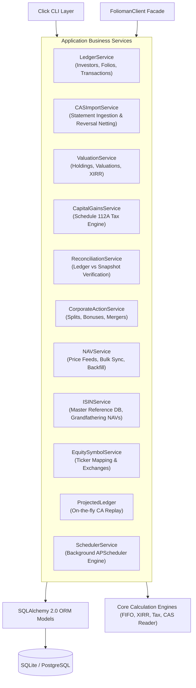

# Application Business Services (`folioman_client.services`)

This document provides a comprehensive technical reference for the 11 business service modules comprising the core service layer of `folioman-client`. These services coordinate database access, domain math, statement processing, tax rules, and background orchestration.

---

## 1. Services Architecture Overview

The service layer sits between the presentation layers (CLI, REST API resources) and the low-level data layer (SQLAlchemy ORM models, core calculation algorithms). All services are asynchronous, operate over SQLAlchemy 2.0 `AsyncEngine`, and enforce transactional consistency using `AsyncSession`.



---

## 2. `LedgerService` (`ledger_service.py`)

### 2.1 Responsibilities
Manages investor entities, family associations, folio account records, manual trade entries, opening lot balances, and basic holding queries.

### 2.2 Dependencies & Constructor
```python
class LedgerService:
    def __init__(self, engine: AsyncEngine | None = None) -> None:
        self.engine = engine or create_folioman_engine()
        self.session_factory = create_sessionmaker(self.engine)
        self._reconcile_service = ReconciliationService(engine=self.engine)
```
- Instantiates an internal `ReconciliationService` to trigger immediate position audits when transactions are created or folios are merged.

### 2.3 Public Methods & Technical Implementation

#### `list_investors(*, user_id: str = "default", family_id: int | None = None, unaffiliated: bool = False) -> list[dict[str, Any]]`
- **Execution Flow**:
  1. Calls `await init_schema(self.engine)` to ensure table readiness.
  2. Queries the `Investor` table filtered by `user_id == user_id`.
  3. If `family_id` is supplied, filters `Investor.family_id == family_id`.
  4. If `unaffiliated=True`, filters `Investor.family_id.is_(None)`.
  5. Projects rows into dictionaries, exposing masked PAN (`pan_masked`) and boolean flag `has_pan` without decrypting or exposing the underlying ciphertext.
- **Return Keys**: `id`, `name`, `email`, `is_huf`, `relation`, `family_id`, `pan_masked`, `has_pan`, `created_at`, `updated_at`.

#### `get_investor(investor_id: int) -> dict[str, Any]`
- **Execution Flow**: Fetches investor row by primary key using `session.get(Investor, investor_id)`.
- **Exceptions**: Raises `ValueError(f"Investor {investor_id} not found.")` if not found.

#### `create_investor(*, user_id: str = "default", name: str, pan: str | None = None, email: str = "", family_id: int | None = None, is_huf: bool = False, relation: str = "") -> dict[str, Any]`
- **Execution Flow**:
  1. Normalizes the PAN: `norm_pan = pan.strip().upper()`.
  2. Encrypts the PAN using Fernet symmetric encryption via `encrypt_pan(norm_pan)`.
  3. Computes the deterministic HMAC-SHA256 lookup digest via `pan_hash(norm_pan)`.
  4. Wraps database insertion in `handle_db_errors(session)` to capture and classify database constraint errors.
  5. Commits and returns the created investor record with `pan_masked` (e.g. `XXXXXX123D`).

#### `list_folios(investor_id: int) -> list[dict[str, Any]]`
- Returns all `Folio` rows belonging to `investor_id`, ordered by folio number.

#### `create_folio(investor_id: int, number: str, *, amc_code: str = "", broker: str = "", folio_type: str = "mf") -> dict[str, Any]`
- **Execution Flow**:
  1. Cleans the folio string using `normalize_folio_number(number)` (strips leading zeroes, slashes, whitespace).
  2. Executes an idempotency check: `where(Folio.investor_id == investor_id, Folio.number == norm_num, Folio.amc_code == amc_code)`.
  3. If an existing record exists, returns it immediately without creating duplicates.
  4. Otherwise, inserts and commits the new `Folio`.

#### `merge_folios(investor_id: int, source_folio_id: int, target_folio_id: int) -> dict[str, Any]`
- **Purpose**: Consolidates split accounts (common when an AMC assigns multiple folio numbers for the same investor).
- **Execution Flow**:
  1. Validates `source_folio_id != target_folio_id`.
  2. Checks that both folios exist and belong to `investor_id`.
  3. Executes bulk SQL `update(Transaction)` moving all transaction rows to `target_folio_id`.
  4. Executes bulk SQL `update(Holding)` moving all snapshot holdings to `target_folio_id`.
  5. Deletes `SecurityIntegrityStatus` rows associated with `source_folio_id`.
  6. Deletes the `source` folio row and commits.
  7. Calls `await self._reconcile_service.reconcile_investor(investor_id)` to audit and recalculate target balances.
- **Return Values**: Dictionary containing `transactions_moved` and `holdings_moved` row counts.

#### `list_transactions(investor_id: int, *, security_id: int | None = None, folio_id: int | None = None, from_date: date | None = None, to_date: date | None = None) -> list[dict[str, Any]]`
- Queries `Transaction` eager-loading `Transaction.security` and `Transaction.folio` via `selectinload`.
- Orders records chronologically: `Transaction.date.asc(), Transaction.id.asc()`.

#### `create_transaction(*, investor_id: int, security_id: int, date: date, transaction_type: str, units: Decimal | str, nav_or_price: Decimal | str, amount: Decimal | str | None = None, folio_id: int | None = None, fees: Decimal | str = "0", stamp_duty: Decimal | str = "0", narration: str = "", source: str = "manual", source_ref: str = "") -> dict[str, Any]`
- **Execution Flow**:
  1. Coerces `units`, `nav_or_price`, `fees`, and `stamp_duty` to strict `Decimal`. If `amount` is omitted, calculates `units * nav_or_price`.
  2. Inserts immutable row into `Transaction` with `cost_basis_complete = True`.
  3. If `folio_id` is supplied, immediately triggers `reconcile_security_folio` on that position to recalculate net ledger units and update integrity status.

#### `create_opening_lot(*, investor_id: int, folio_id: int, security_id: int, units: Decimal | str, cost_basis: Decimal | str, as_of_date: date, classification: str = "ipo_allotment") -> dict[str, Any]`
- Helper that records a synthetic `BUY` transaction for pre-existing holdings (e.g., IPO allotments, gift transfers, or pre-CAS holdings). Sets `source="manual"` and structured `source_ref=f"opening-lot:{folio_id}:{security_id}:{classification}"`.

#### `list_holdings(investor_id: int, *, as_of: date | None = None) -> list[dict[str, Any]]`
- Reconstructs active portfolio positions by evaluating both net ledger units (summing `BUY/BONUS/TRANSFER_IN` minus `SELL/TRANSFER_OUT`) and latest observed snapshot units from `Holding`.
- Filters out fully liquidated positions (`effective_units <= 0`).

---

## 3. `CASImportService` (`import_service.py`)

### 3.1 Responsibilities
Parses CAMS and KFintech Mutual Fund Consolidated Account Statements (CAS) and NSDL / CDSL Demat eCAS PDF statements. Deduplicates identical transactions, isolates incomplete histories into partial blocks, quarantines unparseable schemes, and automatically chains prior statements.

### 3.2 Key Data Structures & Hash Functions

#### `_canon_decimal(value: Decimal | None) -> str`
Converts `Decimal` to normalized fixed-point text, stripping insignificant trailing zeroes (`"100.5000"` -> `"100.5"`).

#### `_dedup_key(security_identity: str, folio_number: str, line: MfCasLineItem) -> str`
Computes deterministic SHA-256 digest over:
`security_identity | folio_number | date | transaction_type | units | nav | amount | balance`.
This allows safe, idempotent re-import of overlapping statements without duplicating trades.

### 3.3 Public Methods & Technical Implementation

#### `import_cas(file_path_or_bytes: str | Path | bytes | io.IOBase, password: str, *, user_id: str = "default", investor_id: int | None = None, source_ref: str = "") -> dict[str, Any]`
- **Step-by-Step Walkthrough**:
  1. **Binary Extraction**: Reads raw file bytes or accepts memory stream. Validates file existence. Computes SHA-256 hash of file content if `source_ref` is blank.
  2. **CAS Parsing**: Calls `read_cas(BytesIO(content), password)`. Maps `CASPasswordError` to `FoliomanPasswordError` and `CASParseError` to `FoliomanParseError`.
  3. **Investor Resolution**: Finds investor matching `user_id` and hashed PAN (`pan_hash`). If absent, automatically provisions new `Investor` row with encrypted PAN.
  4. **Job Tracking**: Inserts `ImportJob` record in `status="running"`.
  5. **Mutual Fund Statement Processing**:
     - Loops over `parsed.mf.schemes`.
     - Uses nested transaction savepoints (`session.begin_nested()`) for each scheme block to ensure that an unparseable scheme does not abort the entire statement.
     - Upserts `AMC`, `Security` (matching by AMFI code, ISIN, or symbol), and `Folio`.
     - **History Gap Verification**: Evaluates whether the scheme has complete transaction history from opening using `scheme_history_gap()`. If `opening_units > 0` and prior ledger balance does not equal opening balance, the block is flagged as **incomplete history** (`cost_basis_complete = False`).
     - Inserts non-duplicate transactions (checking `Transaction.dedup_key`).
     - If history is incomplete, stores `PartialBlock` and creates snapshot `Holding` with `source="cas_pdf"`.
     - If parsing fails with an unexpected exception, creates `ImportQuarantine` row containing the raw error and scheme metadata.
  6. **Chained Partial Upgrade (`_upgrade_chained_partials`)**:
     - Inspects all existing `PartialBlock` records for the investor.
     - If the newly imported statement supplied older transactions that satisfy the opening balance (`abs(prior - pb.opening_units) <= 0.001`), upgrades all incomplete transactions to `cost_basis_complete = True`, deletes the snapshot `Holding`, and removes the `PartialBlock`.
  7. **eCAS Statement Processing (NSDL / CDSL)**:
     - For equity holdings reported in eCAS, snapshots observed holdings into `Holding` with `units`, `value_observed`, `avg_cost_observed`, and `source="ecas"`.
  8. **Auto-Reconciliation**:
     - Calls `reconcile_security()` on all touched `security_id`s.
  9. **Job Finalization**:
     - Marks `ImportJob.status` as `"completed"` (or `"partially_reconciled"` if items were quarantined or partial).
     - Commits session and returns detailed import summary.

---

## 4. `ValuationService` (`valuation_service.py`)

### 4.1 Responsibilities
The central analytical and mark-to-market performance engine. Calculates current portfolio net worth, asset class allocations, XIRR money-weighted returns, historical daily time series (`InvestorValue`), and rolling multi-period returns.

### 4.2 Key Algorithms & Formulas

1. **Mark-to-Market Valuation**:
   $$\text{Market Value} = \sum \text{Held Units} \times \text{Latest Available Quote}$$
2. **XIRR (Extended Internal Rate of Return)**:
   Finds root $r$ such that:
   $$\sum_{i=1}^{N} \frac{C_i}{(1 + r)^{\frac{d_i - d_0}{365}}} = 0$$
   where $C_i$ are net transaction cashflows (investments negative, redemptions positive) and the final cashflow $C_N$ is the terminal portfolio market value (positive).
3. **Trailing Period Returns**:
   Computes annualized CAGR for windows $\ge 1\text{Y}$ and absolute percentage change for windows $< 1\text{Y}$ across standard horizons: `1M`, `3M`, `6M`, `1Y`, `3Y`, `5Y`.

### 4.3 Public Methods & Technical Implementation

#### `build_investor_summary(investor_id: int, as_of_date: date | None = None) -> dict[str, Any]`
- Compiles the full executive dashboard for an investor:
  - Total portfolio value, cost basis, unrealized gain, and overall gain percentage.
  - Overall portfolio XIRR.
  - Breakdown by asset category (`Equity`, `Debt`, `Hybrid`, `Commodity`).
  - Breakdown by AMC / fund house.
  - Trailing period performance returns (`1M`, `3M`, `6M`, `1Y`, `3Y`, `5Y`).
  - Data freshness indicators (count of stale quotes and lagging feeds).

#### `build_family_summary(family_id: int, as_of_date: date | None = None) -> dict[str, Any]`
- Aggregates all member portfolios within a family into a unified group net worth and consolidated XIRR.

#### `build_scheme_detail(investor_id: int, security_id: int, as_of_date: date | None = None) -> dict[str, Any]`
- Deep dive for a single security position:
  - Reconstructs FIFO open lots and calculates per-lot unrealized gains.
  - Extracts security-specific XIRR.
  - Lists historical transactions and dividend distributions.

#### `value_series(investor_id: int, from_date: date | None = None, to_date: date | None = None) -> list[dict[str, Any]]`
- Retrieves contiguous daily portfolio valuation time series from `InvestorValue`.
- If cached series contains gaps, automatically generates values on-the-fly and stores them.

#### `queue_recompute(investor_id: int, from_date: date | None = None) -> None`
- Marks the valuation series for an investor as stale starting from `from_date` (or the earliest transaction date).
- Updates `Investor.valuation_status = "stale"`, scheduling background recomputation.

#### `recompute_investor_valuation(investor_id: int, from_date: date | None = None, batch_size: int = 100) -> int`
- Executes deterministic daily roll-forward from `from_date` to `today`:
  - Reconstructs daily held units by replaying transactions and corporate actions.
  - Resolves daily closing NAVs from `NAVHistory`.
  - Computes daily cost basis and market value.
  - Upserts rows into `InvestorValue` in batches.

---

## 5. `CapitalGainsService` (`capital_gains_service.py`)

### 5.1 Responsibilities
Executes the Indian tax computation engine for realized capital gains on Mutual Funds and Listed Equities under Section 112A, Section 111A, and Section 50AA. Handles Section 112A grandfathering (Jan 31, 2018 FMV lookup), Section 48 expense additions, and Union Budget 2024 cutoff rules (July 23, 2024).

### 5.2 Key Policies & Statutory Rules

- **Union Budget 2024 Cutoff (July 23, 2024)**:
  - Transfers before July 23, 2024: Equity LTCG taxed at 10% (exemption ₹1,00,000); STCG at 15%.
  - Transfers on/after July 23, 2024: Equity LTCG taxed at 12.5% (exemption ₹1,25,000); STCG at 20%.
- **Holding Period Thresholds**:
  - Listed Equities & Equity Mutual Funds: Long-Term if held $> 12$ months (365 days).
  - Debt Mutual Funds (acquired on/after April 1, 2023): Deemed Short-Term under Section 50AA regardless of holding period.
- **Section 112A Grandfathering (Acquisitions on/before Jan 31, 2018)**:
  $$\text{Deemed Cost} = \max(\text{Actual Purchase Cost}, \min(\text{FMV as of Jan 31, 2018}, \text{Full Value of Consideration}))$$

### 5.3 Public Methods & Technical Implementation

#### `get_capital_gains_report(investor_id: int, financial_year: str, as_of_date: date | None = None) -> dict[str, Any]`
- **Execution Flow**:
  1. Resolves date range for financial year (e.g. `"2024-2025"` -> `2024-04-01` to `2025-03-31`).
  2. Queries all tax-ready transactions for `investor_id` (where `cost_basis_complete == True`).
  3. Replays corporate actions on historical lots via `ProjectedLedger`.
  4. Runs FIFO lot matching via `apply_fifo()` to match sell disposals with acquisition lots.
  5. Filters disposals occurring within the financial year.
  6. Loads Jan 31, 2018 FMV reference prices from `FMVJan2018` table via `_build_fmv_lookup()`.
  7. Applies `IndiaTaxPolicy.adjusted_cost()` to determine grandfathered cost basis and Section 48 stamp duty / brokerage deductions.
  8. Aggregates results into LTCG with grandfathering, LTCG without grandfathering, and STCG.

#### `get_schedule_112a(investor_id: int, financial_year: str) -> list[dict[str, Any]]`
- Generates the official 14-column ITR Schedule 112A dataset ready for direct export into Income Tax filing utilities:
  1. Share/Unit Description
  2. Number of Units
  3. Sale Price Per Unit
  4. Full Value of Consideration
  5. Cost of Acquisition (without indexation)
  6. FMV as on 31st January 2018
  7. Total Fair Market Value
  8. Expenditure wholly and exclusively in connection with transfer (Sec 48)
  9. Total Deductions
  10. Balance (Sale Value - Deductions)
  11. Deductions under Sec 54F
  12. Net Capital Gain
  13. ISIN Code
  14. Date of Acquisition

---

## 6. `CorporateActionService` (`corporate_action_service.py`)

### 6.1 Responsibilities
Scrapes, records, and applies corporate actions (stock splits, reverse splits, bonus share issues, mergers, demergers, rights issues, and dividends).

### 6.2 Key Invariant: Transaction Immutability
`folioman-client` strictly adheres to **transaction immutability**. When a 1:5 stock split occurs, historical buy transactions in `Transaction` are **never multiplied or updated in place**. Instead:
1. The split event is recorded in `CorporateActionReference`.
2. The user or auto-reconciler links it to the investor's holdings via `AppliedCorporateAction`.
3. Read-time ledger projectors (`ProjectedLedger`) multiply units on-the-fly when calculating holdings, FIFO lots, or capital gains.

### 6.3 Public Methods & Technical Implementation

#### `refresh_corporate_actions(security_id: int | None = None) -> dict[str, Any]`
- Scrapes corporate actions from Yahoo Finance and NSE Bhavcopy feeds for tracked securities.
- Upserts parsed actions into `CorporateActionReference` avoiding duplicates by checking `(security_id, action_type, ex_date)`.

#### `apply_corporate_action(investor_id: int, action_reference_id: int) -> dict[str, Any]`
- Links an action to an investor's ledger by creating an `AppliedCorporateAction` record.
- Flags valuation cache as stale via `ValuationService.queue_recompute(investor_id)`.
- Triggers reconciliation audit via `ReconciliationService.reconcile_security()`.

---

## 7. `ReconciliationService` (`reconciliation_service.py`)

### 7.1 Responsibilities
Audits portfolio integrity by comparing the running net units calculated from the transaction ledger against the balance observed in CAS holding snapshots. Detects unexplained balance mismatches and identifies pending corporate actions that account for discrepancies.

### 7.2 Integrity Status Classifications
Every position in `SecurityIntegrityStatus` is assigned one of the following states:
- `MATCH`: Ledger net units equal snapshot units within numerical tolerance ($\le 0.001$).
- `MISMATCH`: Ledger net units disagree with snapshot balance and no pending corporate action explains the gap.
- `INCOMPLETE_HISTORY`: Statement has non-zero opening balance without historical transactions.
- `CA_EXPLAINED`: Mismatch perfectly corresponds to a known stock split or bonus issue ratio (e.g. 1:1, 1:2, 1:5).
- `MANUAL_OVERRIDE`: User manually acknowledged and suppressed the discrepancy.

### 7.3 Public Methods & Technical Implementation

#### `reconcile_security_folio(session: AsyncSession, investor_id: int, security_id: int, folio_id: int) -> SecurityIntegrityStatus`
- Recomputes position balance:
  1. Calculates `ledger_units` from `Transaction`.
  2. Replays applied corporate actions.
  3. Fetches latest snapshot units from `Holding`.
  4. If difference $> 0.001$, tests whether unapplied corporate actions in `CorporateActionReference` match the ratio.
  5. Updates or creates `SecurityIntegrityStatus` row.

#### `reconcile_investor(investor_id: int) -> dict[str, Any]`
- Iterates across all active securities and folios for `investor_id`, executing full ledger reconciliation.

#### `acknowledge_mismatch(investor_id: int, security_id: int, folio_id: int, reason: str) -> None`
- Sets `status = "MANUAL_OVERRIDE"` and records user reason string.

---

## 8. `NAVService` (`nav_service.py`)

### 8.1 Responsibilities
Synchronizes daily NAVs for mutual funds and closing prices for equities. Manages multi-source feeds, computes feed freshness, and detects and backfills historical price gaps.

### 8.2 Data Feed Priority Hierarchy
1. **AMFI Bulk Feed**: Daily text feed of all 10,000+ Indian mutual funds. High speed, single HTTP request.
2. **`mfapi.in`**: Historical and latest NAVs by AMFI code for mutual funds.
3. **NSE Bhavcopy**: Official daily closing prices for NSE-listed equities and ETFs.
4. **Yahoo Finance (`yfinance`)**: Real-time quotes, historical price series, and corporate actions.
5. **Captnemo Archive**: Secondary historical backup.

### 8.3 Public Methods & Technical Implementation

#### `refresh_navs(*, security_ids: Sequence[int] | None = None, force: bool = False) -> dict[str, Any]`
- Evaluates securities requiring price updates.
- For mutual funds, downloads the AMFI daily bulk file in one request and updates all matching securities in memory.
- For equities, queries Yahoo Finance or NSE Bhavcopy.
- Upserts closing prices into `NAVHistory` with `date`, `nav`, and `feed_source`.

#### `backfill_navs(security_id: int, from_date: date | None = None) -> int`
- Identifies missing dates between the earliest recorded transaction for `security_id` and today.
- Downloads full historical price series and populates `NAVHistory`.

#### `get_nav_freshness() -> dict[str, Any]`
- Categorizes all securities into `current`, `lagging` (1-2 days old), `stale` (>3 days old), or `never_fetched`.

---

## 9. `ISINService` (`isin_service.py`)

### 9.1 Responsibilities
Maintains master reference dictionary of 100,000+ Indian securities, maps ISINs to AMFI scheme codes, and provides statutory Jan 31, 2018 grandfathering NAVs from the `casparser-isin` database.

### 9.2 Public Methods & Technical Implementation

#### `seed_reference_data(source_path: Path | None = None) -> dict[str, Any]`
- Populates database tables from the bundled `casparser-isin.db` SQLite archive:
  - Populates `FMVJan2018` table with ISIN, NAV, and scheme name.
  - Updates AMFI code to ISIN mappings.

#### `resolve_isin(isin: str) -> dict[str, Any] | None`
- Looks up scheme name, AMFI code, and grandfathering NAV by 12-character ISIN.

#### `get_grandfathering_nav(isin: str) -> Decimal | None`
- Returns exact Jan 31, 2018 benchmark NAV for Schedule 112A grandfathering computations.

---

## 10. `EquitySymbolService` (`equity_symbol_service.py`)

### 10.1 Responsibilities
Resolves plain text company names or ISINs into exchange tickers (e.g., `INE002A01018` -> `RELIANCE.NS`). Ensures correct symbol formatting when querying market data feeds and corporate actions.

---

## 11. `SchedulerService` (`scheduler.py`)

### 11.1 Responsibilities
Wraps `APScheduler` background task scheduler to execute periodic maintenance jobs in long-running embedded daemon or CLI background mode.

### 11.2 Scheduled Recurring Jobs
1. `daily_extend`: Runs daily at 23:30 IST to roll forward portfolio valuations for active investors.
2. `nav_refresh`: Runs daily at 21:30 IST following AMFI's official evening NAV publication.
3. `isin_update`: Runs weekly on Sunday at 02:00 IST to check for updated ISIN master databases.

---

## 12. `ProjectedLedger` (`projected_ledger.py`)

### 12.1 Responsibilities
Dynamic virtual ledger replay engine. Sits between raw database rows in `Transaction` and high-level consumers (`ValuationService`, `CapitalGainsService`, `FIFOUnits`).

### 12.2 Replay Mechanics
When transactions are loaded:
1. Queries all `AppliedCorporateAction` rows for the security.
2. Interleaves split, bonus, and merger events chronologically with historical transactions.
3. For splits: multiplies units of all prior buy transactions and adjusts their virtual cost per unit.
4. For bonus issues: injects synthetic zero-cost `BONUS` buy lots on the ex-date.
5. Emits virtual `CoreTransaction` stream preserving total cost basis without modifying underlying database records.
