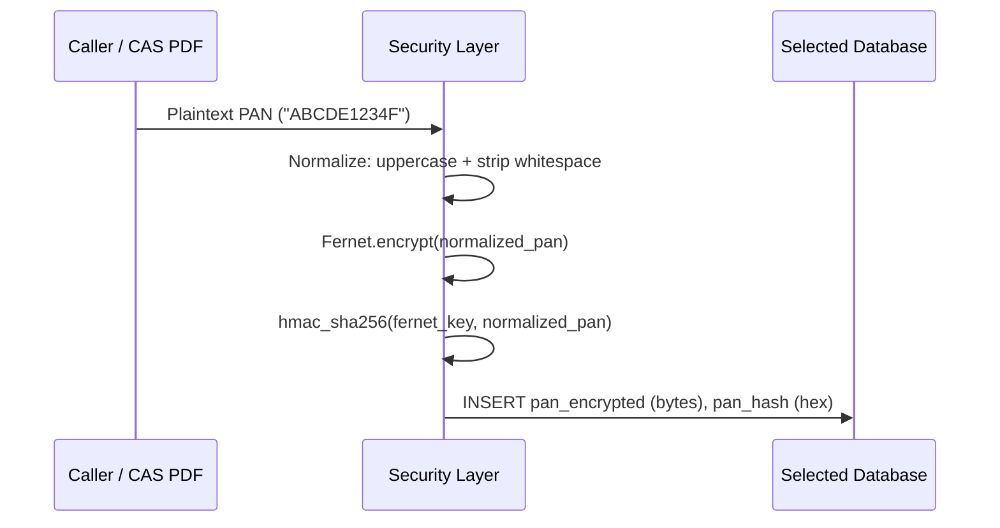

# Security & Privacy

Financial applications handle sensitive Personal Identifiable Information (PII), including Indian Permanent Account Numbers (PAN). `folioman-client` implements defense-in-depth security to protect sensitive investor data at rest and enforce logical multi-tenancy.

---

## 1. PAN Encryption at Rest

In accordance with data protection best practices, PAN numbers are never stored in plaintext within the database.

- **Symmetric Encryption**: PAN strings are encrypted using Fernet symmetric authenticated cryptography (`cryptography.fernet.Fernet`), backed by 128-bit AES in CBC mode with PKCS7 padding and HMAC-SHA256 authentication.
- **Binary Storage**: Ciphertext is stored in the `investors.pan_encrypted` column as raw bytes (`LargeBinary`).



---

## 2. Keyed HMAC-SHA256 Lookup (`pan_hash`)

Because statements frequently need to match existing investor records during re-imports, decrypting every investor row in the database to find a matching PAN would be inefficient and insecure.

- **Why bare SHA-256 is insufficient**: PANs follow a rigid 10-character alphanumeric syntax (`[A-Z]{5}[0-9]{4}[A-Z]{1}`) and have low entropy, making unkeyed hashes vulnerable to precomputed rainbow table attacks.
- **Keyed Hash (HMAC)**: `folioman-client` hashes the PAN using **HMAC-SHA256**, using the Fernet encryption key itself as the pepper secret:

    ```python
    import hashlib
    import hmac

    def pan_hash(pan: str, key_bytes: bytes) -> str:
        return hmac.new(key_bytes, pan.strip().upper().encode(), hashlib.sha256).hexdigest()
    ```

- **Security Guarantee**: Without the encryption key, the `pan_hash` value is useless and cannot be reverse-engineered or dictionary-attacked.

---

## 3. Encryption Key Resolution

The Fernet key is resolved using the following order of precedence:

1. **`FOLIOMAN_FERNET_KEY` Environment Variable**:
   Used in production, CI/CD, and containerized deployments (Docker, Kubernetes).
2. **Key File (`~/.folioman/fernet.key`)**:
   In local development or desktop environments, if no environment variable is provided, `folioman-client` automatically generates a secure 32-byte URL-safe base64 key and writes it with restricted owner-only permissions (`0600`).

---

## 4. Masked Display (`pan_masked`)

To prevent accidental visual leaks or logging of full PAN values:

- The single-investor detail model (`InvestorDetail`) returns only a masked PAN string:
    ```
    XXXXXX1234F
    ```
- The roster list (`Investor`) exposes only a boolean flag `has_pan: bool`, avoiding decryption overhead entirely when listing all investors.

---

## 5. Multi-Tenancy Scoping (`user_id`)

For platforms serving multiple advisors or tenant organizations:

- All `Family` and `Investor` entities carry a `user_id` column.
- Queries are strictly scoped to the active client's `user_id`:
    ```python
    async with FoliomanClient(user_id="advisor_alpha") as client:
        # Automatically filters by user_id="advisor_alpha"
        investors = await client.investors.list()
    ```
- Cross-tenant access is blocked at the database query level.
