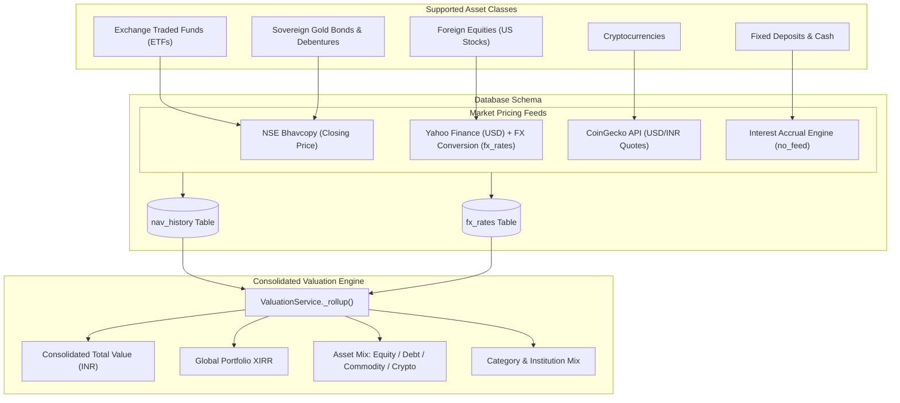

# ETFs, Bonds, Crypto & Multi-Asset Portfolio Rollup

In addition to mutual funds and individual equities, `folioman-client` supports **Exchange Traded Funds (ETFs)**, **Sovereign Gold Bonds (SGBs)**, **Corporate Bonds**, **Foreign Equities**, **Cryptocurrencies**, and **Fixed Deposits (FDs)**.

This guide details how these diverse asset classes are ingested, priced, and rolled up into a unified multi-asset portfolio.

---

## 1. Multi-Asset Data Pipeline



---

## 2. Exchange Traded Funds (ETFs)

ETFs combine characteristics of mutual funds and listed equities: they represent pooled investment portfolios, but trade on stock exchanges in real time.

### A. Identification & Symbol Mapping
* **Database Type**: `security_type = "ETF"`.
* **ISIN Convention**: Typically issued under AMC ISIN series (e.g. `INF204KB14I2` for Nippon India Nifty 50 BeES ETF).
* **Symbol Resolution**: [`EquitySymbolService`](file:///Users/raptor/code/folioman-client/src/folioman_client/services/equity_symbol_service.py) resolves ISINs against `ref_isins` to identify standard NSE trading tickers:
  * `NIFTYBEES`: Nifty 50 Index ETF
  * `JUNIORBEES`: Nifty Next 50 ETF
  * `GOLDBEES`: Nippon India Gold ETF
  * `SILVERBEES`: Nippon India Silver ETF
  * `LIQUIDBEES`: Money Market / Liquid ETF

### B. Ingestion & Storage
* **eCAS Statements**: Ingested as demat holdings in the `holdings` table (`source="ecas"`).
* **Tradebooks**: Ingested as transaction ledger entries in the `transactions` table (`transaction_type="BUY"|"SELL"`).

### C. Pricing & Tax Treatment
* **Market Pricing**: Priced daily via **NSE Bhavcopy** closing prices (identical to equities).
* **Taxation Rules**:
  * **Equity ETFs** ($\ge 65\%$ domestic equity): Eligible for Section 112A equity capital gains (12.5% LTCG after 12 months).
  * **Gold / Commodity / Debt ETFs**: Treated as Specified Mutual Funds under Section 50AA (taxed as STCG at slab rates regardless of holding period for purchases after 1-Apr-2023).

---

## 3. Bonds & Sovereign Gold Bonds (SGBs)

### A. Sovereign Gold Bonds (SGBs)
* **Identification**: Government bonds issued by the Reserve Bank of India, listed with ISINs starting with `IN00` (e.g., `IN0020210085` $\rightarrow$ `SGBMAY29`).
* **Security Type**: `security_type = "BOND"`.
* **Category Mapping**: Categorized into `"Commodities"` or `"Debt"` depending on metadata configuration.
* **Pricing**: Priced from NSE Bhavcopy trading closes or evaluated using gold spot reference rates.
* **Exemption Handling**: Redemption of SGBs by individuals at 8-year maturity is exempt from capital gains tax under Section 47(viic).

### B. Corporate Bonds & Non-Convertible Debentures (NCDs)
* **Identification**: Listed debt securities (e.g., Tata Capital NCDs, HDFC Bonds).
* **Face Value & Coupon**: Recorded in `metadata_json` (e.g., `face_value = 1000`, `coupon_rate = 8.75`).
* **Storage**: Ingested through demat snapshots or ledger transactions.
* **Allocation**: Automatically counted toward the `"Debt"` allocation bucket.

---

## 4. Foreign Equities & Currency Conversion

Folioman supports international portfolios (e.g., US stocks held via Vested, INDmoney, or Interactive Brokers):

### A. Identification & Currency
* **Security Type**: `security_type = "FOREIGN_EQUITY"`.
* **Currency**: `currency = "USD"` (or `EUR`, `GBP`).
* **Exchange**: `"NASDAQ"` or `"NYSE"`.

### B. Pricing & FX Rates Table (`fx_rates`)
1. **USD Price**: Fetched via [`yfinance_feed.fetch_quote(symbol, exchange="NASDAQ")`](file:///Users/raptor/code/folioman-client/src/folioman_client/services/price_feeds/yfinance_feed.py).
2. **Foreign Exchange Conversion**:
   * Evaluates exchange rate on valuation date from the `fx_rates` table:
     ```sql
     SELECT rate FROM fx_rates 
     WHERE from_currency = 'USD' AND to_currency = 'INR' AND date <= :as_of 
     ORDER BY date DESC LIMIT 1;
     ```
3. **INR Value Calculation**:

   $$\text{value\_inr} = \text{units} \times \text{price}_{\text{usd}} \times \text{fx\_rate}_{\text{inr}}$$

---

## 5. Cryptocurrencies

Folioman includes native support for digital assets:

### A. Identification
* **Security Type**: `security_type = "CRYPTO"`.
* **Coin Identifier**: Configured via `metadata_json = {"coin_id": "bitcoin"}` or `{"coin_id": "ethereum"}`.

### B. Live Pricing (`coingecko.py`)
* Queries CoinGecko API:
  `https://api.coingecko.com/api/v3/simple/price?ids=bitcoin&vs_currencies=inr,usd`
* Returns current INR market price, 24h change, and volume.
* Upserts quote into `nav_history` with `source = "coingecko"`.

### C. Valuation & Tax (Section 115BBH)
* Categorized under `"Crypto"` in portfolio asset allocation.
* Indian tax rules (Section 115BBH) apply: flat 30% tax on gains with no loss set-off against other income.

---

## 6. Fixed Deposits (FDs) & Cash Instruments

For fixed-income bank deposits, PPF, or cash reserves:

* **Security Type**: `security_type = "FD"` or `security_type = "OTHER"`.
* **Freshness Classification**: Automatically classified as `"no_feed"`. The system will not attempt to contact stock exchanges or mutual fund portals.
* **Valuation**: Evaluates principal plus accrued interest over the holding tenure.

---

## 7. Consolidated Portfolio Rollup (`ValuationService._rollup`)

When [`client.portfolio.get(investor_id)`](file:///Users/raptor/code/folioman-client/src/folioman_client/client.py#L148-L185) executes, Folioman merges all asset classes into a single consolidated financial report:

```python
rollup = self._rollup(valuation, meta_by_sec, extras)
```

### Generated Portfolio Outputs

#### 1. Total Portfolio Valuation

$$\text{total\_inr} = \sum_{\text{all assets}} \text{value\_inr}$$

#### 2. Multi-Asset Allocation Mix
Computes percentage weights across asset classes:
```json
"asset_mix": [
  {"security_type": "MF", "value_inr": "1250000.00"},
  {"security_type": "EQUITY", "value_inr": "850000.00"},
  {"security_type": "ETF", "value_inr": "250000.00"},
  {"security_type": "BOND", "value_inr": "100000.00"},
  {"security_type": "CRYPTO", "value_inr": "50000.00"}
]
```

#### 3. Category Mix (Macro Asset Allocation)
Normalizes into high-level wealth buckets:
* **Equity**: Domestic Equities, Equity Mutual Funds, Equity ETFs, US Stocks
* **Debt**: Debt Mutual Funds, Corporate Bonds, FDs, Liquid ETFs
* **Commodities**: Sovereign Gold Bonds, Gold ETFs, Silver ETFs
* **Crypto**: Digital assets

#### 4. AMC & Institution Mix
Groups holdings by financial institutions (HDFC, ICICI, Zerodha, SBI, PPFAS) to highlight counterparty concentration risk.

#### 5. Consolidated Multi-Asset XIRR
Consolidates all cash flows across mutual fund SIPs, stock broker contract notes, bond coupon payouts, and crypto buys against the total portfolio market value, solving for a single, unified annual return percentage.
