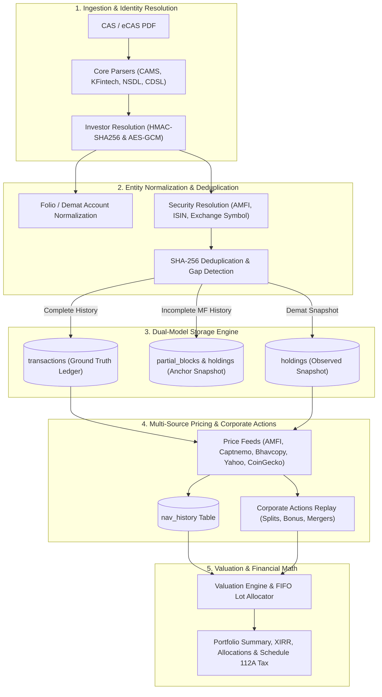

# System Flow & Ingestion Walkthrough

This section provides an exhaustive, end-to-end walkthrough of how `folioman-client` ingests, normalizes, stores, prices, and evaluates investment portfolios across all supported asset classes.

Whether processing mutual fund statements, demat equities, exchange-traded funds, fixed-income debentures, or cryptocurrencies, Folioman follows a unified architectural pipeline while applying specialized accounting rules tailored to each instrument.

---

## Architectural Pipeline Overview

---

## Dedicated Walkthrough Guides

Explore the detailed flow for each asset category:

-   :material-chart-pie: **[Mutual Funds Flow](mutual-funds.md)**
    
    ---
    
    Complete flow for CAMS and KFintech CAS PDFs: parser extraction, folio normalization, inception gap detection, dual-entry transaction ledger, partial block chaining, AMFI/mfapi pricing, FIFO lot matching, and Schedule 112A capital gains.

-   :material-finance: **[Stocks & Equities Flow](stocks.md)**
    
    ---
    
    Complete flow for NSDL and CDSL eCAS demat statements: depository extraction, ISIN-to-NSE/BSE symbol resolution via national reference catalogs, snapshot holding storage, corporate actions event replay (splits, bonuses, demergers), and NSE Bhavcopy pricing.

-   :material-gold: **[ETFs, Bonds & Other Assets Flow](etfs-and-others.md)**
    
    ---
    
    Complete flow for Exchange Traded Funds (ETFs), Sovereign Gold Bonds (SGBs), corporate debentures, Fixed Deposits (FDs), and Cryptocurrencies via CoinGecko, culminating in unified multi-asset portfolio rollups.

---

## Database Model Summary

Across all flows, Folioman organizes data into five relational groups in SQLite, PostgreSQL, or MySQL:

| Category | Primary Tables | Purpose |
| :--- | :--- | :--- |
| **Identity & Account** | `investors`, `families`, `amcs`, `folios` | Secure investor profile, encrypted PAN, multi-account structures. |
| **Securities & Reference** | `securities`, `ref_isins`, `ref_schemes`, `ref_meta` | Canonical master dictionary of schemes, equities, and metadata. |
| **Ledgers & Snapshots** | `transactions`, `holdings`, `partial_blocks` | Immutable trade transactions, observed statement snapshots, and chaining anchors. |
| **Market Data** | `nav_history`, `corporate_action_references`, `fx_rates` | Historical closing NAVs, equity prices, and SEBI corporate actions. |
| **Auditing & State** | `import_jobs`, `import_quarantines`, `security_integrity_statuses` | Import auditing, malformed block quarantining, and balance reconciliation. |
