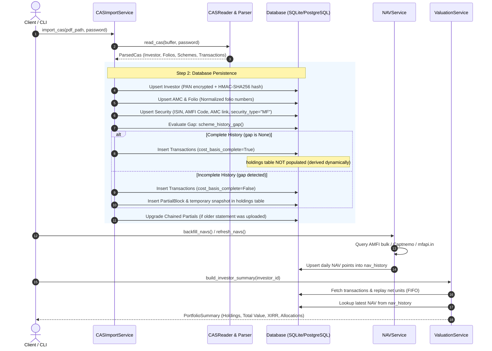
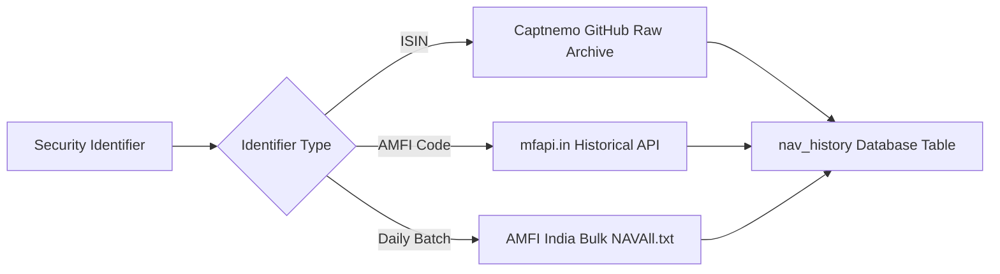

# Mutual Funds Flow: Ingestion, Storage & Valuation

This guide documents the complete end-to-end lifecycle of Mutual Funds in `folioman-client`, from parsing Consolidated Account Statement (CAS) PDFs to database persistence, historical NAV pricing, FIFO lot allocation, and tax reporting.

---

## 1. High-Level Lifecycle



---

## 2. Parsing CAMS & KFintech CAS Statements

Folioman processes official Consolidated Account Statements (CAS) generated by either **CAMS** or **KFintech** (formerly Karvy):

### A. Statement Detection & Password Decryption
* **Input**: In-memory byte buffer or file path + investor password (usually case-sensitive PAN or custom password).
* **Decryption**: `pypdf` opens and authenticates against password protected PDF structures. If the password fails, `FoliomanPasswordError` is raised.

### B. Regex & Text Extraction
1. **Investor Identity**:
   * Extracts investor name, email, address, and mobile number.
   * Extracts PAN matching the standard format `[A-Z]{5}[0-9]{4}[A-Z]{1}`.
2. **Scheme Hierarchy**:
   Statements organize holdings hierarchically:
   ```text
   Folio Number (e.g. "12345678 / 0")
   └── Scheme Name (e.g. "Parag Parikh Flexi Cap Fund - Direct Plan Growth")
       ├── ISIN (e.g. "INF879O01027") & AMFI Code (e.g. "122639")
       ├── Advisor / Broker Code (e.g. "DIRECT" or "ARN-12345")
       ├── Opening Unit Balance
       ├── Transaction Line Items
       └── Closing Unit Balance
   ```
3. **Transaction Line Parsing**:
   Each line item is classified into a canonical `TransactionType`:
   * `BUY`: Lumpsum purchase, initial purchase.
   * `SIP`: Systematic investment plan installments.
   * `SELL`: Partial or full redemption.
   * `SWP`: Systematic withdrawal plan outflow.
   * `STP_IN` / `STP_OUT`: Systematic transfer plan movements.
   * `SWITCH_IN` / `SWITCH_OUT`: Intra-AMC scheme switches.
   * `DIVIDEND`: Dividend payout or reinvestment.
   * `BONUS`: Unit bonus issues.
   * `STAMP_DUTY` & `STT_TAX`: Regulatory levies recorded as cost adjustments or ledger adjustments.

---

## 3. Database Persistence & Entity Resolution

All persistence takes place within an isolated atomic transaction in `CASImportService.import_cas()`:

### A. Investor Profile & Security Encryption
* **Blind Indexing**: Computes `pan_hash = hmac_sha256(raw_pan, secret_salt)`. This allows querying existing investors in O(1) time without decrypting database records.
* **Encryption at Rest**: Raw PAN is encrypted with AES-256-GCM via `cryptography.fernet` and stored in `investors.pan_encrypted`.
* Links or creates an `Investor` record.

### B. AMC & Folio Normalization
* **AMC Upserting**: Resolves the mutual fund house name (e.g., "HDFC Mutual Fund", "PPFAS Mutual Fund") in the `amcs` table.
* **Folio Normalization**: Folios often contain inconsistent formatting across statements (e.g., `"12345 / 0"`, `"12345/0"`, or `"0012345/0"`). Folioman strips extraneous whitespace and standardizes the string:
  ```python
  normalized = normalize_folio_number(raw_folio)
  ```
  The folio is upserted into `folios` indexed by `(investor_id, number)`.

### C. Security Master Catalog
* Matches the scheme in the `securities` table by AMFI code, ISIN, or scheme name.
* Sets `security_type = "MF"`.
* Associates `amc_id` and metadata JSON (storing equity/debt orientation and scheme classification).

---

## 4. Ground-Truth Ledger vs. Snapshot Storage

A critical architectural aspect of Folioman is its **transaction-ledger ground-truth design**:

### Why Mutual Fund Holdings are NOT Stored in the `holdings` Table
In double-entry portfolio accounting, unit balances are **derived from transactions**, not static snapshots:
* When you buy 100 units and redeem 30 units, the ground truth is the two transaction rows.
* Storing static holdings in a separate table creates reconciliation drift and data redundancy.

### History Gap Analysis (`scheme_history_gap`)
Before inserting transactions, Folioman checks whether the statement covers the entire history from inception:
1. Queries prior recorded units in the database before the statement start date:
   ```python
   prior_balance = await self._prior_ledger_balance(
       session, investor_id, security_id, folio_id, statement_from
   )
   ```
2. Compares `prior_balance` with statement `opening_units`:
   * **Complete History (`is_complete = True`)**: `opening_units == 0` (scheme was bought during statement window) OR `opening_units == prior_balance`.
   * **Incomplete History (`is_complete = False`)**: Statement starts with `opening_units > 0` but prior transactions are missing in the database.

### Ledger Insertion & Deduplication
Every transaction is assigned a deterministic deduplication key:
```text
_dedup_key = f"{security_identifier}:{folio_number}:{date}:{type}:{units}:{amount}"
```
* If a transaction with `dedup_key` already exists, it is skipped (`summary["transactions_skipped"] += 1`).
* If new, it is inserted into the `transactions` table with `cost_basis_complete = is_complete`.

### Partial Blocks & Chaining Mechanism
When a scheme has incomplete history (`not is_complete`):
1. A record is added to `partial_blocks` recording `opening_units`, `closing_units`, and `statement_from`.
2. A temporary anchor record is written into `holdings` with `source = "cas_pdf"`.
3. When the user later uploads an older statement containing the missing history, `_upgrade_chained_partials()` automatically triggers:
   * Verifies that the earlier statement's closing balance matches the partial block's opening balance.
   * Updates older transactions to `cost_basis_complete = True`.
   * **Deletes the redundant snapshot** from `holdings` and `partial_blocks`.

---

## 5. NAV Price Feeds & Backfilling

To value mutual fund holdings, Folioman integrates three pricing sources:



### Price Sources
1. **AMFI Daily Bulk Dump (`amfi_bulk.py`)**:
   * Downloads `https://portal.amfiindia.com/spages/NAVAll.txt` daily.
   * Parses all 15,000+ mutual fund NAVs in a single HTTP request.
2. **Captnemo GitHub History (`captnemo.py`)**:
   * Uses the public high-speed NAV repository keyed by ISIN.
   * Provides complete multi-year daily NAV curves.
3. **mfapi.in Fallback (`mfapi.py`)**:
   * Fallback REST API keyed by 6-digit AMFI scheme code.

### Storage in `nav_history`
NAV points are stored in `nav_history`:
* `security_id`: Foreign key to `securities.id`.
* `date`: Trading date.
* `nav`: Net Asset Value per unit (precision: `Numeric(18, 4)`).
* `source`: Source identifier (`"amfi"`, `"captnemo"`, `"mfapi"`).

---

## 6. Valuation & Performance Math

When querying `client.portfolio.get(investor_id)` or `client.holdings.list(investor_id)`:

### A. Dynamic Position Derivation
[`ValuationService._current_positions`](file:///Users/raptor/code/folioman-client/src/folioman_client/services/valuation_service.py) computes active units:
```python
net_units = sum(BUY units) - sum(SELL units)
```
If `net_units > 0`, the position is included in the valuation.

### B. Mark-to-Market (MTM) Valuation
1. Looks up the latest available NAV on or before `as_of` date in `nav_history`.
2. Computes current value:
   $$\text{value\_inr} = \text{net\_units} \times \text{latest\_nav}$$

### C. First-In-First-Out (FIFO) Accounting
For capital invested and tax purposes, [`apply_fifo`](file:///Users/raptor/code/folioman-client/src/folioman_client/core/fifo.py) matches sales against the earliest available purchase lots:
* Tracks remaining cost basis (`invested_inr`).
* Calculates unrealized gain / loss.

### D. Extended Internal Rate of Return (XIRR)
* Assembles all cash inflows (SIPs, purchases) as negative cash flows with transaction dates.
* Assembles cash outflows (redemptions, dividends) as positive cash flows.
* Appends current mark-to-market value as positive cash flow on valuation date.
* Uses the **Newton-Raphson method** with bisection fallback to solve for discount rate $r$ such that:
  $$\sum_{i=1}^{n} \frac{C_i}{(1 + r)^{\frac{d_i - d_0}{365}}} = 0$$

---

## 7. Capital Gains Tax (Schedule 112A)

For tax filing in India, [`CapitalGainsService`](file:///Users/raptor/code/folioman-client/src/folioman_client/services/capital_gains_service.py) computes realized gains for any financial year (e.g. `2025-26`):

1. **Holding Period Classification**:
   * **Equity Funds** (>65% domestic equity): Holding period $\ge 12\text{ months} \implies \text{LTCG}$; otherwise $\text{STCG}$.
   * **Debt Funds** (purchased after 1-Apr-2023): Specified mutual funds taxed at slab rates as STCG under Section 50AA.
2. **Section 112A Grandfathering**:
   * For units acquired on or before **31-Jan-2018**, FMV is looked up from `ref_grandfathering_navs`.
   * Deemed cost of acquisition is:
     $$\max\Big(\text{Actual Cost}, \min(\text{FMV as of 31-Jan-2018}, \text{Sale Price})\Big)$$
3. **Budget 2024 Regime Transitions**:
   * Applies split tax rates for disposals before vs. after **23-Jul-2024** (LTCG 10% vs 12.5%, STCG 15% vs 20%).
