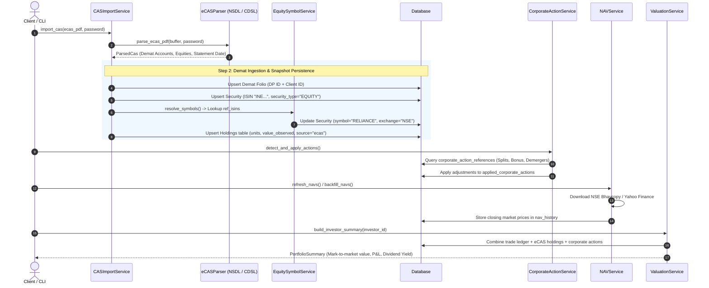
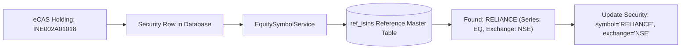
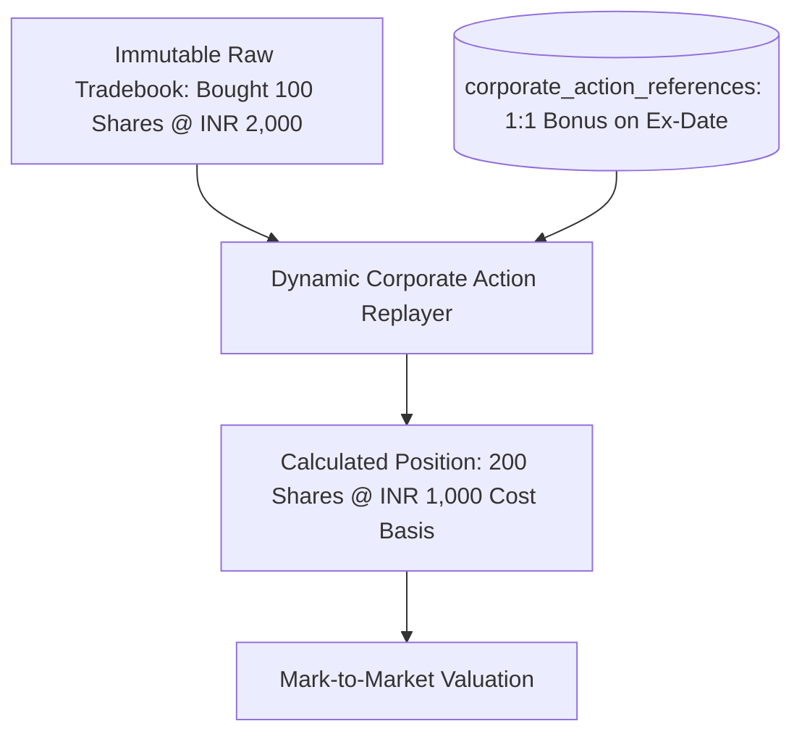

# Stocks & Equities Flow: Ingestion, Corporate Actions & Storage

This guide documents the complete end-to-end lifecycle of Indian listed Equities and Stocks in `folioman-client`, covering NSDL/CDSL eCAS demat statement parsing, ISIN-to-symbol resolution, corporate action event replays (splits, bonuses, mergers), and NSE Bhavcopy market pricing.

---

## 1. High-Level Lifecycle



---

## 2. Parsing NSDL & CDSL eCAS Demat Statements

Unlike mutual fund CAS PDFs which contain continuous transaction histories, **eCAS statements** issued by depositories (**NSDL** or **CDSL**) represent **point-in-time demat portfolio snapshots**.

### A. Statement Identification
`core/ecas_parser.py` detects eCAS formats by analyzing PDF text headers:
* **NSDL**: National Securities Depository Limited statements.
* **CDSL**: Central Depository Services (India) Limited statements.

### B. Extracted Data Fields
1. **Demat Account Identifiers**:
   * **DP ID (Depository Participant ID)**: 8-character code identifying the broker/depository participant (e.g. `IN300126` for Zerodha, `12081600` for Groww).
   * **Client ID / BO ID (Beneficiary Owner ID)**: Unique 8-digit or 16-digit account number.
2. **Statement As-Of Date**:
   * The snapshot date (e.g. `2026-03-31`), used as the holding record's `as_of_date`.
3. **Holding Line Items**:
   For each stock held in the demat account:
   * **Company Name**: e.g., `"Reliance Industries Limited"`, `"Tata Consultancy Services Ltd"`.
   * **ISIN**: International Securities Identification Number starting with `INE` (e.g. `INE002A01018`, `INE467B01029`).
   * **Face Value**: e.g., ₹10.00, ₹1.00.
   * **Units (Quantity)**: Number of free, pledged, or locked shares held.
   * **Market Price & Value Observed**: Stored for immediate baseline comparison.
   * **Average Cost Observed**: Stored if the depository or broker statement includes acquisition cost.

---

## 3. Demat Persistence & The `holdings` Table

Here, the storage engine diverges from the mutual fund model:

### Why Equities Are Stored in the `holdings` Table
Depositories only report **how many shares you hold on the statement date**, not your historical buy/sell tradebook executions over the last 5 years:
* Because tradebook transactions are unavailable from an eCAS PDF, Folioman stores equity positions directly in the [`holdings`](file:///Users/raptor/code/folioman-client/src/folioman_client/db/models.py#L455-L497) table:
  ```python
  Holding(
      investor_id=investor.id,
      security_id=security.id,
      folio_id=folio.id,
      as_of_date=statement_date,
      units=line.units,
      value_observed=line.value_observed,
      avg_cost_observed=line.avg_cost_observed,
      source="ecas",
  )
  ```
* **Unique Snapshot Key**: A database unique constraint ensures idempotency:
  ```sql
  UNIQUE(investor_id, security_id, folio_id, as_of_date, source)
  ```
  Re-importing the same eCAS PDF updates observed values without duplicating rows.

### Tradebook Ingestion & Hybrid Reconciliation
If trade transactions are separately provided (via broker CSV import or `client.transactions.create()`):
1. Trades are stored in the `transactions` table.
2. [`ReconciliationService`](file:///Users/raptor/code/folioman-client/src/folioman_client/services/reconciliation_service.py) automatically runs:

   $$\Delta = \text{net\_units\_from\_trades} - \text{statement\_units}$$

3. Sets `SecurityIntegrityStatus`:
   * `MATCH`: Trade ledger perfectly matches statement holding ($\Delta < 0.001$).
   * `SNAPSHOT_ONLY`: Demat holding exists, but individual trades haven't been imported yet.
   * `LEDGER_ONLY`: Trades exist in ledger, but no demat statement has confirmed the balance.
   * `MISMATCH`: Trade balance differs from statement (flags unrecorded broker trades or off-market transfers).

---

## 4. ISIN to Exchange Symbol Resolution

eCAS statements list companies by **ISIN** (e.g. `INE002A01018`), but market feeds (NSE Bhavcopy, Yahoo Finance) operate on **trading symbols** (e.g. `RELIANCE`):



### The Reference Catalog (`ref_isins`)
Folioman includes an embedded master catalog of ~100,000 national securities maintained in the `ref_isins` table:
* Maps ISIN $\rightarrow$ Primary NSE Symbol, BSE Scrip Code, Company Name, Industry Sector, and Security Type.
* Managed via CLI (`folioman isin seed` or `client.isin.seed()`).

### Automatic Repair (`EquitySymbolService`)
Immediately following eCAS ingestion, [`EquitySymbolService.resolve_symbols()`](file:///Users/raptor/code/folioman-client/src/folioman_client/services/equity_symbol_service.py) executes:
```python
# Queries quote securities having an ISIN but missing an exchange symbol
stmt = select(Security).where(
    Security.security_type.in_(_QUOTE_TYPES),
    Security.symbol == "",
    Security.isin != "",
)
```
Matches each security against `ref_isins` and populates `security.symbol = "RELIANCE"` and `security.exchange = "NSE"`.

---

## 5. Non-Destructive Corporate Actions Replay

Indian equities frequently undergo corporate actions: **Stock Splits**, **Bonus Issues**, **Rights Issues**, **Mergers**, and **Demergers**.

Traditional portfolio tools mutate historical transaction records (e.g., rewriting old buy orders to reflect a 1:10 split). Folioman implements **non-destructive event replay**:



### Supported Corporate Actions
1. **Stock Splits & Bonus Issues**:
   * Evaluates units held as of the record/ex-date using [`held_units_asof()`](file:///Users/raptor/code/folioman-client/src/folioman_client/core/corporate_actions.py).
   * Generates multiplier adjustment (e.g., $2.0$ for a $1:1$ bonus or $1:2$ split).
   * Adjusts effective quantity and scales down per-unit cost basis proportionally.
2. **Demergers (Cost Allocation)**:
   * When a company demergers (e.g. Jio Financial Services demerging from Reliance Industries), SEBI and tax circulars prescribe an official cost apportionment percentage (e.g., 91.68% retained by Reliance, 8.32% allocated to JFSL).
   * [`demerger_reductions()`](file:///Users/raptor/code/folioman-client/src/folioman_client/services/projected_ledger.py) applies the percentage reduction dynamically on read without altering raw purchase notes.
3. **Dividends**:
   * Queries dividend announcements in `corporate_action_references`.
   * Multiplies dividend per share by active units on record date to compute total dividend income and **Dividend Yield on Cost**.

---

## 6. Equity Price Feeds: NSE Bhavcopy & Yahoo Finance

Equities are priced using high-performance dual-tier feeds:

### Tier 1: NSE Bhavcopy Archive (`nse_bhavcopy.py`)
* **Primary source** for Indian equities.
* Downloads official daily NSE Bhavcopy archives directly from the exchange.
* Reads closing prices for the `EQ` series across all traded stocks in milliseconds.
* Uses pre-warmed HTTP clients with browser header rotation to respect exchange rate limits.

### Tier 2: Yahoo Finance Fallback (`yfinance_feed.py`)
* Fallback source for historical backfills or foreign equities.
* Appends `.NS` for National Stock Exchange symbols (e.g. `TCS.NS`, `RELIANCE.NS`) or `.BO` for Bombay Stock Exchange.
* Fetches adjusted close prices over specified historical date ranges.

### Persistence
Closing prices are stored in `nav_history`:
```sql
INSERT INTO nav_history (security_id, date, nav, source)
VALUES (15, '2026-10-10', 2854.40, 'nse-bhavcopy');
```

---

## 7. Valuation & Asset Allocation

When building portfolio summaries:
1. **Unit Aggregation**:
   If transactions exist, computes units via ledger replay; if only eCAS is available, takes the latest snapshot units from `holdings`.
2. **Current Valuation**:

   $$\text{value\_inr} = \text{units} \times \text{latest\_market\_price}$$

3. **Asset Mix Allocation**:
   All securities with `security_type="EQUITY"` are automatically aggregated into the `"Equity"` asset mix slice.
4. **Day Change**:
   Calculates daily price change and day change value in INR:

   $$\text{day\_change\_inr} = \text{units} \times (\text{price}_{\text{today}} - \text{price}_{\text{yesterday}})$$
